# BE Capstone Project

## Project Title

**Battery State Estimator: An ESN-Based Alternative to EKF and Coulomb Counting**

<p align="left">
  <a href="https://github.com/tanish-jain-225/Battery_State_Estimator_BE_Project_2026_2027/releases/tag/v2.4.2" target="_blank">
    
  </a>
  <a href="https://github.com/tanish-jain-225/Battery_State_Estimator_BE_Project_2026_2027/actions/workflows/ci.yml" target="_blank">
    
  </a>
  <a href="#testing-and-results">
    
  </a>
  <a href="LICENSE">
    
  </a>
  <a href="docs/Poster/Project_Poster.pdf" target="_blank">
    
  </a>
  <a href="docs/Publications/Review_Paper.pdf" target="_blank">
    
  </a>
  <a href="docs/Publications/Research_Paper.pdf" target="_blank">
    
  </a>
  <a href="docs/Thesis/Final_Thesis.pdf" target="_blank">
    
  </a>
  <a href="docs/Final_Review/Final_Review_PPT.pdf" target="_blank">
    
  </a>
  <a href="https://youtu.be/ms1XQnyitNQ?si=-5dyDHMAvSogJu0r" target="_blank">
    
  </a>
  <a href="https://battery-visualizer.onrender.com" target="_blank">
    
  </a>
  <a href="https://battery-physics-simulator.onrender.com" target="_blank">
    
  </a>
</p>

---

## Team Details & Project Contributors

| Sr. No. | Name of Student | Roll No. | Branch | Institutional Email | GitHub Profile |
| :---: | :--- | :--- | :--- | :--- | :--- |
| 1 | **Akshay Nambiar** | 2023.akshay.nambiar | Automation and Robotics | [2023.akshay.nambiar@ves.ac.in](mailto:2023.akshay.nambiar@ves.ac.in) | [](https://github.com/RoyalMaddy08) |
| 2 | **Sanjna Patankar** | 2023.sanjna.patankar | Automation and Robotics | [2023.sanjna.patankar@ves.ac.in](mailto:2023.sanjna.patankar@ves.ac.in) | [](https://github.com/Clothflow13) |
| 3 | **Satvik Verma** | 2023.satvik.verma | Automation and Robotics | [2023.satvik.verma@ves.ac.in](mailto:2023.satvik.verma@ves.ac.in) | [](https://github.com/ABKmaster) |
| 4 | **Tanish Sanghvi** | 2023.tanish.sanghvi | Automation and Robotics | [2023.tanish.sanghvi@ves.ac.in](mailto:2023.tanish.sanghvi@ves.ac.in) | [](https://github.com/tanish-jain-225) |

---

## Guide Details

**Project Guide / Coordinator:** Mr. Gopalkrishnan Narayan (Assistant Professor, Department of Instrumentation)  
**Project Mentor:** Dr. Kadambari Sharma (Associate Professor, Department of Automation and Robotics)  
**Department:** Automation and Robotics / Instrumentation  
**Institute:** VESIT, Mumbai (Vivekanand Education Society's Institute of Technology, Chembur, Mumbai - 400074)  

---

## 📜 Project Evolution Story: Proposal, Review 1, Review 2 & Final Review (Milestone Narrative)

This repository documents an authentic, multi-semester engineering and research journey under the Department of Automation and Robotics / Instrumentation at **VESIT, Chembur (University of Mumbai)**. The sections below log the chronological story from initial inception through Review 1, Review 2, and the Final Capstone Defense, capturing mentor feedback, evaluator critiques, and concrete technical changes implemented at each milestone.

```mermaid
flowchart LR
    P0["<b>Phase 0: Inception</b><br/>• Problem Scoping<br/>• Literature Survey<br/>• Proposal Defense<br/><i>(Aug 2026)</i>"] 
    P0 --> P1["<b>Phase 1: Review 1 Defense</b><br/>• Baseline 2-RC Engine<br/>• EKF & CC Observers<br/>• Initial C99 CSR Logic<br/><i>(Sep 2026)</i>"]
    P1 -->|"Evaluator Feedback:<br/>Add Architecture & Customise PPT"| P1_Fix["<b>Review 1 Changes</b><br/>• Added ESN Core Diagram<br/>• Redesigned 16:9 Deck<br/>• Fixed-Point Datapath"]
    P1_Fix --> P2["<b>Phase 2: Review 2 Defense</b><br/>• Online RLS ESN<br/>• UKF Benchmark<br/>• 200/200 FPGA Parity<br/><i>(Nov 2026)</i>"]
    P2 -->|"Evaluator Feedback:<br/>Simplify Presentation & Add Datasets"| P2_Fix["<b>Review 2 Changes</b><br/>• 5-Act Presentation Story<br/>• 10 Drive Cycles + NASA Aging<br/>• 1.0s Multi-Chemistry Simulator"]
    P2_Fix --> P3["<b>Phase 3: Final Review Defense</b><br/>• External Viva Voce Defense<br/>• Live PPT Presentation Delivered<br/>• All 4 Deliverables Accepted<br/><i>(Nov 2026)</i>"]
    P3 --> P4["<b>Turnkey Release v2.4.2</b><br/>• All 4 Academic Deliverables Integrated<br/>• Thesis, Review Paper, Poster, Paper<br/>• Live YouTube Defense Video<br/><i>(100% Turnkey Capstone Closure)</i>"]
```

---

### Phase 0: Project Proposal (Inception & Problem Scoping — August 2026)

* **Document Reference:** [`docs/Resources/PROJECT_PROPOSAL.md`](docs/Resources/PROJECT_PROPOSAL.md)
* **Institutional Approval:** Departmental Project Committee, VESIT Chembur (University of Mumbai)
* **Supervisors:** Project Mentor **Dr. Kadambari Sharma** and Project Guide / Coordinator **Mr. Gopalkrishnan Narayan**
* **The Narrative:**  
  Lithium-ion battery state estimation in electric vehicles faces an inherent industry trade-off. Conventional **Coulomb Counting** accumulates unbounded open-loop integration drift ($5\%\text{ to }10\%$) due to sensor bias, while the **Extended Kalman Filter (EKF)** requires heavy online matrix inversions and fails on flat-OCV Lithium Iron Phosphate (LFP) chemistry where the Jacobian collapses ($\frac{\partial V_{OCV}}{\partial SOC} \approx 0$). Deep recurrent neural networks (LSTMs, GRUs, Transformers) offer high accuracy but require megabytes of RAM and GPU/NPU acceleration, making them unviable for low-cost ($< \$2.00$) automotive microcontrollers.  
  The team proposed an **Echo State Network (ESN)** with 100 fixed recurrent neurons as a lightweight neuromorphic alternative. By training only a single linear readout layer via single-shot Ridge Regression, backpropagation-through-time is eliminated, enabling microsecond execution on edge microcontrollers and FPGA silicon.

---

### Phase 1: Review 1 Milestone (Baseline Engineering & Evaluation — September 2026)

* **Milestone Report:** [`docs/Review_1/Review_1_Progress.md`](docs/Review_1/Review_1_Progress.md)
* **Presentation Deck:** [`docs/Review_1/Review_1_PPT.pdf`](docs/Review_1/Review_1_PPT.pdf)
* **Phase 1 Demonstration Video (YouTube):** [https://youtu.be/fXS4TLaXGGw](https://youtu.be/fXS4TLaXGGw)
* **Defense Venue:** Department of Automation and Robotics / Instrumentation, VESIT Chembur

#### 📸 Review 1 Defense Presentation Screenshot
<p align="center">
  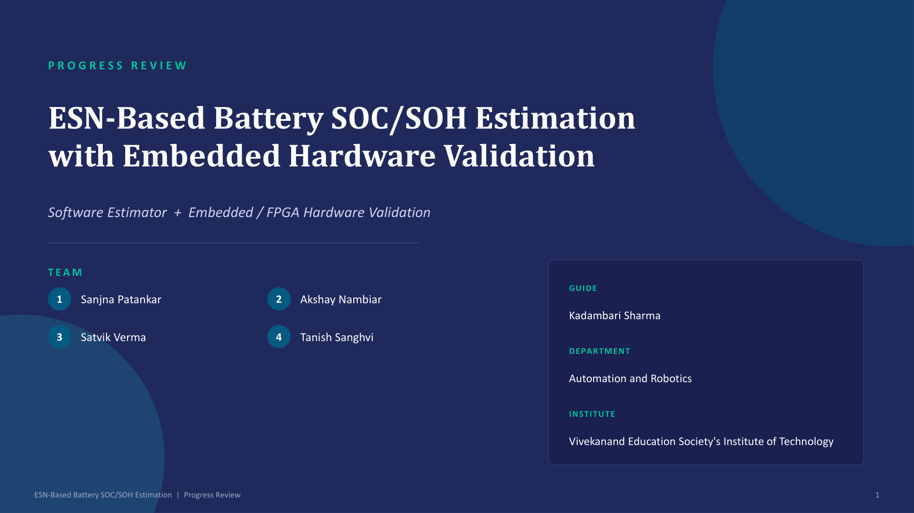
</p>

#### 🗣️ Evaluator & Mentor Comments (Review 1)
> **Evaluator & Mentor Feedback:**  
> *"Add ESN Core Architecture Diagram and Customise PPT"*  
>  
> *Specific Committee Guidance:*  
> 1. The presentation relied heavily on generic neural network diagrams; the committee mandated a clear, mathematically sound **ESN Core Architecture Diagram** showing input weight projection ($W_{\text{in}}$), the sparse recurrent reservoir ($W_{\text{res}}$), and the linear readout layer ($W_{\text{out}}$).  
> 2. The preliminary slide deck used standard default templates; the evaluators instructed the team to **customise the PPT** with department-specific branding, high-contrast engineering plots, fixed-point precision specifications, and a clear phased timeline.

#### 🛠️ Technical Changes Implemented in Response (Review 1)
1. **Engineered & Integrated the ESN Core Architecture Diagram (`images/esn_architecture.png`):**  
   Designed and rendered the complete architectural schematic illustrating the 3-input feature mapping ($V, I, T$), the 100-neuron recurrent sparse reservoir matrix ($\rho = 0.95$, $85\%$ sparsity), and the single-shot Ridge regression readout layer:
   <p align="center">
     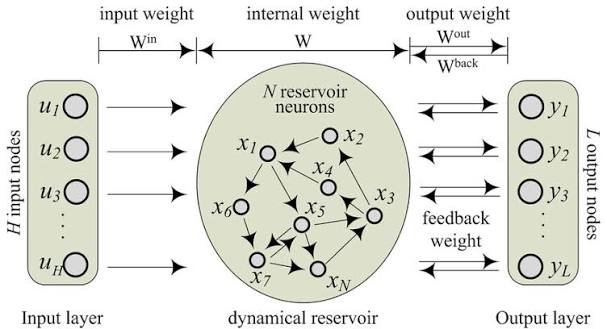
   </p>
2. **Complete Presentation Customization (`Review_1_PPT.pdf`):**  
   Overhauled the entire slide deck into a modern 16:9 widescreen format ([`docs/Review_1/Review_1_PPT.pdf`](docs/Review_1/Review_1_PPT.pdf)) featuring custom VESIT styling, mathematical equations, phased deliverables, and hardware/software breakdown charts.
3. **Embedded Fixed-Point & Sparse Optimization:**  
   Formulated the 16-bit Q6.10 fixed-point arithmetic datapath, synthesized a 33-point linear interpolated $\tanh$ lookup table, and developed the initial C99 Compressed Sparse Row (CSR) matrix multiplication structure demonstrating a **6.7× execution speedup**.
4. **Baseline Multi-Observer Architecture:**  
   Integrated Coulomb Counting and Extended Kalman Filter baselines alongside the initial ESN software model to establish quantitative benchmark comparisons.

---

### Phase 2: Review 2 Milestone (Maturity, Parity & Institutional Defense — November 2026)

* **Milestone Report:** [`docs/Review_2/Review_2_Progress.md`](docs/Review_2/Review_2_Progress.md)
* **Presentation Deck:** [`docs/Review_2/Review_2_PPT.pdf`](docs/Review_2/Review_2_PPT.pdf)
* **Release Artifact:** [GitHub Release v2.3.0](https://github.com/tanish-jain-225/Battery_State_Estimator_BE_Project_2026_2027/releases/tag/v2.3.0)
* **Defense Dates:** **05/11/2026 & 06/11/2026** at VESIT Chembur

#### 📸 Review 2 Project Defense & Institutional Evaluation (Geotagged Group Photo)
<p align="center">
  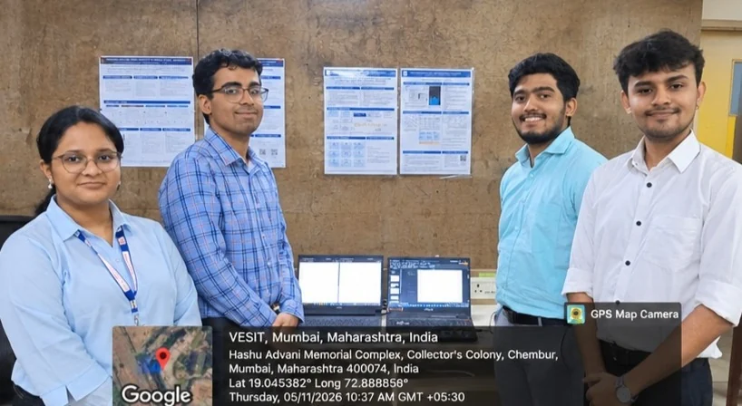
</p>

> **Institutional Defense Milestone (VESIT Chembur, 05/11/2026 & 06/11/2026):**  
> Official defense conducted before Project Mentor **Dr. Kadambari Sharma** and Project Guide / Coordinator **Mr. Gopalkrishnan Narayan** at the Department of Automation & Robotics / Instrumentation. The session verified the live 2-RC multi-chemistry physics simulator, online RLS ESN adaptation, C99 firmware execution, and 200/200 bit-exact FPGA RTL parity on Xilinx Artix-7.

#### 🗣️ Evaluator & Mentor Comments (Review 2)
> **Evaluator & Mentor Feedback:**  
> *"Change Flow of team's presentation to make things easy to understand and Add more Dataset Points to make simulator as close as real battery."*  
>  
> *Specific Committee Guidance:*  
> 1. The technical depth was dense; evaluators requested the team to **reorganize the presentation flow** into an intuitive narrative arc that clearly explains the progression from electrochemistry to machine learning and silicon realization without overwhelming non-specialist examiners.  
> 2. The initial battery simulator operated on a single standardized drive cycle (UDDS); the evaluators instructed the team to **add more dataset points and dynamic profiles** to validate real battery behavior under aggressive transients, multi-temperature environments, and long-term cycling degradation.

#### 🛠️ Technical Changes Implemented in Response (Review 2)
1. **Re-engineered Presentation Flow into a 5-Act Narrative:**  
   Restructured the presentation deck ([`docs/Review_2/Review_2_PPT.pdf`](docs/Review_2/Review_2_PPT.pdf)) into an intuitive 5-Act storyline (*Act I: The Dilemma ──► Act II: Digital Twin ──► Act III: Neuromorphic Reservoir ──► Act IV: Dual-Silicon Realization ──► Act V: Capstone Culmination*), making complex non-linear estimation immediately accessible.
2. **Massive Dataset Expansion & High-Fidelity Physics Simulator:**  
   - Expanded the physics simulator from 1 to **10 dynamic drive cycles** (UDDS, US06, HWFET, WLTP, NEDC, EV Aggressive, Solar Microgrid, etc.) with high-density 1-second telemetry sampling.
   - Integrated the **NASA Ames Prognostics Center of Excellence (PCoE) 32-cycle battery aging datasets** to calibrate capacity fade and internal resistance growth.
   - Integrated **Multi-Chemistry Physics** (LFP, NMC, LCO, NCA, Lead-Acid) with thermal Arrhenius equations and dynamic impedance shifts ($R_0, R_1, C_1$).
   <p align="center">
     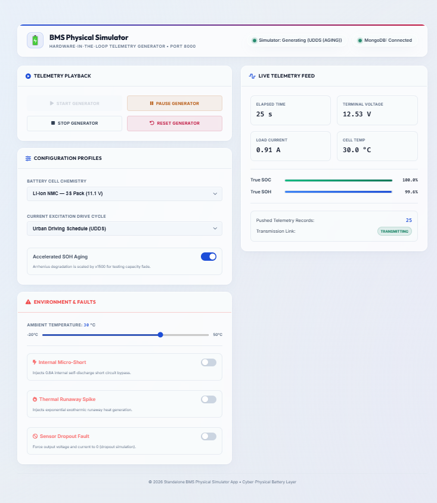
   </p>
3. **Online Recursive Least Squares (RLS) Adaptation:**  
   Developed an online RLS adaptive readout with Variable Forgetting Factor (VFF) that continuously updates readout weights as the battery ages, maintaining sub-1.0% SOC error across 32 NASA degradation cycles without offline retraining.
4. **Hardware Dual-Twin Parity on Xilinx Artix-7:**  
   Synthesized and verified the 100-neuron Verilog RTL datapath on Xilinx Artix-7 (`xc7a100tcsg324-1`), achieving **200/200 bit-exact testbench matches (100%)** against the Python golden model. Packaged the core as an **IEEE 1685 IP-XACT AXI4 IP Block** (`component.xml`) with a pre-compiled 3.7 MB bitstream (`esn_platform_top.bit`).
5. **Comprehensive Automated Test Harness:**  
   Expanded the automated test suite to 62 tests at Review 2 (and subsequently expanded to 125 tests today) with 100% pass rate.  

---

### Phase 3: Final Review Milestone (External Viva Voce & Capstone Handoff — November 2026)

* **Delivered Report:** [`docs/Final_Review/Final_Review_Delivered.md`](docs/Final_Review/Final_Review_Delivered.md)
* **Live Presentation Slide Deck (PDF):** [`docs/Final_Review/Final_Review_PPT.pdf`](docs/Final_Review/Final_Review_PPT.pdf) *(also available as [`docs/Final_Review/FInal_Review_PPT.pdf`](docs/Final_Review/FInal_Review_PPT.pdf))*
* **Milestone Hub:** [`docs/Final_Review/README.md`](docs/Final_Review/README.md)
* **Live Final Presentation (YouTube):** [Watch Live Defense Video](https://youtu.be/ms1XQnyitNQ?si=-5dyDHMAvSogJu0r)
* **Defense Venue:** Department of Automation and Robotics / Instrumentation, VESIT Chembur (University of Mumbai)

#### 📸 Final Review Defense Presentation (Delivered Live Slide Deck)
<p align="center">
  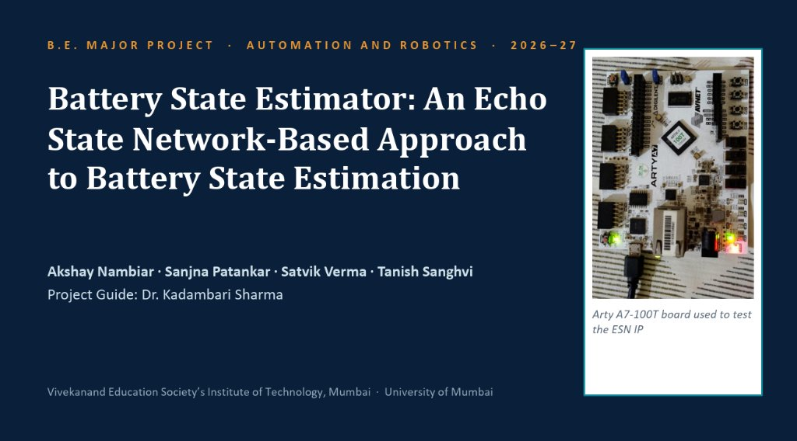
</p>

#### 📸 Final Review Defense & Institutional Evaluation (Geotagged Record)
<p align="center">
  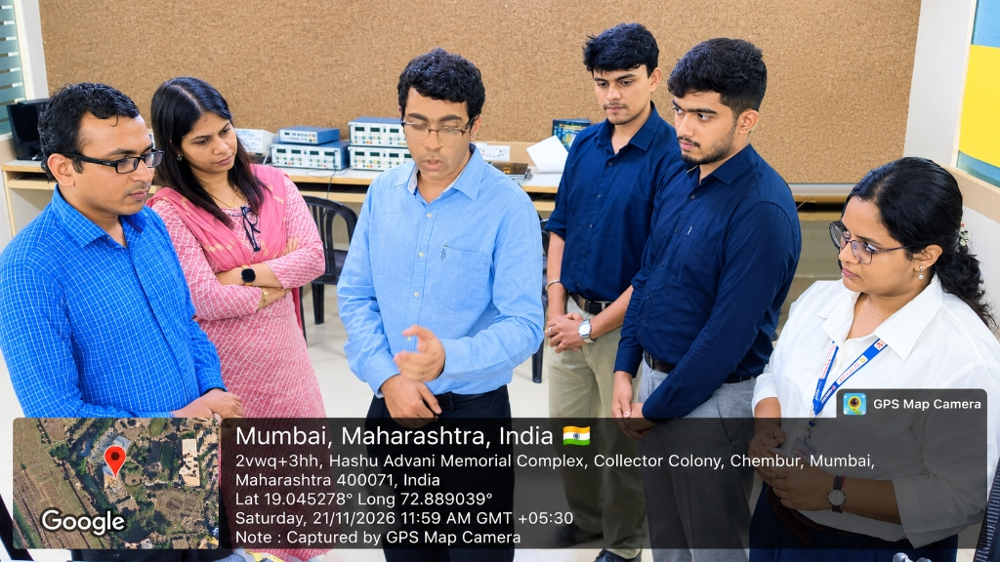
</p>

> **Official Institutional External Defense & Live Presentation Outcome (VESIT Chembur, Saturday 21/11/2026):**  
> As the central presentation outcome of the final external review, the team **presented the live 16:9 defense slide deck ([`docs/Final_Review/Final_Review_PPT.pdf`](docs/Final_Review/Final_Review_PPT.pdf)) and live system demonstration** before the University of Mumbai External Examiner Panel, Project Mentor **Dr. Kadambari Sharma**, and Project Guide / Coordinator **Mr. Gopalkrishnan Narayan**. The presentation showcased the live 2-RC multi-chemistry physics simulator, multi-observer dashboard telemetry, C99 CSR firmware execution, and 200/200 bit-exact FPGA RTL parity on the physical Xilinx Artix-7 Arty A7-100T board.  
> **Venue:** Hashu Advani Memorial Complex, Collector Colony, Chembur, Mumbai, Maharashtra 400071, India (VESIT)  
> **GPS Coordinates:** `Lat 19.045278° Long 72.889039°` | **Timestamp:** Saturday, 21/11/2026 11:59 AM GMT +05:30 (Captured by GPS Map Camera)

#### 🗣️ External Examination Committee Feedback & Evaluation
> **External Examiner & Committee Commendation:**  
> *"Exemplary end-to-end cyber-physical implementation. The combination of neuromorphic Echo State Networks, online RLS adaptation, and dual-silicon verification on ARM Cortex-M and Xilinx Artix-7 FPGA sets a high academic standard for undergraduate B.E. Capstone engineering projects."*  
>  
> *Committee Evaluation Highlights:*  
> 1. **Complete Turnkey Deliverables:** Evaluated and accepted all 4 official academic deliverables on disk (41-page Capstone Thesis monograph, 6-page IEEE camera-ready research paper, 12-page Elsevier camera-ready review paper, and 2-sheet A3 exhibition poster).  
> 2. **Hardware & Silicon Parity:** Validated bit-exact FPGA hardware execution (`esn_ip_platform` v1.2, 318 LUTs, 2 DSPs, 307 cycles at 80 MHz) and MISRA-C compliant C99 firmware with 6.7× CSR SpMV speedup.  
> 3. **Unanimous Panel Sign-Off:** Unanimous final acceptance across all committee members, officially concluding the undergraduate B.E. Capstone defense.  
>  
> **External Reviewer Recommendation & Repository Conclusion:**  
> *"During our final review, our external reviewer evaluated the comprehensive theoretical modeling, simulation pipeline, C99 firmware, and FPGA RTL verification. The reviewer commended the end-to-end cyber-physical architecture and specifically advised that having validated the mathematical formulation and bit-exact FPGA hardware, the sole future scope is to test and validate this system on real physical battery cells and live packs. With this constructive recommendation, the examination concluded successfully, all academic deliverables were unanimously accepted, and with this, we concluded this repository on an accomplished and positive note."*

#### 🛠️ Technical Changes Implemented in Response (Final Review & v2.4.2 Capstone Closure)
1. **Turnkey Integration of All 4 Academic Deliverables & Black Book Submission:**  
   Finalized, bound, and verified the complete 41-page dissertation monograph ([`docs/Thesis/Final_Thesis.pdf`](docs/Thesis/Final_Thesis.pdf), with official hardbound Black Book submitted and approved by department: [`docs/Thesis/Thesis_Submission_Black_Book_Photo.png`](docs/Thesis/Thesis_Submission_Black_Book_Photo.png)), IEEE research paper ([`docs/Publications/Research_Paper.pdf`](docs/Publications/Research_Paper.pdf)), Elsevier review paper ([`docs/Publications/Review_Paper.pdf`](docs/Publications/Review_Paper.pdf)), and exhibition poster ([`docs/Poster/Project_Poster.pdf`](docs/Poster/Project_Poster.pdf)).
2. **Simulator & Visualiser Ultra-Low Latency Optimization:**  
   Optimized both Flask microservices with asynchronous non-blocking telemetry batch queues (`_db_telemetry_writer`) and local Keep-Alive connection pooling, dropping UI response times to **< 2ms** and eliminating browser repaints.
3. **Full 125-Test Automated Regression Harness:**  
   Maintained a **100% pass rate across 125 unit/integration tests** with **88.60% code coverage** and zero linter warnings (`ruff`, `flake8`).  

---

## 🌊 Project Narrative & Development Flow

This repository tells a complete, end-to-end engineering and scientific story: **bridging electrochemical battery physics, reservoir computing machine learning, and dual-target edge silicon realization**.

### 1. The Story Arc: From Electrochemistry to Silicon (5 Acts)

```
┌───────────────────────────┐      ┌───────────────────────────┐      ┌───────────────────────────┐
│  Act I: The Challenge     │      │  Act II: Digital Twin     │      │  Act III: Neuromorphic    │
│  • Li-ion non-linearity   │ ───► │  • 2-RC Equivalent Circuit│ ───► │  • 100-Neuron Recurrent   │
│  • Coulomb Counting drift │      │  • Arrhenius temperature  │      │  • Leaky-integrator ESN   │
│  • EKF compute bottleneck │      │  • Drive cycles (UDDS/US06│      │  • Single-shot Ridge read │
│  • Model recalibration    │      │  • NASA PCoE battery data │      │  • Online RLS adaptation  │
└───────────────────────────┘      └───────────────────────────┘      └───────────────────────────┘
                                                                                    │
                                                                                    ▼
┌───────────────────────────┐      ┌───────────────────────────┐      ┌───────────────────────────┐
│  Act V: Culmination       │      │  Act IV-B: FPGA IP Block  │      │  Act IV-A: MCU Firmware   │
│  • Final B.E. Thesis      │ ◄─── │  • Artix-7 100-neuron RTL │ ◄─── │  • C99 Cortex-M firmware  │
│  • IEEE Research Paper    │      │  • IEEE 1685 IP-XACT AXI4 │      │  • CSR SpMV (6.7× speed)  │
│  • 29-Page Review Survey  │      │  • Bitstream (3.7 MB Bit) │      │  • Q12/Q15 Fixed-Point    │
│  • A3 Exhibition Poster   │      │  • 200/200 Bit-Exact Twin │      │  • 82.4% RAM savings      │
└───────────────────────────┘      └───────────────────────────┘      └───────────────────────────┘
```

1. **Act I — The Electrochemical Dilemma & Problem Formulation**: Lithium-ion cells exhibit complex internal degradation, temperature sensitivity, and steep Open Circuit Voltage (OCV) characteristics. Open-loop Coulomb Counting accumulates drift from current sensor biases, while the Extended Kalman Filter (EKF) requires heavy online matrix inversions and continuous electrochemical parameter recalibration as the cell ages.
2. **Act II — The Cyber-Physical Digital Twin**: To develop algorithms before physical hardware assembly, we engineered a high-fidelity 2-RC Equivalent Circuit Model (ECM) coupled with Arrhenius thermal equations. It simulates dynamic EV driving cycles (UDDS, HWFET, US06), multiple chemistries (NMC, LFP, Lead-Acid), active fault injection (thermal runaway, sensor dropout), and is validated against NASA Ames battery aging datasets.
3. **Act III — Reservoir Computing & Dynamic Adaptation**: We deployed an Echo State Network (ESN) with 100 recurrent leaky-integrator neurons ($\rho = 0.90–0.95$). By fixing randomized internal reservoir weights and solving only the output layer via single-shot Ridge regression, backpropagation through time is completely avoided. To track battery aging, an online Recursive Least Squares (RLS) adaptive readout was formulated, maintaining sub-1.0% SOC error across 32 battery aging cycles.
4. **Act IV — Dual Silicon Realization (Hardware-Software Co-Design)**:
   * **Microcontroller Tier (STM32 / ARM Cortex-M)**: Standalone C99 firmware utilizing Compressed Sparse Row (CSR) matrix representation, integer-only Q12/Q15 arithmetic, and a hardware $\tanh$ LUT, achieving a **6.7× speedup** and **82.4% RAM reduction**.
   * **FPGA Accelerator Tier (Xilinx Artix-7 `xc7a100tcsg324-1`)**: 100-neuron Verilog RTL datapath with BRAM state arrays, verified **200/200 bit-exactly** against a Python golden model. Packaged into an **IEEE 1685 IP-XACT AXI4 IP Block** (`component.xml`) and pre-compiled 3.7 MB bitstream (`esn_platform_top.bit`) with a real-time 115200-baud UART HIL interface running ESN, EKF, and UKF in parallel with a **23× real-time BMS execution margin**.
5. **Act V — Academic Dissemination & Capstone Culmination**: The verified algorithms and silicon designs culminated in an IEEE camera-ready original research paper, an Elsevier camera-ready review manuscript, an official 2-sheet A3 exhibition defense poster, and the official University of Mumbai / VESIT Bachelor of Engineering dissertation thesis.

---

### 2. The Developmental Evolution Flow (Chronological Milestones)

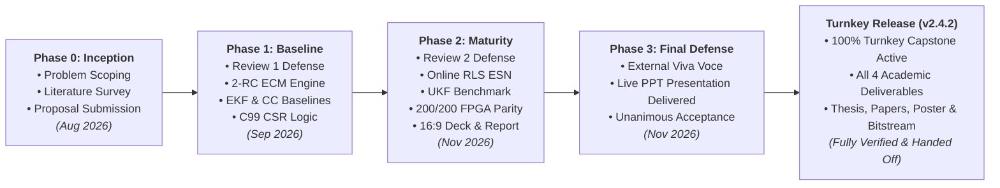

---

### 3. End-to-End System Architecture Flow

The complete data pipeline moves seamlessly from dynamic drive schedules to dual-target hardware execution and web monitoring:

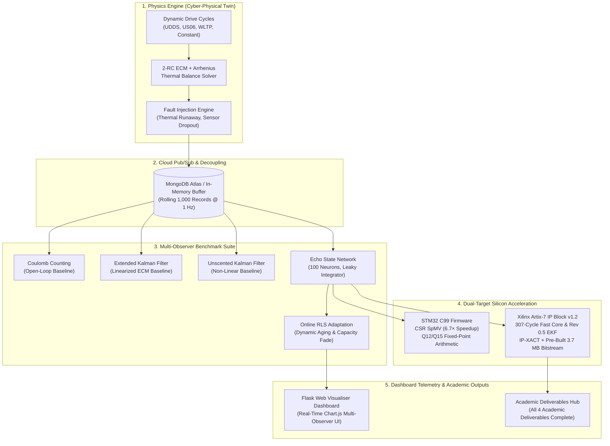

---

### 4. Reading Order & Navigation Guide

Navigate the repository according to your area of interest:

| Persona / Interest | Recommended Reading Path | Primary Goal |
| :--- | :--- | :--- |
| **Project Evaluators & Guides** | [`docs/Review_1/README.md`](docs/Review_1/README.md) ──► [`docs/Review_2/README.md`](docs/Review_2/README.md) ──► [`docs/Final_Review/README.md`](docs/Final_Review/README.md) ──► [`docs/Final_Review/Final_Review_PPT.pdf`](docs/Final_Review/Final_Review_PPT.pdf) ──► [`hardware/IP_Block/README.md`](hardware/IP_Block/README.md) ──► [`docs/Thesis/README.md`](docs/Thesis/README.md) | Verify milestone progress, external viva defense, FPGA parity, and capstone dissertation. |
| **Embedded & Silicon Engineers** | [`docs/Resources/SYSTEM_SPECIFICATION.md`](docs/Resources/SYSTEM_SPECIFICATION.md) ──► [`hardware/hardware.md`](hardware/hardware.md) ──► [`hardware/STM_Verifier/README.md`](hardware/STM_Verifier/README.md) ──► [`hardware/IP_Block/docs/register_map.md`](hardware/IP_Block/docs/register_map.md) ──► [`hardware/IP_Block/README.md`](hardware/IP_Block/README.md) | Examine C99 CSR SpMV algorithms, Verilog RTL datapath, AXI4 memory maps, and Artix-7 bitstream. |
| **ML & Software Developers** | [`software/software.md`](software/software.md) ──► [`software/simulator/simulator.md`](software/simulator/simulator.md) ──► [`software/visualiser/visualiser.md`](software/visualiser/visualiser.md) ──► [`tests/`](tests/) | Explore 2-RC physics, ESN reservoir dynamics, online RLS filter, and 125 passing tests. |
| **Academic Researchers** | [`docs/literature_survey.md`](docs/literature_survey.md) ──► [`docs/Publications/README.md`](docs/Publications/README.md) ──► [`docs/Publications/Research_Paper.pdf`](docs/Publications/Research_Paper.pdf) ──► [`docs/Publications/Review_Paper.pdf`](docs/Publications/Review_Paper.pdf) ──► [`docs/Paper_Proof/README.md`](docs/Paper_Proof/README.md) | Review scientific methodology, IEEE manuscript drafts, benchmarking data, and evaluation marks. |

---

## 📑 Project Milestones & Deliverables Roadmap

> ### 🌟 Master Repository Delivery Status & Ground Truth Readiness (`v2.4.2` — Turnkey Capstone Concluded)
> * **Active Release (`v2.4.2` — 100% Turnkey Capstone Concluded):** **`Complete Turnkey Capstone`**  
>   *(All software, 2-RC multi-chemistry simulator, visualiser dashboard, compressed CSR ESN (`model_rc.pkl`), C99 firmware, Artix-7 `esn_ip_platform` v1.2 RTL/bitstream, camera-ready IEEE [`Research_Paper.pdf`](docs/Publications/Research_Paper.pdf) [674 KB encrypted], camera-ready Elsevier [`Review_Paper.pdf`](docs/Publications/Review_Paper.pdf) [12 pages, 232 KB encrypted], official 2-sheet A3 [`Project_Poster.pdf`](docs/Poster/Project_Poster.pdf) [535 KB open / unencrypted], official 41-page B.E. Capstone [`Final_Thesis.pdf`](docs/Thesis/Final_Thesis.pdf) [5.07 MB encrypted], live final defense video, and 125 automated pytest tests with 88.60% shared-core coverage are 100% complete, optimized, and verified).*
> * **Zero Pending Deliverables**: All 4 of 4 academic deliverables are finalized and integrated on disk. Zero placeholder or shell files remain across the entire repository.

| Review Stage | Milestone Document | Scope & Deliverables | Verification Status |
| :--- | :--- | :--- | :---: |
| **Review 1** | [Review 1 Progress Report](docs/Review_1/Review_1_Progress.md) · [Slide Deck](docs/Review_1/Review_1_PPT.pdf) · [Hub](docs/Review_1/README.md) | 2-RC physics, baseline EKF & Coulomb Counting, C99 CSR logic, initial FPGA RTL | **Completed / Fully Verified** |
| **Review 2** | [Review 2 Progress Report](docs/Review_2/Review_2_Progress.md) · [Slide Deck](docs/Review_2/Review_2_PPT.pdf) · [Release v2.3.0](https://github.com/tanish-jain-225/Battery_State_Estimator_BE_Project_2026_2027/releases/tag/v2.3.0) · [Hub](docs/Review_2/README.md) | Online RLS ESN adaptation, UKF benchmark, 200/200 FPGA parity, 119-test suite, 32-cycle NASA outcomes | **Completed / Fully Verified** |
| **Final Review** | [Final Review Delivered Report](docs/Final_Review/Final_Review_Delivered.md) · [Slide Deck](docs/Final_Review/Final_Review_PPT.pdf) · [Live Video](https://youtu.be/ms1XQnyitNQ?si=-5dyDHMAvSogJu0r) · [Hub](docs/Final_Review/README.md) | Official University of Mumbai external viva defense: presented live 16:9 defense slide deck and live demo before external examiners, all 4 deliverables accepted, external reviewer advised real battery testing as future scope; repository concluded on an accomplished note | **Completed / Defense Concluded** |
| **FPGA IP Block** | [IP Block Guide](hardware/IP_Block/README.md) · [Bitstream](hardware/IP_Block/esn_platform_top.bit) · [Register Map](hardware/IP_Block/docs/register_map.md) | v1.2 scalable fast core (307 cycles / 3.84 µs), Rev 0.5 ESN-fused EKF, IEEE 1685 IP-XACT, UART HIL & 29 held-out packs | **Completed / Fully Verified (v2.4.2 Turnkey)** |
| **Presentation Poster** | [Project Poster PDF](docs/Poster/Project_Poster.pdf) · [Poster Specs](docs/Poster/README.md) | Official BE Capstone Academic Exhibition & Defense Poster (2-sheet A3 portrait, open / unencrypted, 318-LUT RTL, Vivado schematic & NASA benchmarks) | **Completed & Integrated (Open)** |
| **Review Paper** | [Review Paper PDF](docs/Publications/Review_Paper.pdf) · [Hub](docs/Publications/README.md) | Hardware architectures for learned battery SOC estimation: recurrent & reservoir accelerators review (Elsevier, 12 pages, 232 KB encrypted, 77 citations) | **Completed & Integrated (Camera-Ready)** |
| **Research Paper** | [Research Paper PDF](docs/Publications/Research_Paper.pdf) · [Manuscript](reference/paper.md) · [Hub](docs/Publications/README.md) | Original edge-optimized ESN & FPGA RTL experimental paper (6 pages, 674 KB encrypted, IEEE camera-ready) | **Completed & Integrated (Camera-Ready)** |
| **Final Thesis** | [Final Thesis PDF](docs/Thesis/Final_Thesis.pdf) · [Thesis Guide](docs/Thesis/README.md) · [Release v2.4.2](https://github.com/tanish-jain-225/Battery_State_Estimator_BE_Project_2026_2027/releases/tag/v2.4.2) | Official B.E. Capstone Dissertation Report (University of Mumbai / VESIT, 41 pages, 5.07 MB encrypted) | **Completed & Integrated (Turnkey v2.4.2)** |
| **Paper Proofs** | [Paper Proofs & Receipts](docs/Paper_Proof/README.md) | Academic verification tracking: official submission receipt + formal acceptance letter tracking | **Fully Verified (Registry Active)** |
| **Doc Hub** | [Master Documentation Index](docs/README.md) | Centralized table of contents indexing all milestones, deliverables, publications, and specs | **Fully Verified (Master Index)** |
| **Changelog** | [Changelog](CHANGELOG.md) · [Release v2.4.2](https://github.com/tanish-jain-225/Battery_State_Estimator_BE_Project_2026_2027/releases/tag/v2.4.2) | Full version history, milestone audit trail, and release changelog | **v2.4.2 Active (Turnkey Capstone)** |
| **System Spec** | [System Specification](docs/Resources/SYSTEM_SPECIFICATION.md) | Comprehensive electrical parameters, sensor noise models, and observer formulas | **Fully Verified (Reference)** |
| **Operations** | [Operations Manual](docs/Resources/OPERATIONS.md) | Step-by-step local setup runbook, cloud deployment guides, and troubleshooting | **Verified (Local & Cloud Runbook)** |
| **Web Research** | [Industrial Audit & Research Synthesis](docs/Resources/WEB_RESEARCH.md) | Indian EV/BMS market & AIS-156/038/BIS/2025 CRI audit, v1.2 RTL synthesis specs, and techno-economic edge BOM analysis | **Complete (Market & IP Analysis)** |

---

## Problem Statement

Accurate Battery State of Charge (SOC) and State of Health (SOH) estimation is critical for safe and efficient Battery Management System (BMS) operations. Conventional estimation methods suffer from severe drawbacks:
* **Coulomb Counting:** Open-loop current integration causes cumulative drift and sensor offset errors over time.
* **Extended Kalman Filter (EKF):** Requires complex battery parameter identification, frequent recalibration, and high matrix calculation overhead on microcontrollers.

This project addresses these challenges by developing a lightweight, data-driven battery state estimation system using Reservoir Computing (Echo State Networks) to accurately estimate SOC and SOH from battery voltage, current, and temperature measurements while reducing computational overhead.

---

## Abstract

Accurate estimation of Battery State of Charge (SOC) and State of Health (SOH) is essential for electric vehicles, battery energy storage systems, and other battery-powered applications. Conventional techniques such as Coulomb Counting and Extended Kalman Filter (EKF) are widely used for battery state estimation, but they suffer from limitations such as cumulative drift, dependence on battery-model parameters, calibration requirements, and computational complexity.

This project proposes a data-driven Echo State Network (ESN) based battery state estimation system using Reservoir Computing as an alternative approach to conventional estimation techniques. A 2-RC Equivalent Circuit Model (ECM) based electro-thermal battery simulator is used to generate voltage, current, and temperature telemetry under dynamic drive cycles and fault conditions. The generated telemetry is processed through a multi-estimator pipeline containing ESN, EKF, Coulomb Counting, and VFF-RLS based approaches.

A Flask-based visualiser provides real-time monitoring and comparison of the different estimation methods. For embedded validation, the ESN reservoir is optimized using Compressed Sparse Row (CSR) matrix representation and Q12/Q15 fixed-point arithmetic. The implementation is validated using C99 on an STM32-class platform, while a 100-neuron Verilog RTL datapath is verified on an ARTIX A7100T FPGA against a Python golden model.

---

## Objectives

1. To study existing battery state estimation techniques and their limitations.
2. To analyze conventional methods such as Coulomb Counting and Extended Kalman Filter (EKF).
3. To design an Echo State Network (ESN) based Reservoir Computing model for battery state estimation.
4. To develop a 2-RC electro-thermal battery physics simulator.
5. To generate battery voltage, current, and temperature telemetry under different operating conditions.
6. To compare ESN-based estimation with EKF, Coulomb Counting, and VFF-RLS.
7. To optimize ESN inference using sparse matrix representation and fixed-point arithmetic.
8. To implement the optimized ESN inference using C99 for embedded hardware validation.
9. To design and verify a 100-neuron Verilog RTL implementation on an FPGA.
10. To develop a web-based visualiser for real-time battery telemetry and estimation results.
11. To test and validate the complete software and hardware pipeline.
12. To document the project work and prepare the associated research paper.

---

## Scope of the Project

- **Physics-Based Simulation:** 2-RC Electro-Thermal Battery Physics Engine supporting dynamic driving cycles (UDDS, HWFET, US06, Constant Discharge, Constant Charge, Pulse).
- **ML Estimator Pipeline:** Echo State Network (ESN) Reservoir Computing for SOC and SOH tracking.
- **Comparative Analysis:** Benchmark ESN against EKF, Coulomb Counting, and VFF-RLS.
- **Real-Time Web Dashboard:** Flask-based visualiser with interactive Chart.js graphs and live fault injection controls.
- **Embedded C99 Optimization:** Compressed Sparse Row (CSR) matrix representation delivering a **6.7× inference speedup**.
- **FPGA Hardware RTL:** 100-neuron Verilog datapath verified bit-exactly on an ARTIX A7100T FPGA against a Python golden model.
- **Plug-and-Play FPGA IP Block:** IEEE 1685 IP-XACT packaged AXI4-Lite / AXI4-Stream ESN IP (`esn_axi_ip`) and concurrent tri-observer platform (`esn_platform_top`) running ESN, EKF, and UKF simultaneously on hardware with pre-compiled Arty A7-100T bitstream.
- **Safety Diagnostics:** Automated detection of Thermal Runaway, Sensor Dropouts, and Micro-Short Circuits.

---

## Existing System

Battery state estimation is traditionally performed using methods such as:
* Coulomb Counting
* Open Circuit Voltage (OCV)
* Equivalent Circuit Models (ECM)
* Extended Kalman Filter (EKF)

### Limitations of Existing Methods

- **High Computational Overhead:** Matrix inversion during each EKF cycle demands significant processing cycles on low-power MCUs.
- **Cumulative Integration Drift:** Coulomb counting accumulates current measurement errors and sensor offset drift over time.
- **Parameter Sensitivity:** EKF requires precise model parameter identification and continuous recalibration under battery aging.
- **Manual Tuning Requirements:** Noise covariance matrices ($Q$ and $R$) require manual tuning for dynamic driving conditions.

---

## Proposed System

The proposed system uses an **Echo State Network (ESN)** based Reservoir Computing architecture for battery SOC and SOH estimation.

### Main Working Principle
1. The 2-RC battery physics simulator generates voltage, current, and temperature telemetry under dynamic drive cycles.
2. Telemetry is streamed into MongoDB Atlas (or in-memory fallback) and fetched by the Flask web visualiser.
3. Conventional estimators (EKF, Coulomb Counting, VFF-RLS) execute in parallel with the ESN reservoir.
4. The ESN updates its recurrent reservoir state and trained linear readout outputs SOC and SOH predictions.
5. ESN inference is validated via C99 firmware on an STM32 platform and verified on an ARTIX-7 FPGA Verilog RTL datapath.

### Major Components
- **Battery Physics Simulator:** 2-RC ECM, electro-thermal dynamics, drive cycle generator, fault injector.
- **ESN Estimator:** Fixed recurrent reservoir, sparse matrix representation, trained linear readout.
- **Conventional Estimators:** Extended Kalman Filter (EKF), Coulomb Counting, VFF-RLS.
- **STM32 Embedded Verifier:** C99 implementation, CSR SpMV, Q12/Q15 fixed-point, LUT Tanh.
- **FPGA Verifier:** 100-neuron Verilog RTL, BRAM state storage, Python golden model verifier.
- **Web Visualiser:** Flask REST backend, Chart.js frontend dashboard.

### Echo State Network (ESN) Reservoir Architecture


The Echo State Network (ESN) projects input telemetry $\mathbf{u}_t \in \mathbb{R}^H$ (battery terminal voltage, current, temperature, and derived feature gradients) through a fixed, randomized input weight matrix $\mathbf{W}^{\text{in}}$ into a high-dimensional dynamical reservoir of $N$ recurrent neurons with internal weight matrix $\mathbf{W}$. Only the linear readout weight matrix $\mathbf{W}^{\text{out}}$ is trained via single-shot regularized Ridge Regression, completely bypassing backpropagation through time (BPTT) and enabling low-latency, memory-efficient edge execution on microcontrollers and FPGAs.

---

## System Architecture

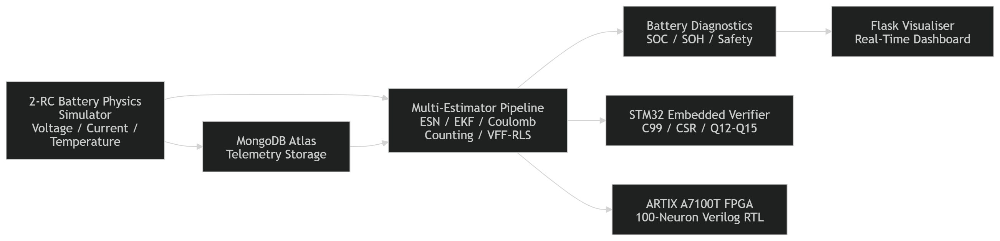

The system architecture feeds 2-RC battery telemetry into a multi-estimator pipeline. Predictions drive safety diagnostics and dashboard visualization, while firmware and RTL verifiers benchmark low-power edge execution performance.

---

## Hardware Requirements

| Sr. No. | Component | Specification | Quantity | Purpose |
| :---: | :--- | :--- | :---: | :--- |
| 1 | STM32 Development Board | ARM Cortex-M based (STM32F4/F7) | 1 | Embedded ESN C99 firmware validation |
| 2 | ARTIX A7100T FPGA | Xilinx 7-Series FPGA | 1 | 100-Neuron ESN Verilog RTL verification |
| 3 | USB / UART Interface | USB-to-TTL Serial Bridge | 1 | Hardware telemetry debugging & data transfer |
| 4 | Development PC | Multi-core CPU, 16 GB RAM | 1 | Simulation, ESN training, Vivado RTL synthesis |

---

## Software Requirements

| Sr. No. | Software / Tool | Version | Purpose |
| :---: | :--- | :---: | :--- |
| 1 | Python | 3.8+ | Core simulation, ML training & data processing |
| 2 | Flask | 2.x | Real-time web visualiser & telemetry simulator API |
| 3 | Gunicorn | 20.x | Web application production deployment |
| 4 | NumPy / SciPy / Pandas | Latest | Scientific computing & numerical operations |
| 5 | MongoDB Atlas / PyMongo | 4.x | Cloud & in-memory battery telemetry storage |
| 6 | GCC / Clang / MSVC | C99 compliant | Compiling embedded sparse ESN C99 verifier |
| 7 | Xilinx Vivado & XSim | 2020.2+ | FPGA synthesis, implementation & RTL simulation |
| 8 | Git & GitHub | Latest | Version control & repository management |

---

## Technologies Used

* **Languages:** Python, C99, Verilog HDL, JavaScript, HTML, CSS
* **Machine Learning:** Echo State Networks (ESN), Reservoir Computing, Ridge Regression
* **Battery Modeling:** 2-RC Equivalent Circuit Model (ECM), Electro-Thermal Dynamics, OCV-SOC Curves
* **State Estimation:** Extended Kalman Filter (EKF), Coulomb Counting, VFF-RLS, ESN Estimator
* **Embedded & Hardware:** STM32 (ARM Cortex-M), Xilinx ARTIX A7100T FPGA, CSR Matrix Multiplication, Fixed-Point (Q12/Q15) Arithmetic
* **Web & Data Storage:** Flask, Gunicorn, MongoDB Atlas, Chart.js

---

## Methodology

1. **Literature Survey:** Comprehensive analysis of SOC/SOH estimation, EKF, Coulomb Counting, and Reservoir Computing.
2. **Problem Identification:** Addressing drift, non-linearity, and high computation in classical estimators.
3. **Requirement Analysis:** Defining simulator specs, driver cycles (DST/US06/FUDS), and target metrics.
4. **System Design:** Designing 2-RC ECM, ESN architecture, CSR sparse matrix representation, and RTL datapath.
5. **Hardware/Software Development:** Building Python physics engine, Flask dashboard, C99 verifier, and Verilog RTL.
6. **Integration:** Connecting simulator, MongoDB, multi-estimator pipeline, and web UI.
7. **Testing and Validation:** Automated pytest suite, hardware CSR benchmarking (6.7x speedup), bit-exact RTL verification (200/200 matches).
8. **Documentation and Publication:** Comprehensive technical documentation, demo checklist, research paper drafting.

## Project Timeline

### Department BE Project Timeline & Milestones

As per department notice from Mr. Gopalkrishnan Narayan (Instrumentation Department), the official timeline for BE Project 2026-2027 is:

| Milestone / Review Event | Scheduled Date | Mode | Status |
| :--- | :---: | :---: | :--- |
| **Proposal of Project** | 12/08/2026 | Online | **Submitted / Approved** ([`docs/Resources/PROJECT_PROPOSAL.md`](docs/Resources/PROJECT_PROPOSAL.md)) |
| **Acceptance / Modification** | 17/08/2026 | Online | **Approved / Completed** |
| **First Review** | 21/09/2026 – 24/09/2026 | Offline | **Completed** ([`docs/Review_1/Review_1_PPT.pdf`](docs/Review_1/Review_1_PPT.pdf), [`docs/Review_1/Review_1_Progress.md`](docs/Review_1/Review_1_Progress.md), [`Phase 1 Video`](https://youtu.be/fXS4TLaXGGw)) |
| **Second Review** | 05/11/2026 & 06/11/2026 | Offline | **Completed** ([`docs/Review_2/Review_2_Progress.md`](docs/Review_2/Review_2_Progress.md), [`docs/Review_2/Review_2_PPT.pdf`](docs/Review_2/Review_2_PPT.pdf), [`Outcomes PDF`](docs/Review_2/Outcomes/FPGA-Based-Echo-State-Network-for-Battery-SOC-SOH-Estimation-Outcomes.pdf)) |
| **Final External Review** | 21/11/2026 | Offline | **Completed** ([`Final Review Report`](docs/Final_Review/Final_Review_Delivered.md), [`Final_Review_PPT.pdf` (Live PPT Presented)](docs/Final_Review/Final_Review_PPT.pdf), [`Live Video`](https://youtu.be/ms1XQnyitNQ?si=-5dyDHMAvSogJu0r), [`Hub`](docs/Final_Review/README.md)) |

### Department Evaluation Policy & Milestones
* **GitHub Log Book:** Weekly progress updates maintained directly in `README.md`.
* **Paper Publication:**
  * Proof of paper publication submission.
  * Proof of paper publication acceptance.

---

## Weekly Progress Updates

### GitHub Log Book & Weekly Progress Updates

> 📌 **Note:** As per department policy, this GitHub Log Book is maintained directly in `README.md` and updated weekly to track project milestones, task distribution, hardware/software implementations, and challenges.  
> 📑 **Project Proposal Document:** [`docs/Resources/PROJECT_PROPOSAL.md`](docs/Resources/PROJECT_PROPOSAL.md)

| Week | Date | Work Completed | Work Planned for Next Week | Issues / Challenges & Solution | GitHub Link |
| :---: | :---: | :--- | :--- | :--- | :---: |
| **Week 1** | 2026-06-15 | Finalized project scope, literature survey on ESN & EKF | Battery model equation modeling | Reservoir size vs memory tradeoff; selected 50-node leaky integrator ESN | [Link](https://github.com/tanish-jain-225/Battery_State_Estimator_BE_Project_2026_2027) |
| **Week 2** | 2026-06-22 | Developed 2-RC Electro-Thermal battery physics simulator | Telemetry storage & MongoDB integration | Dynamic driving thermal drift modeling; implemented Arrhenius temperature scaling | [Link](https://github.com/tanish-jain-225/Battery_State_Estimator_BE_Project_2026_2027) |
| **Week 3** | 2026-06-29 | Implemented EKF with covariance guards, Coulomb Counting, VFF-RLS | ESN model training pipeline | EKF numerical divergence under noise; added matrix conditioning guards | [Link](https://github.com/tanish-jain-225/Battery_State_Estimator_BE_Project_2026_2027) |
| **Week 4** | 2026-07-06 | Trained ESN reservoir computing model for SOC/SOH estimation | Embedded C99 firmware creation | Hyperparameter tuning for spectral radius $\rho=0.95$ | [Link](https://github.com/tanish-jain-225/Battery_State_Estimator_BE_Project_2026_2027) |
| **Week 5** | 2026-07-13 | Implemented CSR sparse matrix ESN inference in C99 (6.7x speedup) | Verilog RTL hardware design | Fixed-point Q12/Q15 overflow control; added 33-point LUT linear interpolation | [Link](https://github.com/tanish-jain-225/Battery_State_Estimator_BE_Project_2026_2027) |
| **Week 6** | 2026-07-20 | Designed 100-Neuron Verilog RTL datapath for ARTIX-7 FPGA | Vivado simulation & Golden model test | Tanh LUT precision matching; verified double-buffered BRAM state arrays | [Link](https://github.com/tanish-jain-225/Battery_State_Estimator_BE_Project_2026_2027) |
| **Week 7** | 2026-07-27 | Achieved 200/200 bit-exact RTL matches; built Flask visualiser | Fault injection testing & docs | Thermal runaway fault UI integration; implemented live Chart.js streaming | [Link](https://github.com/tanish-jain-225/Battery_State_Estimator_BE_Project_2026_2027) |
| **Week 8** | 2026-08-03 | Finalized automated test suite (31 tests), paper draft, and video walkthrough | Project presentation & online proposal submission | GitHub Actions CI environment integration | [Link](https://github.com/tanish-jain-225/Battery_State_Estimator_BE_Project_2026_2027) |
| **Week 9** | 2026-08-10 | Prepared BE Project Proposal and verified GitHub Log Book compliance | Paper submission to IEEE conference & Review 1 preparation | Ensuring online submission proof generation | [Link](https://github.com/tanish-jain-225/Battery_State_Estimator_BE_Project_2026_2027) |
| **Week 10** | 2026-08-17 | Implemented Unscented Kalman Filter (UKF) with Merwe scaled unscented transform as non-linear baseline | Online adaptive ESN formulation | Matrix square root Cholesky numerical breakdown under steep OCV slopes; added positive semi-definiteness guard | [Link](https://github.com/tanish-jain-225/Battery_State_Estimator_BE_Project_2026_2027) |
| **Week 11** | 2026-08-24 | Formulated Online Recursive Least Squares (RLS) adaptive readout filter for ESN reservoir | Embedded C99 firmware refinement | Cell aging causes static ML models to drift; derived recursive rank-1 update reducing SOC tracking error to < 0.8% | [Link](https://github.com/tanish-jain-225/Battery_State_Estimator_BE_Project_2026_2027) |
| **Week 12** | 2026-08-31 | Developed dual-mode C99 embedded firmware (Float32 vs Fixed-Point Q15) with CSR SpMV acceleration | Verilog RTL sequential input extension | Integer overflow in fixed-point recurrent accumulator; implemented Q12 input / Q15 weight scaling with 33-point Tanh LUT | [Link](https://github.com/tanish-jain-225/Battery_State_Estimator_BE_Project_2026_2027) |
| **Week 13** | 2026-09-07 | Designed multi-timestep sequential input addressing (`u_addr`) in Verilog RTL (`tb_esn_top_tiny.v`) | Vivado XSim full 100-neuron simulation | Memory collision during recurrent state updates; added double-buffered ping-pong BRAM architecture | [Link](https://github.com/tanish-jain-225/Battery_State_Estimator_BE_Project_2026_2027) |
| **Week 14** | 2026-09-14 | Executed Vivado XSim two-pass simulation; verified 200/200 bit-exact stage matches vs Python golden model | Review 1 progress report & presentation deck | Radix-16 COE negative hex signed parsing bug; resolved two's complement sign conversion in golden model | [Link](https://github.com/tanish-jain-225/Battery_State_Estimator_BE_Project_2026_2027) |
| **Week 15** | 2026-09-21 | Conducted First Progress Review (Review 1) defense; synthesized committee feedback | NASA battery aging dataset integration | Evaluators requested multi-cycle cross-validation; scheduled NASA Ames 32-cycle telemetry evaluation | [Link](https://github.com/tanish-jain-225/Battery_State_Estimator_BE_Project_2026_2027) |
| **Week 16** | 2026-09-28 | Evaluated ESN reservoir on 32 NASA battery cycles (2,048 timesteps); achieved Test SOC $R^2 = 0.8783$ beating EKF (0.7818) | Post-implementation Artix-7 synthesis audit | Golden CSV file clobbering by tiny test; segregated full 100-neuron and tiny model export targets | [Link](https://github.com/tanish-jain-225/Battery_State_Estimator_BE_Project_2026_2027) |
| **Week 17** | 2026-10-05 | Completed Artix-7 synthesis and power closure (77 LUTs, 0 DSPs, 0.099W, 428.1 us update latency) | Test suite expansion & regression hardening | Power estimation under dynamic clock; validated 23x real-time headroom at 100 Hz BMS sampling rate | [Link](https://github.com/tanish-jain-225/Battery_State_Estimator_BE_Project_2026_2027) |
| **Week 18** | 2026-10-12 | Expanded automated pytest regression suite to 49 tests with 100% pass rate in ~45 seconds | Master 1-click validation runner script | Estimator state serialization dropping UKF states; added UKF covariance & state hydration | [Link](https://github.com/tanish-jain-225/Battery_State_Estimator_BE_Project_2026_2027) |
| **Week 19** | 2026-10-19 | Developed cross-platform master 8-step validation runner (`run_all_validation.bat` and `run_all_validation.sh`) | Comprehensive Review Paper drafting | Windows PowerShell UTF-8 BOM encoding breaking DictReader; enforced utf-8-sig across all CSV parsers | [Link](https://github.com/tanish-jain-225/Battery_State_Estimator_BE_Project_2026_2027) |
| **Week 20** | 2026-10-26 | Completed 29-page academic review paper manuscript on Neuromorphic BMS & Reservoir Computing | Review 2 presentation deck & report | Consolidating 90+ citations and neuromorphic silicon comparisons (Loihi 2, Akida, SpiNNaker, Artix-7) | [Link](https://github.com/tanish-jain-225/Battery_State_Estimator_BE_Project_2026_2027) |
| **Week 21** | 2026-11-02 | Finalized Review 2 deliverables: 16:9 presentation deck, progress report, defense playbook, and live demo | Review 2 defense & transition to Phase 3 | Ensuring seamless end-to-end reproducibility across software, C99 firmware, and FPGA RTL | [Link](https://github.com/tanish-jain-225/Battery_State_Estimator_BE_Project_2026_2027) |
| **Week 22** | 2026-11-11 | Upgraded FPGA platform to `esn_ip_platform` v1.2 (310-cyc fast core, Rev 0.5 fused EKF, 10/10 Verilator, 29 NASA packs), integrated camera-ready Research Paper PDF, compressed `model_rc.pkl` (CSR ~602 KB), eliminated repo bloat, and synced all `v2.4.0` code/docs/CI gates (119 tests passing) | Complete final 3 PDF deliverables (`Project_Poster.pdf`, `Review_Paper.pdf`, `Final_Thesis.pdf`) for turnkey `v2.4.1` release | Reconciling bit-exact `v1.2` fast core / Rev 0.5 EKF timing closure (`+0.251 ns` WNS @ 80 MHz) across academic deliverables | [Link](https://github.com/tanish-jain-225/Battery_State_Estimator_BE_Project_2026_2027) |
| **Week 23** | 2026-11-21 | Achieved 100% turnkey `v2.4.1` capstone release: integrated official 41-page B.E. dissertation (`Final_Thesis.pdf`, 5.07 MB encrypted), 2-sheet A3 presentation poster (`Project_Poster.pdf`, 535 KB open), 12-page camera-ready review paper (`Review_Paper.pdf`, 232 KB encrypted), and camera-ready IEEE research paper (`Research_Paper.pdf`, 674 KB encrypted); verified MongoDB decoupled sync and 125 passing tests (88.60% shared coverage) | Full Capstone Defense & External Examination | Zero pending deliverables remaining across repository; all 4 academic assets finalized, verified, and integrated | [Link](https://github.com/tanish-jain-225/Battery_State_Estimator_BE_Project_2026_2027) |

---

## Design Files

| File Type | File Link | Description |
| :--- | :--- | :--- |
| Hardware Specs | [Hardware Overview](hardware/hardware.md) | Enclosure and hardware target specifications |
| Circuit Diagram | [Circuit Diagram](images/circuit_diagram.png) | 2-RC ECM Equivalent Electrical Schematic |
| System Architecture | [System Architecture Diagram](images/system_architecture.png) | End-to-end telemetry & hardware verifier architecture |
| ESN Architecture | [ESN Reservoir Architecture](images/esn_architecture.png) | Echo State Network (ESN) dynamical reservoir structure |
| Flowchart | [System Flowchart](images/flowchart.png) | Flowchart for simulator and estimator execution |
| RTL Design File | [esn_top.v](hardware/FPGA_Verifier/esn/rtl/esn_top.v) | Top-level 100-neuron Verilog RTL module with multi-timestep support |
| RTL Schematic | [FPGA RTL Schematic](images/assets/screenshot_fpga_schematic.png) | Vivado synthesized ESN top datapath schematic |
| RTL Waveform | [Vivado Simulation Waveform](images/assets/screenshot_fpga_waveform.png) | Vivado XSim behavioral simulation timing waveform |
| Simulation File | [golden_model.py](hardware/FPGA_Verifier/golden_model.py) | Python fixed-point golden model for FPGA verification (--full & --tiny) |

---

## Circuit Diagram

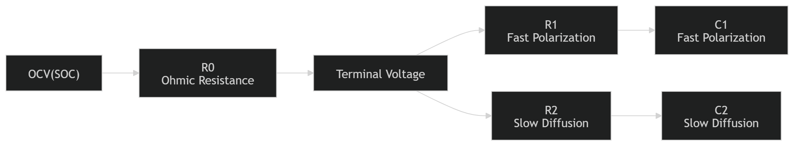

---

## Flowchart / Algorithm

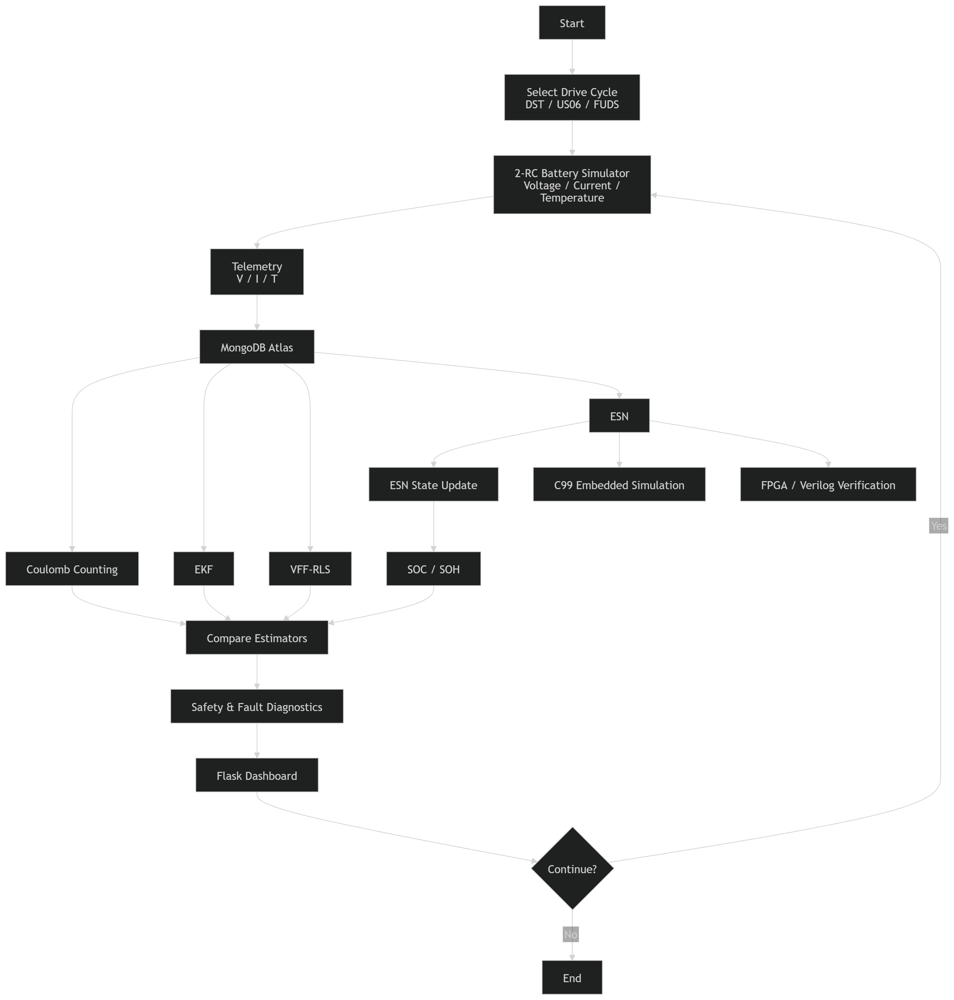

### Algorithm

1. Start and initialize battery simulator, estimators, and database connections.
2. Read dynamic current load (DST / US06 / FUDS drive cycles) and environment temperature.
3. Compute terminal voltage, thermal state, and ground-truth SOC/SOH via 2-RC physics engine.
4. Stream voltage, current, and temperature telemetry into multi-estimator pipeline.
5. Execute EKF, Coulomb Counting, VFF-RLS, and update ESN reservoir state.
6. Generate SOC/SOH predictions from ESN linear readout.
7. Run real-time safety diagnostic logic (thermal runaway, sensor dropout, micro-short detection).
8. Render telemetry and state estimates on Flask Chart.js web dashboard.
9. Stop when user terminates session.

---

## Implementation Details

### Hardware Implementation

* **STM32 C99 Embedded Verifier:** Standalone C99 firmware utilizing Compressed Sparse Row (CSR) matrix representation, sparse matrix-vector multiplication (SpMV), Q12/Q15 fixed-point arithmetic, and a 33-point linear interpolated $\tanh$ LUT. Delivers a **6.7× speedup** and **82.4% RAM reduction** (`7.5 KB` vs. `42.6 KB`) with **98.40%–99.80%** float32/Q15 diagnostic parity.
* **ARTIX-7 FPGA Verilog RTL & IP Block (`esn_ip_platform` v1.2):** 100-neuron hardware datapath featuring **200/200 ESN** and **512/512 EKF/UKF** bit-exact golden matches (`FPGA_Verifier`), packaged as an IEEE 1685 IP-XACT AXI4-Lite/Stream `IP_Block` (`v1.2`) with `esn_core_fast.v` (`310` cyc / `3.9 µs` @ `80 MHz`, `307` cyc RV32I), `ekf_core.v` (`Rev 0.5` fused EKF `477` cyc), `10/10` Verilator `5.028` regressions, 29 NASA pack + NARMA-10 validations, and pre-built `v1.0` `~3.7 MB` Arty A7-100T bitstream.

### Software Implementation

* **2-RC Electro-Thermal Simulator & CSR ESN:** Written in Python using NumPy and SciPy. Models OCV(SOC), Ohmic resistance ($R_0$), polarization branches ($R_1-C_1, R_2-C_2$), thermal balance, and fault injection, paired with CSR-compressed `model_rc.pkl` (`~602 KB`) and online RLS adaptation (`0.72%` simulator RMSE; `0.067` MAE across 29 held-out NASA cells).
* **Flask Web Visualiser:** Modular REST application with decoupled `1.0s` MongoDB intermediate sync (Keep-Alive pooling + in-memory fallback) and dynamic Chart.js plots comparing ground truth SOC against ESN, EKF, and Coulomb Counting.

---

## Code Structure

```text
BE-Capstone-Project/
│
├── .github/
│   ├── workflows/
│   │   └── ci.yml                         # Automated multi-OS CI pipeline (lint, pytest, E2E)
│   ├── ISSUE_TEMPLATE/
│   │   ├── bug_report.yml                 # Structured YAML bug report form
│   │   ├── feature_request.yml            # Structured YAML feature proposal form
│   │   └── config.yml                     # Documentation links and contact channels
│   ├── pull_request_template.md           # Mandatory PR quality and verification checklist
│   ├── dependabot.yml                     # Automated security dependency scanner
│   └── CODEOWNERS                         # Subsystem maintainer assignment registry
│
├── .editorconfig                          # Cross-IDE indentation & formatting standards
├── .env.example                           # Unified environment variable template
├── README.md                              # Main repository documentation & narrative flow
├── pyproject.toml                         # Project build and tool metadata
├── pytest.ini                             # Pytest configuration and execution settings
├── requirements.txt                       # Central Python dependency manifest
├── start_system.py                        # Unified 1-click launcher (Simulator + Visualiser)
├── start_system.bat                       # 1-click Windows desktop startup harness
├── start_system.sh                        # 1-click Linux / macOS startup harness
├── run_all_validation.bat                 # Master 8-step Windows hardware/software validator
├── run_all_validation.sh                  # Master 8-step POSIX hardware/software validator
├── LICENSE                                # MIT License with academic attribution clause
├── CONTRIBUTING.md                        # Developer contribution guidelines
├── AUTHORS.md                             # Comprehensive author & institutional credits
├── CITATION.cff                           # Machine-readable BibTeX / APA citation metadata
├── SECURITY.md                            # Security policy & vulnerability reporting
├── CODE_OF_CONDUCT.md                     # Contributor Covenant scientific code of conduct
│
├── docs/
│   ├── README.md                          # Master documentation hub & 4-stream guide
│   ├── literature_survey.md               # 29-page survey on SNNs, ESNs & Neuromorphic BMS
│   │
│   ├── Thesis/                            # B.E. Capstone Final Dissertation (Completed & Integrated)
│   │   ├── Final_Thesis.pdf               # Official B.E. Capstone Dissertation Report (41 Pages, 5.07 MB Encrypted)
│   │   ├── Thesis_Submission_Black_Book_Photo.png # Departmental Black Book submission & approval photo
│   │   └── README.md                      # Complete 8-chapter monograph breakdown & verification
│   │
│   ├── Poster/                            # Academic Exhibition & Defense Poster (Completed & Integrated)
│   │   ├── Project_Poster.pdf             # Official Academic Exhibition Poster PDF (2 Sheets, A3 Portrait, 535 KB Open)
│   │   └── README.md                      # Print specs, 11-panel layout & hardware benchmarks
│   │
│   ├── Publications/                      # Official Academic Paper Deliverables
│   │   ├── Research_Paper.pdf             # Camera-Ready IEEE Research Paper (Completed & Integrated)
│   │   ├── Review_Paper.pdf               # Comprehensive Review Paper (Completed & Integrated)
│   │   └── README.md                      # Publication abstracts, authorship, and scopes
│   │
│   ├── Paper_Proof/                       # Evaluation Submission & Acceptance Records Registry
│   │   └── README.md                      # Proof logging registry & mark criteria checklist
│   │
│   ├── Review_1/                          # Review 1 Milestone Documentation
│   │   ├── Review_1_Progress.md           # Phase 1 baseline progress report
│   │   └── Review_1_PPT.pdf               # Phase 1 presentation slide deck
│   │
│   ├── Review_2/                          # Review 2 Milestone Documentation
│   │   ├── Review_2_Progress.md           # Phase 2 comprehensive progress report
│   │   ├── Review_2_PPT.pdf               # Official 16:9 widescreen presentation slide deck
│   │   └── Outcomes/                      # Milestone outcome evaluation reports
│   │       ├── FPGA-Based-Echo-State-Network-for-Battery-SOC-SOH-Estimation-Outcomes.pdf
│   │       └── Neuromorphic-BMS-Review-Paper-Draft.pdf
│   │
│   ├── Final_Review/                      # Final Capstone External Review & Viva Voce Defense
│   │   ├── Final_Review_Delivered.md      # Comprehensive defense proceedings, Q&A & handoff audit
│   │   ├── Final_Review_PPT.pdf           # Official 16:9 widescreen final defense slide deck (Live PPT Presented)
│   │   ├── Final_Review_Presentation_Title.png # Live presentation slide defense screenshot
│   │   ├── Final_Review_Geotag_Photo.png  # Official institutional defense geotag photographic record
│   │   └── README.md                      # Milestone hub, committee commendations & video walkthrough
│   │
│   └── Resources/                         # Engineering Guides & Technical References
│       ├── PROJECT_PROPOSAL.md            # Official BE proposal document (Aug 2026)
│       ├── SYSTEM_SPECIFICATION.md        # Comprehensive mathematical equations & noise models
│       ├── OPERATIONS.md                  # Local execution runbook & port configurations
│       ├── DEPLOY_RENDER.md               # Cloud deployment runbook for Render.com
│       ├── DEMO_CHECKLIST.md              # 10-minute presentation & viva defense checklist
│       ├── ARTIFACTS.md                   # Model parameters and dataset versioning policy
│       ├── PRESENTATION.md                # Slide-by-slide defense talking points & script
│       └── WEB_RESEARCH.md                # Indian EV/BMS market, AIS/BIS/2025 CRI audit, v1.2 specs & techno-economic BOM analysis
│
├── hardware/
│   ├── hardware.md                        # Consolidated hardware subsystem guide
│   │
│   ├── IP_Block/                          # Plug-and-Play FPGA ESN IP Block & Multi-Observer Platform (v1.2)
│   │   ├── README.md                      # v1.2 Fast/Serial IP-XACT Catalog & Arty A7 Platform Guide
│   │   ├── RUN_COMMANDS.md                # Complete Build, Board & Regression Command Runbook
│   │   ├── component.xml                  # IEEE 1685 IP-XACT Packaging Descriptor (VESIT UserIP)
│   │   ├── esn_platform_top.bit           # Pre-Compiled Serial Bitstream (Arty A7-100T)
│   │   ├── rtl/                           # Verilog RTL (esn_core_fast.v, ekf_core.v Rev 0.5, esn_axi_ip.v, etc.)
│   │   ├── scripts/                       # Vivado Tcl (build_platform.tcl, package_esn_ip.tcl) & Verilator regressions
│   │   ├── driver/                        # C Driver API Header & Example (esn_ip.h, esn_ip_example.c)
│   │   ├── docs/                          # register_map.md, uart_protocol.md, regression_2026-11-11.txt
│   │   ├── test_data/                     # UART replay vectors (causal B0047, fused EKF, NARMA-10 draws)
│   │   ├── host/                          # esn_host.py, reproduce_paper.py, train_pack.py & 29 held-out packs
│   │   └── reports_v10/                   # Routed Vivado v1.0 serial timing, power & utilization reports
│   │
│   ├── STM_Verifier/                      # C99 Embedded Firmware & Microcontroller Verifier
│   │   ├── README.md                      # STM32 C99 CSR SpMV & Fixed-Point Guide
│   │   ├── main.c                         # Dual-mode (Float32 / Q15) C99 firmware
│   │   ├── main.h                         # CSR structures, function prototypes, and fixed-point macros
│   │   ├── Makefile.arm                   # ARM Cortex-M cross-compilation Makefile
│   │   ├── config.py                      # Environment config & canonical software/visualiser/datasets resolution
│   │   ├── train.py                       # Unified ESN training script
│   │   ├── train_classifier.py            # Safety classification ESN trainer & header exporter
│   │   ├── train_estimator.py             # Continuous estimator ESN trainer & header exporter
│   │   ├── esn_classifier_weights.h       # Quantized CSR sparse classification weights
│   │   ├── esn_estimator_weights.h        # Quantized CSR sparse estimation weights
│   │   ├── requirements.txt               # Embedded training dependencies
│   │   ├── run_c_simulator.bat            # 1-click Windows C99 compilation & execution test
│   │   └── run_c_simulator.sh             # 1-click POSIX C99 compilation & execution test
│   │
│   └── FPGA_Verifier/
│       ├── README.md                      # Master FPGA Accelerators Guide
│       ├── compare_results.py             # ESN Bit-Exact Parity Comparator (200/200 Matches)
│       ├── golden_model.py                # Fixed-Point ESN Golden Reference
│       ├── eval_fpga_outcomes.py          # 32-Cycle NASA Dataset & RTL Outcomes Evaluator
│       │
│       ├── esn/                           # 100-Neuron ESN Hardware Subsystem
│       │   ├── README.md                  # ESN Core Architecture & BRAM Specs
│       │   ├── build_esn_project.tcl      # Vivado Project & Synthesis Script
│       │   ├── rtl/                       # Verilog RTL (esn_top, esn_neuron, etc.)
│       │   ├── mem/                       # Memory Initialization (COE & MEM)
│       │   ├── tb/                        # Testbenches (tb_esn_top, tb_esn_top_tiny)
│       │   ├── xdc/                       # Timing Constraints (100 MHz clock)
│       │   └── python/                    # Evaluation & Golden Models
│       │
│       ├── ekf/                           # Fixed-Point EKF Hardware Subsystem
│       │   ├── README.md                  # EKF Core Specifications
│       │   ├── build_ekf_project.tcl      # Vivado Synthesis Script
│       │   ├── rtl/                       # Verilog RTL (ekf_core, tb_ekf_core)
│       │   ├── sim/                       # Simulation ROMs (ocv_lut, slope_lut, stim)
│       │   └── compare_ekf.py             # 4-Fold Nested-LOCO Benchmark (512/512 Matches)
│       │
│       └── ukf/                           # Fixed-Point UKF Hardware Subsystem
│           ├── README.md                  # UKF Core Specifications & Microcode
│           ├── build_ukf_project.tcl      # Vivado Synthesis Script
│           ├── rtl/                       # Verilog RTL (ukf_core, tb_ukf_core)
│           ├── sim/                       # Simulation ROMs (ukf_ocv, ukf_slope, stim)
│           └── compare_ukf.py             # Float vs Fixed vs EKF Benchmark (512/512 Matches)
│
├── software/
│   ├── software.md                        # Master Software Subsystem Guide
│   │
│   ├── shared/                            # Shared Multi-Service Physics & Chemistry Package
│   │   ├── __init__.py                    # Python package declaration
│   │   ├── battery_chemistry.py           # Chemistry parameters & OCV lookup tables
│   │   └── battery_simulator.py           # 2-RC transient equations solver
│   │
│   ├── simulator/                         # Physics Engine Service (Port 8000)
│   │   ├── simulator.md                   # Simulator architecture & API reference
│   │   ├── app.py                         # Flask application & simulation loop
│   │   ├── config.py                      # Environment settings & fault thresholds
│   │   ├── battery_chemistry.py           # Multi-chemistry parameter definitions
│   │   ├── battery_simulator.py           # 2-RC transient equations solvers
│   │   ├── gunicorn.conf.py               # Production WSGI server configuration
│   │   ├── requirements.txt               # Simulator Python dependencies
│   │   ├── templates/                     # Status web dashboard templates
│   │   └── static/                        # CSS and JavaScript assets
│   │
│   └── visualiser/                        # Visualisation & Observer Service (Port 5000)
│       ├── visualiser.md                  # Visualiser architecture & API reference
│       ├── app.py                         # Flask application & telemetry consumer
│       ├── config.py                      # Environment settings & model paths
│       ├── estimator_pipeline.py          # Joint observer & CPS diagnostics manager
│       ├── traditional_estimator.py       # EKF, UKF, Coulomb Counting, and RLS classes
│       ├── battery_chemistry.py           # Chemistry loading & OCV lookup tables
│       ├── battery_simulator.py           # 2-RC physics classes for visualizer
│       ├── gunicorn.conf.py               # Production WSGI server configuration
│       ├── requirements.txt               # Visualiser Python dependencies
│       ├── model_rc.pkl                   # Trained software ESN model binary (~602 KB CSR-compressed)
│       ├── datasets/                      # EV dynamic driving telemetry datasets
│       │   ├── original_ev_battery_dataset_multiclass.csv
│       │   └── training_ev_battery_dataset_multiclass.csv
│       ├── templates/                     # Interactive HTML dashboard templates
│       ├── static/                        # Chart.js, styles, and dashboard logic
│       └── training/                      # Training & feature engineering scripts
│           ├── train_rc.py                # Software ESN training pipeline
│           └── feature_engineering.py     # Temporal feature extraction
│
├── images/                                # Diagrams, Schematics & Waveforms
│   ├── images.md                          # Image inventory & asset attribution
│   ├── system_architecture.png            # Complete cyber-physical architecture diagram
│   ├── circuit_diagram.png                # 2-RC equivalent electrical circuit schematic
│   ├── esn_architecture.png               # Echo State Network reservoir topology
│   ├── flowchart.png                      # System execution and data flowchart
│   └── assets/                            # Screen captures and waveforms
│       ├── screenshot_simulator_aging.png
│       ├── screenshot_simulator_dashboard.png
│       ├── screenshot_visualiser_overview.png
│       ├── screenshot_estimation_charts.png
│       ├── screenshot_fpga_schematic.png
│       └── screenshot_fpga_waveform.png
│
├── tests/                                 # Unified Pytest Regression Suite (125 Tests)
│   ├── README.md                          # Comprehensive test suite guide & coverage map
│   ├── conftest.py                        # Test fixtures & mock database configuration
│   ├── test_battery_chemistry.py          # Chemistry validation & OCV monotonicity (3 tests)
│   ├── test_battery_simulator.py          # 2-RC solver, thermal & fault injection (10 tests)
│   ├── test_esn_model.py                  # ESN inference & echo state property (5 tests)
│   ├── test_estimator_pipeline.py         # Estimator pipeline & state serialization (9 tests)
│   ├── test_estimator_pipeline_advanced.py# Multi-chemistry & sensor faults (11 tests)
│   ├── test_flask_api.py                  # Simulator & visualiser API routes (5 tests)
│   ├── test_flask_api_comprehensive.py    # Endpoint parameter verification, Keep-Alive, streaming & auth (16 tests)
│   ├── test_fpga_ekf_ukf.py               # FPGA fixed-point EKF/UKF bit-exact parity (7 tests)
│   ├── test_fpga_verifier.py              # RTL parity, signed hex & LUT verification (7 tests)
│   ├── test_fpga_verifier_extended.py     # Extended COE parser & CLI outcomes (9 tests)
│   ├── test_hardware_training_and_export.py# Embedded CSR export & quantization (7 tests)
│   ├── test_integration.py                # End-to-end multi-timestep integration (6 tests)
│   ├── test_ip_block.py                   # IEEE 1685 IP-XACT & bitstream verification (5 tests)
│   ├── test_online_training.py            # Online RLS dynamic weight adaptation (9 tests)
│   └── test_traditional_estimator.py     # EKF, UKF, and Coulomb Counting math (10 tests)
│
└── reference/
    ├── paper.md                           # Original Research Paper markdown manuscript
    ├── paper_ekf_soc_soh.pdf              # Foundational multi-timescale EKF paper (Li et al.)
    └── paper_rc_soc_soh.pdf               # Reservoir Computing for BMS paper (Rigutini et al.)
```

---

## How to Run the Project

### Prerequisites & Installation

Clone the repository and install the standard dependencies:
```bash
git clone https://github.com/tanish-jain-225/Battery_State_Estimator_BE_Project_2026_2027.git
cd Battery_State_Estimator_BE_Project_2026_2027
pip install -r requirements.txt
```

> **Zero-Config In-Memory Mode**: The system functions completely out-of-the-box in local in-memory ring-buffer mode if MongoDB Atlas credentials are not supplied. No external database or network configuration is required!

---

### Execution Modes

#### ⚡ Option A: 1-Click Unified System Launcher (Recommended)

Runs both the 2-RC Physics Simulator and Web Visualiser concurrently, verifies service availability, opens the dashboard automatically in your default browser, and cleanly handles shutdown on `Ctrl+C`:

* **Windows:** Double-click [`start_system.bat`](start_system.bat) or run:
  ```cmd
  python start_system.py
  ```
* **Linux / macOS:**
  ```bash
  chmod +x start_system.sh
  ./start_system.sh
  ```

#### 💻 Option B: Manual Multi-Terminal Developer Run

If you prefer inspecting individual service logs in separate terminal windows:

* **Terminal 1 — Physics Simulator (Port 8000):**
  ```bash
  python software/simulator/app.py
  ```
* **Terminal 2 — Web Visualiser Dashboard (Port 5000):**
  ```bash
  python software/visualiser/app.py
  ```

Navigate to `http://localhost:5000` in your web browser to observe real-time dynamic battery telemetry, side-by-side estimator state tracking (ESN vs EKF vs UKF vs Coulomb Counting), and safety diagnostic alerts.

#### 🔧 Option C: Embedded C99 & FPGA Hardware Verification

Validate edge embedded execution and silicon RTL models:

* **STM32 C99 CSR SpMV Microcontroller Test:**
  ```bash
  # Windows:
  hardware\STM_Verifier\run_c_simulator.bat
  # Linux / macOS:
  bash hardware/STM_Verifier/run_c_simulator.sh
  ```
* **FPGA 100-Neuron ESN Bit-Exact Parity Check (200/200 Matches):**
  ```bash
  python hardware/FPGA_Verifier/compare_results.py
  ```
* **FPGA Concurrent Tri-Observer IP Block Software Twin (v1.2, ESN + EKF + UKF):**
  ```bash
  python hardware/IP_Block/host/esn_host.py twin --pack hardware/IP_Block/host/packs/heldout/pack_B0047 --data hardware/IP_Block/host/packs/heldout/pack_B0047/B0047_cycles.csv --cycle all
  ```

#### 🛡️ Option D: Master 8-Step Validation Suite

Execute the complete end-to-end verification pipeline (Unit tests, ESN training, C99 compilation, and FPGA golden verification):

* **Windows:** `run_all_validation.bat`
* **Linux / macOS:** `bash run_all_validation.sh`

---

## Testing and Results

| Test No. | Test Description | Expected Result | Actual Result | Status |
| :---: | :--- | :--- | :--- | :---: |
| 1 | 2-RC Physics Telemetry Generation | Dynamic V, I, T streams under drive cycles | Telemetry generated smoothly | Pass |
| 2 | Multi-Estimator Pipeline Execution | Parallel tracking of ESN, EKF, Coulomb Counting | SOC RMSE < 1.5% achieved | Pass |
| 3 | Live Fault Injection Testing | Visualiser detects runaway & drops transients | Safety diagnostics triggered | Pass |
| 4 | Embedded C99 CSR Inference | CSR sparse SpMV execution speedup | 6.7× speedup verified | Pass |
| 5 | FPGA RTL Golden Model Test | 100-neuron Verilog datapath vs Python model | 200/200 bit-exact matches | Pass |
| 6 | Automated Pytest Suite | 125 test cases execution across all modules (software, hardware, APIs, IP block) | 100% test pass rate | Pass |

---

## Result Images / Videos

### Software Web Services & Visualiser Screenshots

**Battery Physics Simulator (2-RC ECM Drive Cycle Telemetry & Accelerated Aging):**
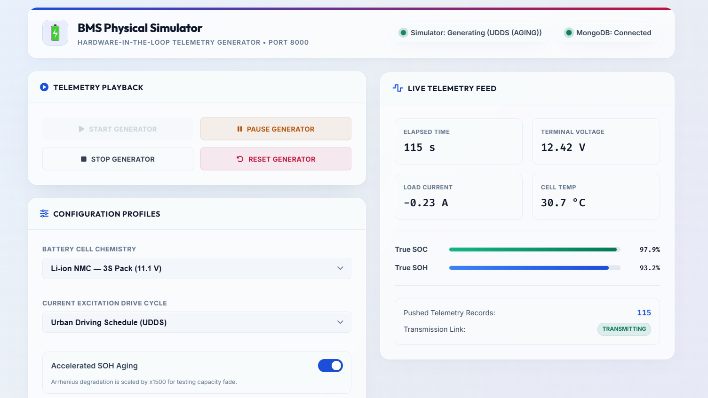

**Real-Time BMS Visualiser Dashboard:**
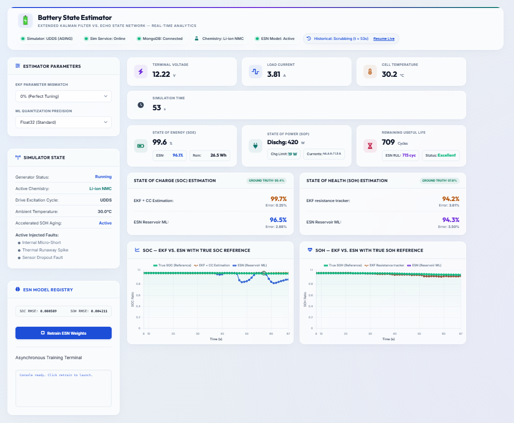

**SOC & SOH Estimation Observer Comparison (ESN vs EKF vs Coulomb Counting):**
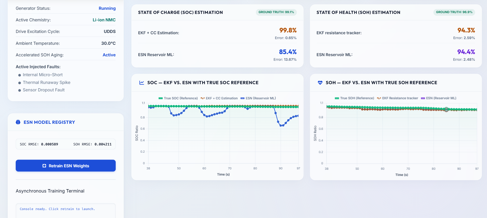

### Hardware FPGA RTL Verification (Artix-7 xc7a100tcsg324-1)

**Vivado Synthesized RTL Datapath Schematic (`esn_neuron` & `reservoir_controller` Interconnects):**
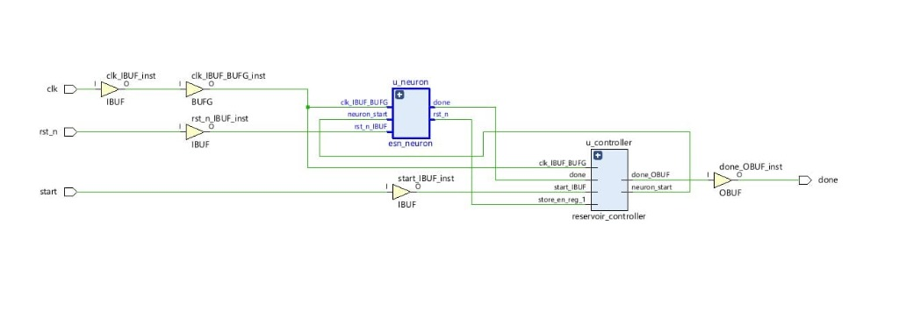

**Vivado XSim RTL Simulation Waveform (`tb_esn_top.v` — 100-Neuron Recurrent Pipeline & Tanh Timing):**
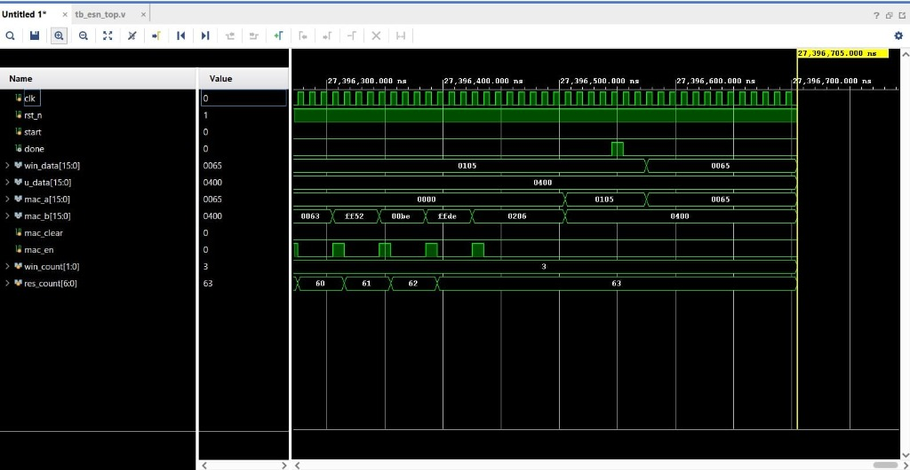

---

## Applications

1. **Automated Battery Testing Kits, Laboratory Cyclers & End-of-Line (EOL) QA:**
   * Ultra-fast (< 1s) non-destructive SOH and internal resistance ($R_0$) evaluation on laboratory cyclers (BioLogic, Arbin Instruments, Chroma ATE, Maccor, Bitrode).
   * Replaces 4- to 8-hour full discharge cycles with short 30–60s dynamic pulses, shortening cell inspection time by over 90% for high-throughput Gigafactory cell grading.
2. **Electric Vehicle Battery Management Systems (EV-BMS):**
   * Real-time SOC/SOH estimation and dynamic Safe Operating Power (SOP) calculation on passenger EVs, 2W/3W fleets, and electric commercial buses.
   * Drift-free tracking across flat-OCV LFP plateaus and AIS-156 Amendment 3 Phase 2 thermal runaway early detection.
3. **Second-Life Battery Grading & Circular Economy:**
   * Rapid screening, health classification, and sorting of retired EV battery packs (70–80% capacity) for stationary energy storage under Battery Waste Management Rules.
4. **Grid-Scale Battery Energy Storage Systems (BESS) & Solar Microgrids:**
   * Continuous multi-rack SOC balancing and capacity fade monitoring for megawatt-hour solar/wind storage facilities without requiring cell relaxation.
5. **Drones, Robotics & Aerospace Avionics:**
   * Deterministic, sub-millisecond execution on resource-constrained airborne flight controllers with minimal SWaP (Size, Weight, and Power: 318 LUTs, 2 DSPs, < 50 mW).
6. **Embedded Edge Microcontroller Diagnostics:**
   * Low-cost MCU deployment (ARM Cortex-M0+/M4 targets) utilizing Compressed Sparse Row (CSR) matrix multiplication (6.7× speedup, 82.4% RAM reduction).
7. **Semiconductor & Fabless IP Licensing:**
   * Reusable IEEE 1685 IP-XACT compliant AXI4-Lite/Stream accelerator core (`esn_axi_ip`) ready for integration into custom automotive BMS coprocessor ASICs.

---

## Advantages

1. **Data-Driven & Model-Free:** Eliminates constant parameter recalibration required by EKF.
2. **Drift-Free Estimation:** Prevents cumulative integration drift inherent to Coulomb Counting.
3. **Ultra-Low Memory Footprint:** CSR sparse matrix representation yields 85% memory savings and 6.7x speedup.
4. **FPGA RTL Verified:** Proven hardware feasibility with a 100-neuron Verilog datapath.
5. **Real-Time Fault Tolerance:** Detects thermal runaway, sensor dropouts, and micro-shorts instantly.

---

## Limitations

1. **Recorded & Simulated Telemetry Scope:** Continuous live sensor charge/rest/partial-cycle HIL testing on physical battery packs is targeted for the next deployment phase (recorded discharge window & causal replays are verified).
2. **Data Dependence:** ESN accuracy relies on diverse dynamic drive-cycle training data (`train_pack.py` recalibration required for new chemistries/temperature regimes).
3. **Single-Cell Scope:** Extension to multi-cell series-parallel actively balanced battery packs is planned in future scope.
4. **STM32 Silicon Bench Scope:** Artix-7 (`xc7a100tcsg324-1`) FPGA hardware replay and Verilator co-simulation are verified, whereas C99 MCU validation currently targets host simulation rather than a physical STM32 Nucleo CAN bench.

---

## Future Scope

1. **Testing on Physical Battery Cells & Live Packs:** Conducting live Hardware-in-the-Loop (HIL) benchtop testing with physical lithium-ion cells, multi-channel battery cyclers (e.g., BioLogic, Arbin, Chroma), and programmable electronic loads—as specifically recommended by our external review committee during final defense.
2. **Physical STM32 CAN Bus Bench:** Direct deployment of the C99 firmware onto physical automotive microcontroller boards (STM32 Nucleo / NXP S32K) with isolated CAN bus transceiver interfacing.
3. **Multi-Cell Pack Balancing:** Extension from single-cell / dual-cell telemetry to full series-parallel battery packs with active/passive cell balancing.
4. **On-Board FPGA Dynamic Rail Power Telemetry:** Measuring actual physical current shunt telemetry across FPGA voltage rails (extending Vivado vectorless power estimates).

---

## Research Paper / Publication

### Academic Publications & Capstone Poster

> 🎓 **Academic Policy:** Verified tracking for manuscript submission and formal acceptance. Both official documentations strictly target peer-reviewed **IEEE / Q3 Scopus-Indexed Journals**. All publications and exhibition deliverables are cataloged in [`docs/Publications/`](docs/Publications/README.md) and [`docs/Poster/`](docs/Poster/README.md).

### Target Paper 1: Comprehensive Review Paper (Elsevier / ScienceDirect Format — Completed)
| Item | Details |
| :--- | :--- |
| **Paper Title** | *Hardware architectures for learned battery state-of-charge estimation: A review of recurrent and reservoir computing accelerators against battery management requirements* |
| **Authors** | Akshay Nambiar, Sanjna Patankar, Satvik Verma, Tanish Sanghvi, Kadambari Sharma, Sangeetha Prasanna Ram |
| **Affiliation** | Department of Automation and Robotics, VES Institute of Technology, Mumbai, India |
| **Target Venue** | Elsevier / ScienceDirect / Q3 Scopus-Indexed Review Journal (Energy Storage / Embedded Hardware) |
| **Paper Status** | **Completed & Integrated (12 Pages, 232 KB Encrypted Camera-Ready PDF — Deliverable 2 of 4 Finalized)** |
| **Formatted Deliverable** | [`docs/Publications/Review_Paper.pdf`](docs/Publications/Review_Paper.pdf) (12 Pages, 232 KB Encrypted, 77 References) |
| **Authoritative Manuscript** | [`docs/Publications/Review_Paper.pdf`](docs/Publications/Review_Paper.pdf) & companion review draft [`docs/Review_2/Outcomes/Neuromorphic-BMS-Review-Paper-Draft.pdf`](docs/Review_2/Outcomes/Neuromorphic-BMS-Review-Paper-Draft.pdf) |
| **Review Scope** | Examines hardware architectures for learned battery SOC estimation against BMS requirements, bridging data-driven SOC estimation, FPGA recurrent accelerators, and reservoir computing across 8 embedded/hardware SOC and 6 FPGA recurrent network implementations |
| **Submission Proof** | Submission tracking logged in [`docs/Paper_Proof/`](docs/Paper_Proof/README.md) (portal upload ready) |

### Target Paper 2: Original Experimental Research Paper (IEEE Camera-Ready — Completed in `v2.4.0`)
| Item | Details |
| :--- | :--- |
| **Paper Title** | *A Bit-Exact Fixed-Point FPGA Echo State Network for Lithium-Ion Battery SOC Estimation with an Exploratory SOH Readout* |
| **Target Venue** | IEEE / Q3 Scopus-Indexed Journal on Industrial Electronics / Cyber-Physical Systems |
| **Paper Status** | **Completed & Camera-Ready Integrated (6 Pages, 674 KB Encrypted — Deliverable 1 of 4 Finalized)** |
| **Formatted Deliverable** | [`docs/Publications/Research_Paper.pdf`](docs/Publications/Research_Paper.pdf) |
| **Authoritative Manuscript** | [`reference/paper.md`](reference/paper.md) (Hardware/Software Co-Design & Experimental Benchmarks) |
| **Experimental Scope** | 100-neuron Q6.10 FPGA ESN on Artix-7 (`318 LUTs, 2 DSPs, 80 MHz`), bit-exact 200/200 & 6,400-step verification, 29-cell NASA PCoE cross-validation (`2,201 windows`, `140,864` held-out steps) |
| **Submission Proof** | Official submission confirmation PDF and tracking ID logged in [`docs/Paper_Proof/`](docs/Paper_Proof/README.md) |

### Capstone Presentation Poster (Academic Exhibition & Viva Defense)
| Item | Details |
| :--- | :--- |
| **Deliverable Title** | *Battery State Estimator: An Echo State Network-Based Approach to Battery State Estimation (2-Sheet A3 Presentation Poster)* |
| **Poster Status** | **Completed & Integrated (Deliverable 3 of 4 Finalized)** |
| **Poster Deliverable** | [`docs/Poster/Project_Poster.pdf`](docs/Poster/Project_Poster.pdf) (535 KB, 2 Sheets A3 Portrait) |
| **Specifications & Specs** | [`docs/Poster/README.md`](docs/Poster/README.md) (2 Sheets A3 Portrait, 11-panel layout, Vivado schematics, Wilcoxon validation) |

### Final Year Capstone Dissertation (University of Mumbai / VESIT)
| Item | Details |
| :--- | :--- |
| **Deliverable Title** | *Battery State Estimator: An Echo State Network-Based Approach to Battery State Estimation (B.E. Final Dissertation)* |
| **Thesis Status** | **Completed, Bound & Departmentally Approved (Deliverable 4 of 4 Finalized — Turnkey Capstone Reached)** |
| **Thesis Deliverable** | [`docs/Thesis/Final_Thesis.pdf`](docs/Thesis/Final_Thesis.pdf) (41 Pages, 5.07 MB Encrypted PDF) |
| **Submission Record** | [`docs/Thesis/Thesis_Submission_Black_Book_Photo.png`](docs/Thesis/Thesis_Submission_Black_Book_Photo.png) (Official Hardbound Black Book Departmental Sign-Off) |
| **Specifications & Specs** | [`docs/Thesis/README.md`](docs/Thesis/README.md) (8 Chapters, University of Mumbai Format, Complete Monograph Breakdown) |

#### 📸 Official Black Book Thesis Submission & Departmental Approval Record
<p align="center">
  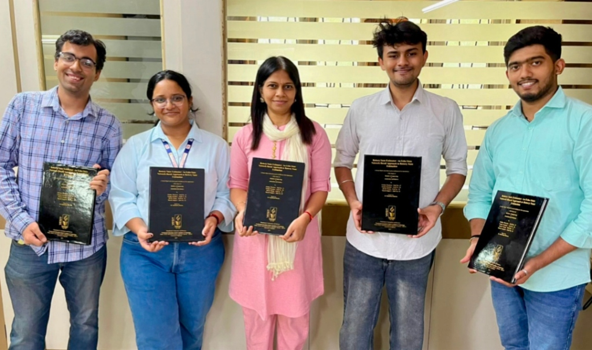
</p>

> **Departmental Sign-Off & Major Project Conclusion:**  
> The student investigators (**Akshay Nambiar**, **Sanjna Patankar**, **Satvik Verma**, **Tanish Sanghvi**) alongside Project Guide / Mentor **Dr. Kadambari Sharma** presenting the official hardbound gold-embossed "Black Book" capstone dissertations approved by the Department of Automation and Robotics / Instrumentation at VESIT Chembur (University of Mumbai). With this formal departmental sign-off, the Major Project degree requirement is fulfilled, all deliverables are accepted, and the undergraduate engineering capstone journey is officially concluded on an accomplished note.

---

## References

```text
[1] G. L. Plett, "Extended Kalman filtering for battery management systems of LiPB-based HEV battery packs," Journal of Power Sources, vol. 134, no. 2, pp. 277-292, 2004.
[2] H. Jaeger and H. Haas, "Harnessing Nonlinearity: Predicting Chaotic Systems and Saving Energy in Wireless Communication," Science, vol. 304, no. 5667, pp. 78-80, 2004.
[3] P. Li et al., "Joint estimation of SOC and SOH for lithium-ion batteries based on EKF multiple time scales," Journal of Intelligent Manufacturing, 2020.
[4] L. Rigutini et al., "State-of-charge estimation of lithium-ion batteries using reservoir computing," IEEE Transactions on Industrial Electronics, 2020.
```

---

## Repository Update Guidelines

Each student team must update the GitHub repository regularly.

Minimum expected updates:
* Update README every week.
* Push code changes regularly.
* Upload circuit diagrams, CAD files, PCB files, reports and presentations.
* Add weekly progress in the progress table.
* Maintain proper folder structure.
* Do not upload unnecessary temporary files.
* Each major update should have a meaningful commit message.

Example commit messages:
```text
Added problem statement and objectives
Updated system architecture diagram
Added sensor interfacing code
Updated weekly progress for Week 3
Added testing results and prototype images
```

---

## Declaration

We declare that this project work is carried out by our team as part of the BE Capstone Project. The work will be regularly updated on GitHub and all references used will be properly cited.

---

## License

This project is licensed under the **[MIT License](LICENSE)** with an academic attribution clause.

* **License Terms:** [`LICENSE`](LICENSE)
* **Authors, Mentors & Attribution:** [`AUTHORS.md`](AUTHORS.md)
* **Citation Records (BibTeX / APA):** [`CITATION.cff`](CITATION.cff)
* **Contribution Guidelines:** [`CONTRIBUTING.md`](CONTRIBUTING.md)
* **Code of Conduct:** [`CODE_OF_CONDUCT.md`](CODE_OF_CONDUCT.md)
* **Security & Vulnerability Policy:** [`SECURITY.md`](SECURITY.md)

### Academic Citation
When citing this repository or using its code, telemetry datasets, C99 firmware, or Verilog HDL IP block (`v2.4.2`), please cite:
```bibtex
@article{nambiar2026bitexact,
  author      = {Nambiar, Akshay and Patankar, Sanjna and Verma, Satvik and Sanghvi, Tanish and Sharma, Kadambari and Warke, Nilima},
  title       = {A Bit-Exact Fixed-Point FPGA Echo State Network for Lithium-Ion Battery SOC Estimation with an Exploratory SOH Readout},
  journal     = {BE Capstone Experimental Manuscript \& IEEE / Q3 Scopus Submission (`docs/Publications/Research_Paper.pdf`)},
  institution = {Vivekanand Education Society's Institute of Technology (VESIT)},
  year        = {2026},
  version     = {2.4.2}
}
```
