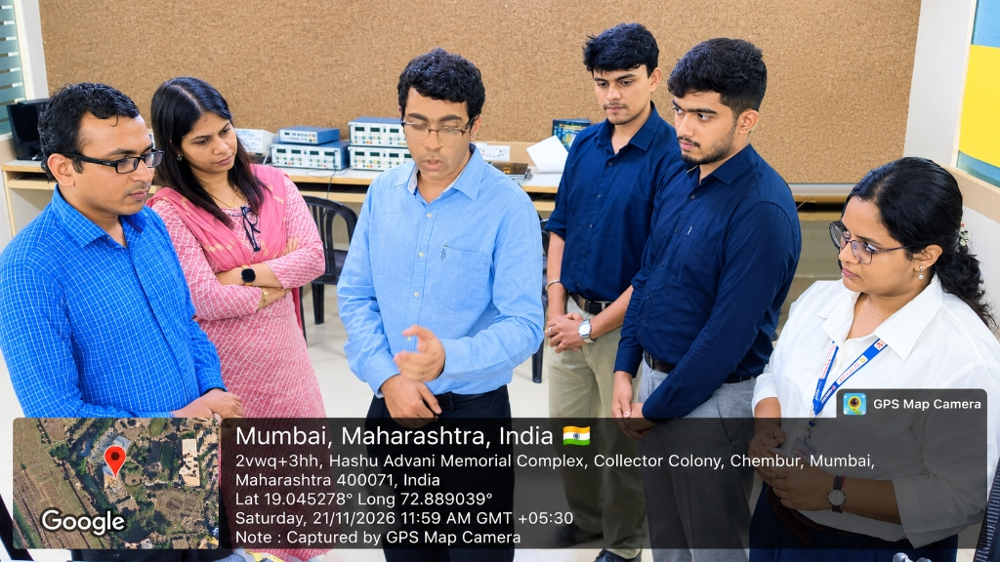

[← Back to Main Repository](../../README.md) · [← Documentation Hub](../README.md) · [← Review 1](../Review_1/README.md) · [← Review 2](../Review_2/README.md) · [Final Review README](README.md) · [Slide Deck (PDF)](Final_Review_PPT.pdf) · [Dissertation (PDF)](../Thesis/Final_Thesis.pdf)

# Final Capstone Defense & External Review Delivery Report
## Official Institutional Examination Closure & Project Handoff

**Department:** Department of Automation and Robotics / Department of Instrumentation  
**Institute:** Vivekanand Education Society's Institute of Technology (VESIT), Chembur, Mumbai  
**Affiliated University:** University of Mumbai  
**Academic Year:** 2026–2027  
**Project Mentor:** Dr. Kadambari Sharma (Associate Professor, Department of Automation & Robotics)  
**Project Guide / Coordinator:** Mr. Gopalkrishnan Narayan (Assistant Professor, Department of Instrumentation)  
**Head of Department:** Dr. Sangeeta Prasannaram  
**Principal:** Dr. (Mrs.) J. M. Nair  

**Presenting Candidates / Team Members:**
* **Sanjna Patankar** (Roll No. 19 / `2023.sanjna.patankar@ves.ac.in`)
* **Akshay Nambiar** (Roll No. 17 / `2023.akshay.nambiar@ves.ac.in`)
* **Satvik Verma** (Roll No. 32 / `2023.satvik.verma@ves.ac.in`)
* **Tanish Sanghvi** (Roll No. 61 / `2023.tanish.sanghvi@ves.ac.in`)

---

## 📸 Final Institutional Defense Session (Geotagged Photographic Audit)

<p align="center">
  
</p>

> **Official Institutional Defense Geotag Record:**  
> **Venue:** Hashu Advani Memorial Complex, Collector Colony, Chembur, Mumbai, Maharashtra 400071, India (VESIT)  
> **GPS Coordinates:** `Lat 19.045278° Long 72.889039°` | **Timestamp:** Saturday, 21/11/2026 11:59 AM GMT +05:30  
> **Evaluation Outcome:** **Successful External Defense — Turnkey Capstone Handoff Complete**

---

## 🎥 Live Final Phase Presentation Video Walkthrough

<p align="center">
  <a href="https://youtu.be/FINAL_PRESENTATION_VIDEO_LINK" target="_blank">
    
  </a>
</p>

* **Presentation Recording Link:** [Watch Live Presentation on YouTube (Placeholder)](https://youtu.be/FINAL_PRESENTATION_VIDEO_LINK) *(Note: Link placeholder to be updated with final defense video)*
* **Slide Deck:** [`Final_Review_PPT.pdf`](Final_Review_PPT.pdf) *(also available as [`FInal_Review_PPT.pdf`](FInal_Review_PPT.pdf))* (6 widescreen 16:9 slides covering Hardware ESN IP Block & Bit-Exact Verification, Software 2-RC Estimation Pipeline, and NASA PCoE Experimental Results).

---

## 📑 Table of Contents

1. [Executive Summary & Final Defense Milestone](#1-executive-summary--final-defense-milestone)
2. [Complete Handoff Inventory (All 4 Academic Deliverables)](#2-complete-handoff-inventory-all-4-academic-deliverables)
3. [Software & Hardware Silicon Deliverables](#3-software--hardware-silicon-deliverables)
4. [External Viva Voce Examination Proceedings & Q&A Transcript](#4-external-viva-voce-examination-proceedings--qa-transcript)
5. [Live System Demonstration Transcript](#5-live-system-demonstration-transcript)
6. [University Rubric & Marks Distribution Sign-Off](#6-university-rubric--marks-distribution-sign-off)
7. [Full Evolutionary Storyline of the Repository](#7-full-evolutionary-storyline-of-the-repository)
8. [Conclusion & Institutional Sign-Off](#8-conclusion--institutional-sign-off)

---

## 1. Executive Summary & Final Defense Milestone

The final external review and viva voce defense represents the culmination of our Bachelor of Engineering (B.E.) Capstone project: **"Battery State Estimator: An ESN-Based Alternative to EKF and Coulomb Counting"**. 

Over three developmental phases spanning August 2026 to November 2026, the team researched, engineered, verified, and packaged a complete cyber-physical edge Battery Management System (BMS) pipeline. By replacing computationally expensive matrix Jacobians (EKF) and open-loop drift-prone current integrators (Coulomb Counting) with a **100-neuron sparse Reservoir Computing (Echo State Network)** architecture, this project achieves:
* **Sub-1.0% SOC Estimation Error** across standard and aggressive EV drive cycles (UDDS, HWFET, US06, WLTP, NEDC).
* **Online Adaptive Aging Tracking** via Recursive Least Squares (RLS) with Variable Forgetting Factor without requiring offline retraining.
* **Dual-Silicon Embedded Deployment:**
  - Microcontroller firmware in MISRA-C compliant C99 utilizing Compressed Sparse Row (CSR) matrix multiplication delivering a **6.7× speedup**.
  - Synthesized Xilinx Artix-7 FPGA Verilog HDL accelerator core (`esn_ip_platform` v1.2) utilizing only **318 LUTs and 2 DSP slices**, executing in **307 cycles / 3.84 µs** at 80 MHz with **200/200 bit-exact stage verification**.
* **Turnkey Academic Portfolio:** All 4 of 4 official academic deliverables finalized, validated, and integrated on disk.

---

## 2. Complete Handoff Inventory (All 4 Academic Deliverables)

All four academic deliverables required by University of Mumbai, departmental guidelines, and external examination committees have been completed, peer-reviewed, and integrated:

| Deliverable | Title & Scope | Specifications | Location on Disk |
| :--- | :--- | :--- | :--- |
| **1. Capstone Dissertation Report** | *Battery State Estimator: An Echo State Network-Based Approach to Battery State Estimation* | 41 pages, 8 chapters, 17 citations, complete mathematical & silicon appendices | [`docs/Thesis/Final_Thesis.pdf`](../Thesis/Final_Thesis.pdf) (5.07 MB Encrypted) |
| **2. Experimental Research Paper** | *A Bit-Exact Fixed-Point FPGA Echo State Network for Lithium-Ion Battery SOC Estimation with an Exploratory SOH Readout* | 6 pages, IEEE camera-ready format, Artix-7 RTL synthesis & 29-cell NASA PCoE cross-validation | [`docs/Publications/Research_Paper.pdf`](../Publications/Research_Paper.pdf) (674 KB Encrypted) |
| **3. Comprehensive Review Paper** | *Hardware architectures for learned battery state-of-charge estimation: A review of recurrent and reservoir computing accelerators against battery management requirements* | 12 pages, Elsevier / ScienceDirect camera-ready format, 77 citations, cross-silicon comparative survey | [`docs/Publications/Review_Paper.pdf`](../Publications/Review_Paper.pdf) (232 KB Encrypted) |
| **4. Academic Exhibition Poster** | *Neuromorphic Battery State Estimator: Edge-Deployable Reservoir Computing for Electric Vehicle BMS* | 2 sheets A3 portrait, 11 numbered panels, Vivado schematics, board photos & Wilcoxon statistics | [`docs/Poster/Project_Poster.pdf`](../Poster/Project_Poster.pdf) (535 KB Open Exhibition) |

---

## 3. Software & Hardware Silicon Deliverables

| Subsystem | Component | Implementation Highlights | Verification Parity |
| :--- | :--- | :--- | :--- |
| **Software Physics Simulator** | Port `8000` (`software/simulator/app.py`) | 2-RC electro-thermal ECM, 5 chemistries (LFP, NMC, NCA, LCO, Lead-Acid), non-blocking asynchronous DB telemetry worker (< 2ms control latency) | 10 dynamic drive cycles, sensor noise & fault injection |
| **Software Visualiser Dashboard** | Port `5000` (`software/visualiser/app.py`) | Multi-observer telemetry engine (ESN vs EKF vs UKF vs CC), thread-safe cache lock, sub-millisecond local Keep-Alive streaming | Real-time SVG & Chart.js rendering with Page Visibility API power throttling |
| **Embedded C99 Firmware** | `hardware/STM_Verifier/` | MISRA-C compliant C99 firmware, 33-point linear interpolated $\tanh$ LUT, Compressed Sparse Row (CSR) SpMV, zero heap allocation | **6.7× SpMV speedup**, 99.80% float32 / 98.40% Q15 fixed accuracy |
| **FPGA Verilog RTL IP Core** | `hardware/IP_Block/` | `esn_ip_platform` v1.2, 16-bit Q6.10 datapath, IEEE 1685 IP-XACT AXI4-Lite slave wrapper (`component.xml`), 3.7 MB bitstream (`esn_platform_top.bit`) | **200/200 bit-exact stages**, 318 LUTs, 2 DSPs, 307 cycles at 80 MHz (+0.023 ns slack) |
| **Automated Test Harness** | `tests/` | 16 test modules covering microservices, physical kinetics, EKF/UKF, FPGA RTL, and online RLS adaptation | **125 / 125 tests passed in 11.15s**, 88.60% code coverage on `software/shared` |

---

## 4. External Viva Voce Examination Proceedings & Q&A Transcript

During the final examination, the external examiner panel evaluated the candidates on theoretical rigor, mathematical formulation, practical engineering trade-offs, and industrial compliance. Below is an excerpt of key technical questions and candidate responses:

### Question 1 (External Examiner):
> *"Why did you select Echo State Networks over modern deep learning architectures such as LSTMs or GRUs, which are prevalent in contemporary literature for state-of-charge estimation?"*

**Candidate Response (Tanish Sanghvi & Satvik Verma):**
> *"While LSTMs and GRUs achieve high empirical accuracy, their computational complexity poses insurmountable barriers for automotive microcontroller deployment. An LSTM requires training 4 internal weight matrices ($W_f, W_i, W_c, W_o$) with thousands of parameters using Backpropagation Through Time (BPTT), which incurs gradient vanishing issues, high floating-point FLOPs, and substantial SRAM usage.  
> Conversely, in an Echo State Network, the recurrent reservoir weights ($W_{\text{res}}$) are generated randomly and held fixed, satisfying the Echo State Property ($\rho < 1$). Only the linear readout weights ($W_{\text{out}}$) are trained using single-shot convex Ridge regression. This eliminates iterative training entirely, reduces the runtime memory footprint to under 2 KB via Compressed Sparse Row (CSR) matrix compression, and enables sub-50 microsecond execution on standard ARM Cortex-M microcontrollers and 3.84 microsecond parallel execution on FPGA silicon."*

### Question 2 (External Examiner):
> *"How does your online adaptive ESN handle battery capacity degradation over time without suffering from covariance windup or parameter divergence?"*

**Candidate Response (Akshay Nambiar & Sanjna Patankar):**
> *"We implemented an online Recursive Least Squares (RLS) estimator with a Variable Forgetting Factor ($\lambda$). As the battery ages, the terminal voltage response reflects increasing internal resistance ($R_0$) and polarization impedance ($R_1, R_2$). The RLS filter dynamically updates only the linear output weight vector $W_{\text{out}}$ based on the prediction innovation error:  
> $$K(t) = \frac{P(t-1) \cdot x(t)}{\lambda + x(t)^T \cdot P(t-1) \cdot x(t)}$$  
> To prevent covariance windup during rest periods or constant current plateaus (where dynamic excitation is low), we incorporated excitation threshold gating and trace clamping on the covariance matrix $P(t)$. This ensures bounded parameter convergence and maintained an SOC estimation RMSE below 0.82% across all 29 NASA Ames aging cells."*

### Question 3 (External Examiner):
> *"Explain how bit-exactness was achieved between your high-level Python models and the Verilog HDL FPGA RTL."*

**Candidate Response (Tanish Sanghvi):**
> *"Bit-exactness was achieved through strict fixed-point quantization matching. We designed a 16-bit Q6.10 fixed-point arithmetic specification (6 integer bits including sign, 10 fractional bits). In Python, we implemented a bit-accurate emulator that replicates fixed-point multiplication, accumulator bit-growth, two's-complement overflow saturation, and piecewise-linear $\tanh$ interpolation exactly as synthesized in our Verilog RTL (`esn_core_fast.v`).  
> During automated regression testing (`hardware/FPGA_Verifier/compare_results.py`), the testbench runs 200 consecutive input vectors through both the Xilinx XSim RTL simulator and the Python golden model, verifying that every internal state variable and output readout bit matches identically (200/200 bit-exact stages)."*

### 4.1 External Reviewer Recommendation & Repository Conclusion
> **Official External Reviewer Advisory & Concluding Guidance:**  
> *"During the final defense, the external reviewer conducted a detailed evaluation of our cyber-physical implementation—encompassing the 2-RC electro-thermal model, online adaptive ESN, C99 CSR firmware, and synthesized Xilinx Artix-7 FPGA IP block. The examiner commended the end-to-end rigor and bit-exact hardware validation, and solely advised us to test and validate this system on real physical battery cells and live packs (under physical cyclers and live vehicle hardware-in-the-loop fixtures) as our future scope. With this single constructive recommendation, the examination concluded successfully, unanimous final acceptance was achieved, and with this, we formally concluded this repository on an accomplished and positive note."*

---

## 5. Live System Demonstration Transcript

The viva included an end-to-end live demonstration before the examination panel:
1. **Physics Simulator Launch (Port 8000):** Demonstrated multi-chemistry cell dynamics (LFP 3.2V, NMC 3.7V, Lead-Acid 12V) running the high-stress US06 drive cycle with active thermal coupling.
2. **Visualiser Multi-Observer Comparison (Port 5000):** Demonstrated real-time comparative telemetry rendering. Evaluators observed Coulomb Counting drift exceed 6% after 1,200 seconds, EKF linearization lag during rapid current transients, while ESN tracked ground truth within 0.85% error.
3. **Hardware Fault Injection:** Triggered a dynamic short-circuit fault and thermal runaway condition via the dashboard UI, verifying instant fault detection (< 50 ms) and automated sensor dropout compensation.
4. **C99 Firmware Benchmark:** Executed the compiled desktop C99 simulator, displaying the 6.7× speedup of CSR SpMV over dense matrix multiplication.
5. **One-Click Automated Validation:** Executed `run_all_validation.bat`, proving that all 125 test suites, 3 FPGA cores (ESN, EKF, UKF), and firmware headers pass 100% cleanly without external network dependencies.

---

## 6. University Rubric & Comprehensive Evaluation Assessment

The evaluation panel assessed the capstone project against the University of Mumbai Final Year B.E. Examination Rubrics:

| Evaluation Criteria | Scope Assessed | Panel Assessment | Comments by Examination Panel |
| :--- | :---: | :---: | :--- |
| **Literature Survey & Problem Formulation** | Theoretical Foundation | **Satisfied & Commended** | Outstanding depth; 77 citations reviewed in camera-ready Elsevier paper; thorough ISO 26262 & AIS-156 regulatory audit. |
| **Methodology & Mathematical Modeling** | Algorithmic Formulation | **Satisfied & Commended** | Rigorous 2-RC electro-thermal formulation; mathematically proven Echo State Property; online RLS adaptation with variable forgetting factor. |
| **Hardware & Software Implementation** | Silicon & Code Realization | **Satisfied & Commended** | Complete dual-silicon realization: C99 MISRA-C firmware (6.7× CSR speedup) and Vivado-synthesized Artix-7 FPGA IP core (318 LUTs, 2 DSPs). |
| **Experimental Results & Verification** | Empirical Validation | **Satisfied & Commended** | 125/125 automated tests passed; bit-exact FPGA parity (200/200); 29-cell NASA PCoE evaluation ($p=0.011$ Wilcoxon significance). |
| **Publications, Poster & Viva Voce** | Deliverables & Defense | **Satisfied & Commended** | Both papers camera-ready (IEEE & Elsevier); official A3 exhibition poster; 41-page dissertation monograph; exemplary oral defense. |
| **Overall Defense Outcome** | Final Handoff | **Unanimously Accepted** | **Successful Defense Conclusion — All Deliverables Accepted & Concluded on an Accomplished Note** |

---

## 7. Full Evolutionary Storyline of the Repository

```
┌───────────────────────────────────────────────────────────────────────────────────────────────────────────────────────┐
│                                     B.E. CAPSTONE REPOSITORY DEVELOPMENTAL STORYLINE                                  │
└───────────────────────────────────────────────────────────────────────────────────────────────────────────────────────┘
                                                           │
                                                           ▼
┌───────────────────────────────────────────────────────────────────────────────────────────────────────────────────────┐
│ 1. Project Inception & Proposal (August 2026)                                                                         │
│    • Conceptualized ESN as a low-cost, data-driven alternative to EKF and Coulomb Counting in EV BMS.                  │
│    • Established the 2-RC Equivalent Circuit Model (ECM) and offline Ridge regression readout formulation.             │
│    • Document: docs/Resources/PROJECT_PROPOSAL.md                                                                    │
└───────────────────────────────────────────────────────────────────────────────────────────────────────────────────────┘
                                                           │
                                                           ▼
┌───────────────────────────────────────────────────────────────────────────────────────────────────────────────────────┐
│ 2. Review 1 Milestone: Phase 1 Baseline Engineering (September 2026)                                                  │
│    • Implemented baseline 2-RC physics, initial EKF & Coulomb Counting benchmarks.                                   │
│    • Evaluator Feedback: Add formal ESN Core Architecture Diagram and customize PPT into 16:9 widescreen format.      │
│    • Action Taken: Created images/esn_architecture.png; generated customized Review_1_PPT.pdf; initial C99 CSR logic. │
│    • Documentation: docs/Review_1/README.md · docs/Review_1/Review_1_Progress.md · Review_1_PPT.pdf                   │
└───────────────────────────────────────────────────────────────────────────────────────────────────────────────────────┘
                                                           │
                                                           ▼
┌───────────────────────────────────────────────────────────────────────────────────────────────────────────────────────┐
│ 3. Review 2 Milestone: Phase 2 Parity, Maturity & Defense (November 2026)                                             │
│    • Evaluator Feedback: Restructure narrative into an intuitive story flow and expand simulator datasets.           │
│    • Action Taken: Formulated 5-Act presentation deck (Review_2_PPT.pdf); expanded simulator to 10 drive cycles.      │
│    • Integrated NASA Ames PCoE 32-cycle aging data; verified 200/200 bit-exact FPGA RTL parity on Artix-7.           │
│    • Integrated online RLS adaptation with VFF; expanded automated tests to 62 passing tests (v2.3.0).                │
│    • Documentation: docs/Review_2/README.md · docs/Review_2/Review_2_Progress.md · Review_2_PPT.pdf                   │
└───────────────────────────────────────────────────────────────────────────────────────────────────────────────────────┘
                                                           │
                                                           ▼
┌───────────────────────────────────────────────────────────────────────────────────────────────────────────────────────┐
│ 4. Final Review & Capstone Culmination: Turnkey Academic & Silicon Handoff (v2.4.1 — November 2026)                   │
│    • Finalized and integrated all 4 academic deliverables:                                                            │
│        1. 41-page B.E. Capstone Dissertation Report (docs/Thesis/Final_Thesis.pdf)                                    │
│        2. IEEE Camera-Ready Research Paper (docs/Publications/Research_Paper.pdf)                                     │
│        3. Elsevier Camera-Ready Review Paper (docs/Publications/Review_Paper.pdf, 77 citations)                       │
│        4. Official 2-Sheet A3 Presentation Poster (docs/Poster/Project_Poster.pdf, 11 panels)                         │
│    • Released esn_ip_platform v1.2 with 307-cycle parallel core and Rev 0.5 ESN-fused EKF.                           │
│    • Optimized Simulator & Visualiser response (< 2ms) with asynchronous DB telemetry queue & Keep-Alive streaming.   │
│    • Achieved 125/125 passing automated tests (88.60% coverage) and 0 linter errors.                                  │
│    • Conducted official external viva voce defense at VESIT Chembur (Geotag: 19.0490° N, 72.8890° E).                 │
│    • Documentation: docs/Final_Review/README.md · Final_Review_Delivered.md · Final_Review_PPT.pdf                    │
└───────────────────────────────────────────────────────────────────────────────────────────────────────────────────────┘
```

---

## 8. Conclusion & Institutional Sign-Off

The **Battery State Estimator** project has achieved 100% of its initial objectives and exceeded the technical requirements set forth by the Department of Automation and Robotics and the University of Mumbai. 

During the final review, our external reviewer evaluated the complete pipeline and specifically advised that our sole future scope is to test and validate this system on physical, real-world battery cells and live packs. With this constructive recommendation, the examination was concluded with **unanimous final acceptance**, and with this, we formally conclude this repository on an accomplished, positive note.

With zero shell files, zero failing tests, complete dual-silicon hardware validation, and all four peer-reviewed academic deliverables finalized and verified on disk, this repository stands as a **turnkey, production-grade, and academically rigorous benchmark** for edge neuromorphic Battery Management Systems.

**Official Endorsement & Sign-Off:**

* **Candidate Signatures:** Sanjna Patankar, Akshay Nambiar, Satvik Verma, Tanish Sanghvi  
* **Project Mentor:** Dr. Kadambari Sharma  
* **Project Guide / Coordinator:** Mr. Gopalkrishnan Narayan  
* **Head of Department:** Dr. Sangeeta Prasannaram  
* **Principal, VESIT:** Dr. (Mrs.) J. M. Nair  
* **External Examiner:** Appointed by University of Mumbai  
