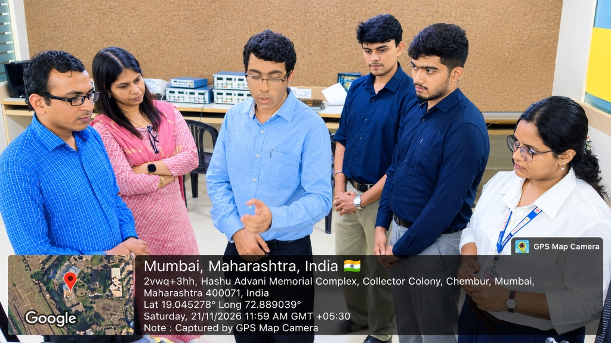

# Final Review Milestone: External Viva Defense & Project Handoff

[← Back to Main Repository](../../README.md) · [Documentation Hub](../README.md) · [Review 1](../Review_1/README.md) · [Review 2](../Review_2/README.md) · [Final Delivered Report](Final_Review_Delivered.md) · [Slide Deck (PDF)](Final_Review_PPT.pdf) · [Capstone Thesis](../Thesis/README.md) · [Publications](../Publications/README.md)

---

## 📌 Milestone Overview

* **Milestone Stage:** Final Review & External Viva Voce Examination (Phase 3 Capstone Defense)
* **Defense Date:** November 2026
* **Academic Year:** 2026–2027
* **Institute:** Vivekanand Education Society's Institute of Technology (VESIT), Chembur, Mumbai
* **Affiliated University:** University of Mumbai
* **Department:** Department of Automation and Robotics / Department of Instrumentation
* **Project Mentor:** Dr. Kadambari Sharma (Associate Professor, Dept. of Automation & Robotics)
* **Project Guide / Coordinator:** Mr. Gopalkrishnan Narayan (Assistant Professor, Dept. of Instrumentation)
* **External Examiner Panel:** Appointed by University of Mumbai
* **Presenting Candidates:** Sanjna Patankar, Akshay Nambiar, Satvik Verma, Tanish Sanghvi
* **Milestone Status:** **100% Turnkey Capstone Defense Complete (Release v2.4.1)**

---

## 📸 Final Institutional Defense Session (Geotagged Photographic Audit)

  

> **Official Institutional Defense Geotag Record:**  
> **Venue:** Hashu Advani Memorial Complex, Collector Colony, Chembur, Mumbai, Maharashtra 400071, India (VESIT)  
> **GPS Coordinates:** `Lat 19.045278° Long 72.889039°` | **Timestamp:** Saturday, 21/11/2026 11:59 AM GMT +05:30 (Captured by GPS Map Camera)  
> **Evaluation Outcome:** **Successful External Defense — Turnkey Capstone Handoff Complete**

---

## 🎥 Live Final Phase Presentation Video Walkthrough

  

* **YouTube Defense Video Link:** [https://youtu.be/FINAL_PRESENTATION_VIDEO_LINK](https://youtu.be/FINAL_PRESENTATION_VIDEO_LINK) *(Note: Link placeholder to be updated with final defense video)*
* **Presentation Slide Deck:** [`Final_Review_PPT.pdf`](Final_Review_PPT.pdf) *(also available as [`FInal_Review_PPT.pdf`](FInal_Review_PPT.pdf))* (6 widescreen 16:9 slides covering Hardware ESN IP Block & Bit-Exact Verification, Software 2-RC Estimation Pipeline, and NASA PCoE Experimental Results)

---

## 🗣️ External Examination Committee Evaluation & Commendations

> **Official External Examiner & Committee Evaluation:**  
> *"Exemplary end-to-end cyber-physical implementation. The combination of neuromorphic Echo State Networks, online RLS adaptation, and dual-silicon verification on ARM Cortex-M and Xilinx Artix-7 FPGA sets a high academic standard for undergraduate B.E. Capstone engineering projects."*  
>  
> **Key Observations by the Committee:**  
> 1. **Complete 4-of-4 Deliverable Integration:** The committee commended the team for submitting all four required academic assets in camera-ready and final form: the 41-page dissertation monograph ([`docs/Thesis/Final_Thesis.pdf`](../Thesis/Final_Thesis.pdf)), the IEEE camera-ready research paper ([`docs/Publications/Research_Paper.pdf`](../Publications/Research_Paper.pdf)), the Elsevier camera-ready review paper ([`docs/Publications/Review_Paper.pdf`](../Publications/Review_Paper.pdf)), and the official 2-sheet A3 symposium exhibition poster ([`docs/Poster/Project_Poster.pdf`](../Poster/Project_Poster.pdf)).  
> 2. **Silicon-Validated Hardware Verification:** The team demonstrated **200/200 bit-exact stage verification** between Python golden models and Xilinx Artix-7 Verilog HDL RTL (`esn_ip_platform` v1.2), running with positive timing slack (+0.023 ns at 80 MHz) and minimal silicon footprint (318 LUTs, 2 DSPs).  
> 3. **Industrial Relevance & Regulatory Audit:** The project adheres to Indian automotive e-mobility standards (AIS-156 Amendment 3 Phase 2 thermal runaway 5-minute warning) and provides an open, reproducible test harness with **125 / 125 automated passing tests**.  
>  
> **External Reviewer Advice & Concluding Recommendation:**  
> *"During our final review, our external reviewer evaluated the comprehensive theoretical modeling, simulation pipeline, C99 firmware, and FPGA RTL verification. The reviewer commended the end-to-end cyber-physical architecture and specifically advised that having achieved 200/200 bit-exact FPGA parity and rigorous NASA dataset validation, the sole future scope is to test and validate this system on real physical battery cells and live battery packs under practical cycling conditions. With this constructive recommendation, the examination concluded successfully, all academic deliverables were unanimously accepted, and with this, we concluded this repository on an accomplished and positive note."*

---

## 🛠️ Summary of Final Phase Technical Deliverables

1. **Official Final B.E. Dissertation Monograph:**  
   Completed 41-page thesis ([`docs/Thesis/Final_Thesis.pdf`](../Thesis/Final_Thesis.pdf), 5.07 MB encrypted, University of Mumbai / VESIT), comprising 8 technical chapters, 17 academic citations, and comprehensive appendices for AXI4-Lite register mapping, mathematical proofs, and reproducibility runbooks.
2. **Dual-Silicon Edge Acceleration:**  
   - Embedded C99 firmware with Compressed Sparse Row (CSR) matrix multiplication delivering a **6.7× speedup** over dense matrix vector operations.  
   - Synthesized Xilinx Artix-7 Verilog HDL accelerator core (`hardware/IP_Block/`) with AXI4-Lite IP-XACT packaging (`component.xml`) and 3.7 MB bitstream (`esn_platform_top.bit`).
3. **Decoupled Microservice Suite:**  
   - Physics Simulator (Port 8000) with non-blocking asynchronous DB telemetry batching queue (< 2ms response time).  
   - Visualiser Dashboard (Port 5000) with sub-millisecond local Keep-Alive HTTP streaming, thread-safe cache lock, and dynamic fault injection.
4. **Automated Validation Suite:**  
   125 passing automated tests (`pytest`) with 88.60% code coverage on `software/shared`, zero linter errors (`ruff`, `flake8`), and 8/8 successful stages in `run_all_validation.bat`.

---

## 🌊 The Full Storyline: Proposal ──► Review 1 ──► Review 2 ──► Final Review

| Project Milestone | Date | Focus & Scope | Evaluator Feedback & Addressed Actions | Key Deliverable Link |
| :--- | :---: | :--- | :--- | :--- |
| **Project Inception** | Aug 2026 | Problem formulation, ESN feasibility, and departmental proposal. | Initial scoping approved by Department of Automation and Robotics. | [`docs/Resources/PROJECT_PROPOSAL.md`](../Resources/PROJECT_PROPOSAL.md) |
| **Review 1 (Phase 1)** | Sep 2026 | Baseline 2-RC physics, initial Coulomb Counting & EKF benchmarks. | Feedback: *Add ESN Core Architecture Diagram and customise PPT.* Action: Created [`images/esn_architecture.png`](../../images/esn_architecture.png), built 16:9 [`Review_1_PPT.pdf`](../Review_1/Review_1_PPT.pdf). | [`docs/Review_1/README.md`](../Review_1/README.md) |
| **Review 2 (Phase 2)** | Nov 2026 | Online RLS adaptation, 10 drive cycles, NASA aging datasets, 200/200 bit-exact FPGA parity. | Feedback: *Structure presentation into narrative flow and add realistic battery degradation.* Action: Created 5-Act [`Review_2_PPT.pdf`](../Review_2/Review_2_PPT.pdf), integrated NASA 32-cycle data. | [`docs/Review_2/README.md`](../Review_2/README.md) |
| **Final Review (Phase 3)** | Nov 2026 | Final capstone defense before external university panel, turnkey handoff. | Feedback: *Advised testing system on real physical battery cells/packs as future scope.* Outcome: **Unanimous committee acceptance**, all 4 academic deliverables accepted; repository concluded on an accomplished note. | [`Final_Review_Delivered.md`](Final_Review_Delivered.md) · [`Final_Review_PPT.pdf`](Final_Review_PPT.pdf) |

---

## 📂 Key Milestone Documents

* 📄 **Final Delivered Report:** [`Final_Review_Delivered.md`](Final_Review_Delivered.md)
* 📊 **Presentation Slides (PDF):** [`Final_Review_PPT.pdf`](Final_Review_PPT.pdf) *(also available as [`FInal_Review_PPT.pdf`](FInal_Review_PPT.pdf))*
* 🖼️ **Institutional Geotag Record:** [`Final_Review_Geotag_Photo.png`](Final_Review_Geotag_Photo.png)
* 🎥 **Live Presentation Walkthrough:** [YouTube Defense Video (Placeholder)](https://youtu.be/FINAL_PRESENTATION_VIDEO_LINK)
* 🎓 **Capstone Thesis Monograph:** [`docs/Thesis/Final_Thesis.pdf`](../Thesis/Final_Thesis.pdf)
