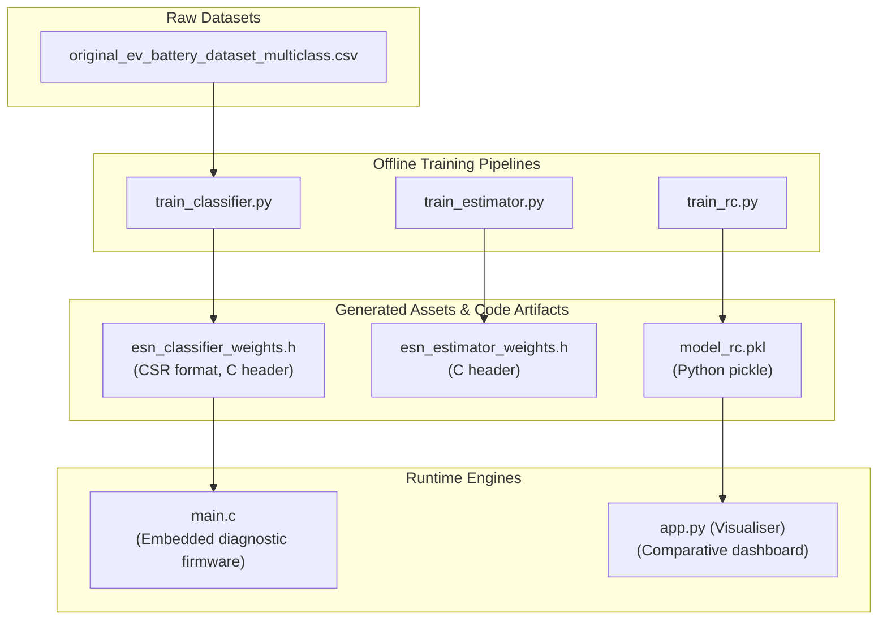

[← Back to README](../../README.md)

# Artifact Policy

This document outlines the versioning, maintenance and generation guidelines for the dataset and model weights stored within this repository. To ensure reviewers and evaluators can immediately run the visualization and edge diagnostic demonstrations, a pre-compiled set of model parameters is tracked.

---

## Artifact Generation & Deployment Flow

The diagram below details how source datasets feed into the training scripts to produce the serialized model assets and embedded C headers:

---

## Tracked Repository Artifacts

The table below catalogs all model parameters, datasets and generated headers tracked in Git:

| File path | Format | Typical Size | Role | Source / Generator | Versioning Policy |
| :--- | :--- | :--- | :--- | :--- | :--- |
| [`software/visualiser/datasets/original_ev_battery_dataset_multiclass.csv`](../../software/visualiser/datasets/original_ev_battery_dataset_multiclass.csv) | CSV | ~360 KB | Canonical training/validation dataset shared by Visualiser & STM Verifier (with optional local CSV override). | Synthesized battery sensor logs. | Canonical dataset reference. |
| [`software/visualiser/model_rc.pkl`](../../software/visualiser/model_rc.pkl) | PKL | ~600 KB | Local fallback model for the visualiser ESN estimator (zlib-compressed CSR reservoir, used when MongoDB is offline). | Trained via [`train_rc.py`](../../software/visualiser/training/train_rc.py). | Regenerated upon tuning model hyperparameters. |
| [`hardware/STM_Verifier/esn_classifier_weights.h`](../../hardware/STM_Verifier/esn_classifier_weights.h) | H (C Header) | ~13 KB | Generated sparse classifier weights consumed by [`main.c`](../../hardware/STM_Verifier/main.c). | Exported via [`train_classifier.py`](../../hardware/STM_Verifier/train_classifier.py). | Re-exported whenever the classifier ESN is retrained. |
| [`hardware/STM_Verifier/esn_estimator_weights.h`](../../hardware/STM_Verifier/esn_estimator_weights.h) | H (C Header) | ~1.3 MB | Generated sparse estimator weights for embedded testing. | Exported via [`train_estimator.py`](../../hardware/STM_Verifier/train_estimator.py). | Updated on observer pipeline refinements. |
| [`hardware/FPGA_Verifier/esn/mem/input_bram.coe`](../../hardware/FPGA_Verifier/esn/mem/input_bram.coe) | COE | ~2.5 KB | NASA B0005 battery dataset quantized to Q6.10 for 64-step RTL simulation. | Derived from NASA Ames battery dataset. | Locked reference dataset for FPGA simulation. |
| [`hardware/FPGA_Verifier/golden_results.csv`](../../hardware/FPGA_Verifier/golden_results.csv) | CSV | ~12 KB | Bit-exact Python golden reference outputs across all 200 neuron evaluation stages. | Generated via [`golden_model.py`](../../hardware/FPGA_Verifier/golden_model.py). | Verified golden parity reference. |
| [`hardware/FPGA_Verifier/golden_tiny.csv`](../../hardware/FPGA_Verifier/golden_tiny.csv) | CSV | ~1 KB | Sequential 3-timestep tiny test golden reference output. | Generated via [`golden_model.py --tiny`](../../hardware/FPGA_Verifier/golden_model.py). | Verified sequence parity reference. |
| [`hardware/FPGA_Verifier/vivado_esn_results.csv`](../../hardware/FPGA_Verifier/vivado_esn_results.csv) | CSV | ~12 KB | Vivado XSim RTL simulation output logged from [`tb_esn_top.v`](../../hardware/FPGA_Verifier/esn/tb/tb_esn_top.v). | Vivado XSim simulator testbench dump. | Matches golden_results.csv bit-exactly (200/200). |
| [`hardware/IP_Block/component.xml`](../../hardware/IP_Block/component.xml) | XML | ~43 KB | IEEE 1685 IP-XACT component descriptor for Vivado IP Catalog packaging. | Generated via [`scripts/package_esn_ip.tcl`](../../hardware/IP_Block/scripts/package_esn_ip.tcl). | Production IP-XACT deliverable for Vivado integration. |
| [`hardware/IP_Block/esn_platform_top.bit`](../../hardware/IP_Block/esn_platform_top.bit) | BIT | ~3.7 MB | Complete ready-to-program serial FPGA bitstream for Digilent Arty A7-100T. | Synthesized & routed via Vivado 2023.1 (`scripts/build_platform.tcl`). | Hardware deployment bitstream deliverable. |
| [`hardware/IP_Block/rtl/esn_axi_ip.v`](../../hardware/IP_Block/rtl/esn_axi_ip.v) | Verilog | ~12 KB | Top-level reusable AXI4-Lite control and AXI4-Stream data ESN IP module (`FAST=0/1`). | Authored Verilog HDL. | Core IP Block RTL deliverable (supports [`esn_core_fast.v`](../../hardware/IP_Block/rtl/esn_core_fast.v)). |
| [`hardware/IP_Block/host/packs/general_32cells/`](../../hardware/IP_Block/host/packs/general_32cells/) | Pack (`.mem` / `.json`) | Variable | General 32-cell NASA PCoE pack & 29 held-out packs (`heldout/pack_<cell>`) + NARMA-10 packs. | Generated via [`train_pack.py`](../../hardware/IP_Block/host/train_pack.py). | Verified bit-exact v1.2 hardware/software twin model packs. |
| [`docs/Review_2/Outcomes/FPGA-Based-Echo-State-Network-for-Battery-SOC-SOH-Estimation-Outcomes.pdf`](../Review_2/Outcomes/FPGA-Based-Echo-State-Network-for-Battery-SOC-SOH-Estimation-Outcomes.pdf) | PDF | ~150 KB | Official outcomes evaluation report for 32 NASA cycles, synthesis & timing closure. | Verified via [`eval_fpga_outcomes.py`](../../hardware/FPGA_Verifier/eval_fpga_outcomes.py). | Formal Review 2 outcome deliverable. |
| [`docs/Poster/Project_Poster.pdf`](../Poster/Project_Poster.pdf) | PDF | Variable | Official BE Capstone Academic Exhibition & Defense Poster shell. | Authored presentation deliverable. | **Pending v2.4.1** (1 of 3 Remaining). |
| [`docs/Publications/Review_Paper.pdf`](../Publications/Review_Paper.pdf) | PDF | Variable | Comprehensive Review Paper shell targeting IEEE / Q3 Scopus (companion draft in `Review_2/Outcomes/`). | Authored academic manuscript. | **Pending v2.4.1** (2 of 3 Remaining). |
| [`docs/Publications/Research_Paper.pdf`](../Publications/Research_Paper.pdf) | PDF | ~668 KB | Camera-ready 6-page IEEE Experimental Research Paper. | Authored academic manuscript. | **Completed & Integrated (v2.4.0)**. |
| [`docs/Review_2/Outcomes/Neuromorphic-BMS-Review-Paper-Draft.pdf`](../Review_2/Outcomes/Neuromorphic-BMS-Review-Paper-Draft.pdf) | PDF | ~500 KB | 29-page comprehensive review paper draft on Neuromorphic BMS & Reservoir Computing. | Compiled academic manuscript. | Review 2 deliverable (v2.4.0 reference). |
| [`docs/Review_2/Review_2_PPT.pdf`](../Review_2/Review_2_PPT.pdf) | PDF | ~570 KB | Official 16:9 widescreen presentation slide deck for Review 2 defense. | Standalone 16:9 widescreen presentation deck. | Formal Review 2 defense slide deck. |
| [`docs/Thesis/Final_Thesis.pdf`](../Thesis/Final_Thesis.pdf) | PDF | Variable | Official B.E. Capstone Dissertation Report shell adhering to University of Mumbai guidelines. | Authored academic dissertation report. | **Pending v2.4.1** (3 of 3 Remaining). |
| [`CHANGELOG.md`](../../CHANGELOG.md) | MD | ~4 KB | Formal versioning history and release notes log (v2.4.0 active today, v2.4.1 planned turnkey). | Maintained in repository root. | Updated upon every milestone/tag release. |

---

## 🚫 What NOT to Commit

> [!CAUTION]
> The root `.gitignore` file enforces exclusion rules. Do not bypass it to commit:
> - Local configuration scripts or `.env` files.
> - Raw local database dumps, temporary runtime logs, or telemetry playback caches.
> - Local python virtual environments (`venv`, `.venv`) and compiler outputs (`.o`, `.elf`, `.hex`, `.exe`).
> - Temp python caches (`__pycache__`, `.pytest_cache`).

---

## 🔁 Updating Artifacts

When submitting a pull request that updates any tracked model or dataset, the submitter must document the following in the commit message or PR description:

1. **Training Command**: The exact python execution script and arguments used.
2. **Dataset Version**: The source files and dataset timestamps used.
3. **Metrics Log**: The validation criteria met (e.g., classification accuracy percentage, estimator RMSE bounds).
4. **Justification**: A brief rationale explaining why the pre-trained weights need updating in Git instead of running dynamic local training.
