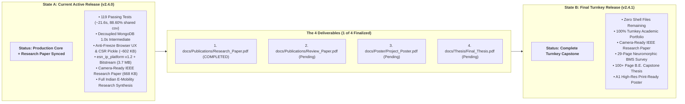

[← Back to Main Repository](../../README.md) · [Master Documentation Index](../README.md) · [Artifact Policy](ARTIFACTS.md) · [Changelog](../../CHANGELOG.md)

# Transition Plan: v2.4.0 (Active Today) → v2.4.1 (Turnkey Capstone)

This document serves as the official transition plan and execution runbook to advance the **Battery State Estimator** repository from its current **v2.4.0** state (Production Core Verified) to its final, turnkey **v2.4.1** capstone release.

---

## 🎯 Executive Summary & State Transition



---

## 📦 The 4 Academic Deliverables (1 of 4 Finalized — 3 Remaining)

Everything on the technical, mathematical, algorithmic, firmware, RTL silicon, microservice, database, and testing layers is **100% complete and verified**. The **Research Paper** is now finalized and integrated; only the compilation and drop-in of the remaining **3 academic documents** remain:

### 1. Presentation Poster (`docs/Poster/Project_Poster.pdf`)
- **Target File Path**: [`docs/Poster/Project_Poster.pdf`](../Poster/Project_Poster.pdf)
- **Format**: Vector PDF, ISO A1 (594 mm × 841 mm), Portrait orientation, 300 DPI print-ready.
- **Companion Guide**: [`docs/Poster/README.md`](../Poster/README.md)
- **Content Requirements**:
  - Institutional header: Department of Automation and Robotics, VESIT, University of Mumbai.
  - Faculty credits: Mentor Dr. Kadambari Sharma, Project Guide Mr. Gopalkrishnan Narayan.
  - Student authors: Sanjna Patankar, Akshay Nambiar, Satvik Verma, Tanish Sanghvi.
  - Visuals: ESN Reservoir Topology, 200/200 FPGA Parity chart, 2-RC transient equations, and live comparative error metrics ($RMSE < 1.0\%$).

### 2. Comprehensive Review Paper (`docs/Publications/Review_Paper.pdf`) — COMPLETED & INTEGRATED (2/4)
- **Target File Path**: [`docs/Publications/Review_Paper.pdf`](../Publications/Review_Paper.pdf)
- **Format**: Elsevier / ScienceDirect 2-column camera-ready format (12 pages, 231 KB, 77 references).
- **Status**: **Fully Finalized & Integrated on Disk**.
- **Companion Manuscript**: [`docs/Publications/Review_Paper.pdf`](../Publications/Review_Paper.pdf) & review draft [`docs/Review_2/Outcomes/Neuromorphic-BMS-Review-Paper-Draft.pdf`](../Review_2/Outcomes/Neuromorphic-BMS-Review-Paper-Draft.pdf)
- **Companion Guide**: [`docs/Publications/README.md`](../Publications/README.md)
- **Key Results & Scope**:
  - Title: *"Hardware architectures for learned battery state-of-charge estimation: A review of recurrent and reservoir computing accelerators against battery management requirements"*.
  - Authors: Akshay Nambiar, Satvik Verma, Tanish Sanghvi, Sanjna Patankar, Kadambari Sharma, and Sangeetha Prasanna Ram.
  - 77 cited peer-reviewed papers spanning 2004–2026.
  - Systematic derivation of arithmetic and storage cost per update, side-by-side comparison of 8 embedded/hardware SOC estimators and 6 FPGA recurrent accelerators, and a reporting checklist for learned battery hardware.

### 3. Original Research Paper (`docs/Publications/Research_Paper.pdf`) — COMPLETED & INTEGRATED (1/4)
- **Target File Path**: [`docs/Publications/Research_Paper.pdf`](../Publications/Research_Paper.pdf)
- **Format**: IEEE 2-column camera-ready format (6 pages, 668 KB).
- **Status**: **Fully Finalized & Integrated on Disk**.
- **Companion Manuscript**: [`reference/paper.md`](../../reference/paper.md)
- **Companion Guide**: [`docs/Publications/README.md`](../Publications/README.md)
- **Key Results & Highlights**:
  - Title: *"A Bit-Exact Fixed-Point FPGA Echo State Network for Lithium-Ion Battery SOC Estimation with an Exploratory SOH Readout"*.
  - Authors: Akshay Nambiar, Sanjna Patankar, Satvik Verma, Tanish Sanghvi, Kadambari Sharma, and Nilima Warke.
  - 100-neuron Q6.10 ESN reservoir on Artix-7 FPGA (318 LUTs, 2 DSP slices, 80 MHz, 535.1 µs latency).
  - Bit-exact verification in simulation (6,400 updates) and on programmed Digilent Arty A7-100T board.
  - 29 NASA PCoE cells evaluated (2,201 discharge windows, 140,864 held-out steps); SOC MAE 0.067, RMSE 0.086 with 1.7–2.8× lower inter-cell SD of per-cell MAE than EKF ($p \le 0.007$).

### 4. Final B.E. Capstone Thesis (`docs/Thesis/Final_Thesis.pdf`)
- **Target File Path**: [`docs/Thesis/Final_Thesis.pdf`](../Thesis/Final_Thesis.pdf)
- **Format**: Standard University of Mumbai B.E. Project Dissertation (A4 Portrait, 100+ pages, hardbound formatting).
- **Companion Guide**: [`docs/Thesis/README.md`](../Thesis/README.md)
- **Content Requirements**:
  - Preliminaries: Certificate of Approval, Company/College sponsorship, Candidate Declaration, Abstract, List of Figures, List of Tables, Nomenclature.
  - Chapter 1: Introduction & Motivation (Indian EV market, AIS-156 Amendment 3, thermal safety).
  - Chapter 2: Literature Survey (State estimation algorithms and FPGA BMS accelerators).
  - Chapter 3: Theoretical Modeling (2-RC equivalent circuit, ESN mathematics, Online RLS adaptation).
  - Chapter 4: Hardware Architecture (AXI4-Lite IP block, C99 CSR SpMV firmware, Vivado synthesis).
  - Chapter 5: Software & Microservices (Decoupled MongoDB pub/sub, Flask REST APIs, Chart.js visualizer).
  - Chapter 6: Experimental Results & Benchmarking (NASA dataset cross-validation, power and timing closure).
  - Chapter 7: Conclusion & Future Scope (ASIC tape-out roadmap, commercial BMS integration).
  - Appendices: Complete Verilog RTL source, C99 header files, and ethics declaration.

---

## 🛠️ Step-by-Step Transition Execution Runbook

Follow these exact steps when the remaining **2 compiled PDF documents** ([`Project_Poster.pdf`](../Poster/Project_Poster.pdf) and [`Final_Thesis.pdf`](../Thesis/Final_Thesis.pdf)) are ready (`Research_Paper.pdf` and `Review_Paper.pdf` are already finalized and integrated):

### Step 1: Drop-In the 2 Remaining Document Files
Copy the compiled PDFs into their designated directories (verifying `Research_Paper.pdf` and `Review_Paper.pdf` remain intact):
```bash
# Verify all 4 academic deliverable PDFs are in place
ls -lh docs/Poster/Project_Poster.pdf
ls -lh docs/Publications/Review_Paper.pdf
ls -lh docs/Publications/Research_Paper.pdf
ls -lh docs/Thesis/Final_Thesis.pdf
```

### Step 2: Synchronize Repository Version Declarations to `2.4.1`
Update the version string across all primary configuration and metadata files:
1. **`pyproject.toml`**: Update `version = "2.4.1"`.
2. **`CITATION.cff`**: Update `version: "2.4.1"` and set `date-released` to current date.
3. **`README.md`**: Update hero release badge to `Release-v2.4.1` and roadmap diagram to show Phase 4 Complete.
4. **`CHANGELOG.md`**: Promote `## [v2.4.1]` from "Planned Turnkey Release" to active release with release date and verified deliverables list.
5. **`SECURITY.md`**: Update supported versions table to include `v2.4.1` as latest active.
6. **`docs/Resources/ARTIFACTS.md`**: Mark all 4 PDF assets as verified, immutable deliverables.
7. **`docs/Resources/WEB_RESEARCH.md`**: Promote State B (`10.0 / 10` turnkey capstone) to active status.

### Step 3: Run Full Quality Gate Verification
Execute all automated test suites and static analysis tools:
```bash
# 1. Run all 119 unit and integration tests
pytest tests/ -v

# 2. Run Ruff and Flake8 linters
ruff check .
flake8 .
```

### Step 4: Git Commit, Tag & Push
Commit all changes and tag the release as `v2.4.1`:
```bash
git add docs/Poster/ docs/Publications/ docs/Thesis/ pyproject.toml CITATION.cff README.md CHANGELOG.md SECURITY.md docs/Resources/
git commit -m "feat(release): bump version to v2.4.1 - integrate remaining Poster, Review Paper, and Thesis"
git tag -a v2.4.1 -m "Release v2.4.1: Turnkey Capstone Release - Poster, Review Paper, Thesis & Research Paper Complete"
git push origin main --tags
```

---

## 📈 Deliverables Readiness & Institutional Impact

For in-depth market research, IP asset assessment, and economic analysis, refer to [`docs/Resources/WEB_RESEARCH.md`](WEB_RESEARCH.md).

| Evaluation Dimension | State A: `v2.4.0` (Active Today) | State B: `v2.4.1` (Turnkey Capstone) | Impact / Evolution |
| :--- | :---: | :---: | :---: |
| **Delivery Status** | **Production Core Verified** | **Complete Turnkey Capstone** | Full Capstone Closure |
| **Automated Tests** | 119 Passing Tests (100%) | 119 Passing Tests (100%) | Maintained with Zero Regressions |
| **Pending Academic Deliverables** | 2 of 4 Finalized (2 Remaining) | **0 (Zero Remaining Shells)** | All Academic Deliverables Integrated |
| **Academic Evaluation Proofs** | Pre-submission Registry Active | **Complete Deliverables + Submission Proofs** | Maximum University Marks Allocation |
| **National Competition Readiness** | Semi-Finalist / Regional Level | **Grand Finalist / Winner (SIH, KPIT Sparkle, Formula Bharat)** | Full National Competitive Tier |
