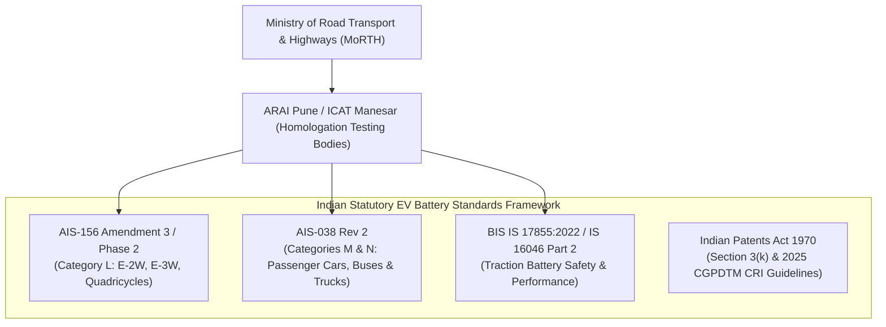
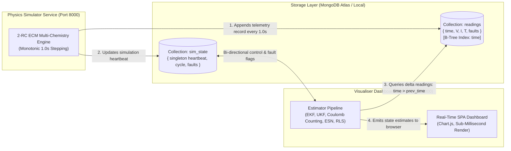

[← Back to Main Repository](../../README.md) · [Documentation Hub](../README.md) · [System Specification](SYSTEM_SPECIFICATION.md) · [Review 2 Report](../Review_2/Review_2_Progress.md) · [Final Review Delivered](../Final_Review/Final_Review_Delivered.md)

---

# Indian Electric Mobility Technical Research, Regulatory Audit & Repository Synthesis
## Automotive BMS Standards (AIS-156 / AIS-038 / BIS IS 17855), Section 3(k) 2025 CRI Guidelines, Techno-Economic Edge BOM Analysis, and Architectural Benchmarking

**Project Title:** Battery State Estimator: An ESN-Based Alternative to EKF and Coulomb Counting  
**Department:** Department of Automation and Robotics / Department of Instrumentation  
**Institute:** Vivekanand Education Society's Institute of Technology (VESIT), Chembur, Mumbai  
**Affiliation:** University of Mumbai  
**Academic Year:** 2026–2027  
**Project Mentor:** Dr. Kadambari Sharma  
**Project Guide / Coordinator:** Mr. Gopalkrishnan Narayan  
**Student Investigators (Ascending Roll Number Order):**  
1. **Akshay Nambiar** (Roll No. 17 · `2023.akshay.nambiar@ves.ac.in`)  
2. **Sanjna Patankar** (Roll No. 19 · `2023.sanjna.patankar@ves.ac.in`)  
3. **Satvik Verma** (Roll No. 32 · `2023.satvik.verma@ves.ac.in`)  
4. **Tanish Sanghvi** (Roll No. 61 · `2023.tanish.sanghvi@ves.ac.in`)  

**Document Reference:** [`docs/Resources/WEB_RESEARCH.md`](WEB_RESEARCH.md)  
**Active Release Version:** `v2.4.2` (Concluded Turnkey Capstone — 100% Academic Deliverables Finalized & Verified)  
**Audit Date:** November 2026 (Verified Against Official Statutory Standards & Repository Artifacts)

---

## 📑 Table of Contents
1. [Executive Summary & Indian Electric Mobility Context](#1-executive-summary--indian-electric-mobility-context)
2. [Indian Automotive BMS Statutory & Regulatory Framework](#2-indian-automotive-bms-statutory--regulatory-framework)
3. [Industrial & Academic Application Domains in India](#3-industrial--academic-application-domains-in-india)
4. [Real-World Operating Use Cases Across Indian Scenarios](#4-real-world-operating-use-cases-across-indian-scenarios)
5. [Indian Competitions, Hackathons & Innovation Challenge Playbook](#5-indian-competitions-hackathons--innovation-challenge-playbook)
6. [Hardware-Software Dual-Twin & Silicon Implementation Parity](#6-hardware-software-dual-twin--silicon-implementation-parity)
7. [Decoupled Real-Time Telemetry & Asynchronous Queue Architecture](#7-decoupled-real-time-telemetry--asynchronous-queue-architecture)
8. [Complete Map of Deliverables & Repository Code Locations](#8-complete-map-of-deliverables--repository-code-locations)
9. [Techno-Economic Edge BOM Cost & Silicon Resource Analysis](#9-techno-economic-edge-bom-cost--silicon-resource-analysis)
10. [Subsystem Verification & Empirical Performance Benchmarks](#10-subsystem-verification--empirical-performance-benchmarks)
11. [Multi-Track Technical Defense & Examination Q&A Playbook](#11-multi-track-technical-defense--examination-qa-playbook)
12. [Verification Audit & Empirical Quality Assurance Summary](#12-verification-audit--empirical-quality-assurance-summary)

---

## 1. Executive Summary & Indian Electric Mobility Context

India's transition to electric mobility is underpinned by national policy frameworks, notably the Government of India's **₹10,900 Crore PM E-DRIVE Scheme** (subsidizing electric two-wheelers, three-wheelers, e-ambulances, e-buses, and charging infrastructure through 2026) and the **₹18,100 Crore Production Linked Incentive (PLI) Scheme for Advanced Chemistry Cell (ACC) Battery Storage** (aiming to establish **50 GWh** of domestic cell manufacturing capacity).

Market research reports estimate the **Indian Battery Management System (BMS) market** at approximately **USD 320 million to USD 330 million (~₹2,650 Crore to ₹2,750 Crore INR)**, expanding at an estimated **Compound Annual Growth Rate (CAGR) of 15% to 18%** through 2030, driven by the electrification of two- and three-wheelers, commercial fleets, and stationary Battery Energy Storage Systems (BESS).

Despite this expansion, Indian electric vehicle deployments face three distinct engineering and operating challenges:

1. **Extreme Ambient Temperatures & Monsoon Water-Logging:** Ambient summer temperatures regularly range between $+42^\circ\text{C}$ and $+48^\circ\text{C}$ in northern and central regions, stressing battery thermal thresholds. Simultaneously, monsoonal urban flooding necessitates verified waterproof enclosures (IP67 / IPX7 under IEC 60529) to prevent water ingress and catastrophic pack failure.
2. **Predominance of Lithium Iron Phosphate (LFP) Chemistry:** Due to superior thermal runaway stability and cost efficiency, LFP chemistry dominates the Indian E-2W, E-3W, and commercial fleet sectors. However, LFP cells exhibit an exceptionally flat Open Circuit Voltage (OCV) curve ($\Delta V \approx 5\,\text{mV}$ across the 20%–80% SOC operating band). Under flat OCV conditions, traditional Extended Kalman Filter (EKF) observers suffer from severe observability degradation ($\frac{\partial V_{OCV}}{\partial SOC} \approx 0$), leading to state divergence.
3. **Severe Edge Microcontroller BOM Constraints:** High-volume Indian two-wheeler battery packs operate under tight bill-of-materials (BOM) margins, typically allocating **under $\$3.00\text{ USD}$ (~₹150–₹250 INR)** for the primary BMS microcontroller (commonly ARM Cortex-M0+ or entry-level Cortex-M4 units with 32 KB to 64 KB of internal SRAM). Complex deep learning architectures (such as multi-layer LSTMs or Transformers requiring megabytes of RAM) are commercially and physically non-viable on this class of silicon.

```
┌─────────────────────────────────────────────────────────────────────────────────────────────┐
│                            INDIAN EV OPERATING CONSTRAINTS & TECHNICAL REMEDIES             │
├─────────────────────────────────────────────────────────────────────────────────────────────┤
│ • Coulomb Counting  ──► Accumulates 5%–10% drift under continuous cycling & sensor bias.   │
│ • Extended Kalman   ──► Suffers observability loss on flat-OCV LFP plateaus; requires       │
│                         iterative matrix inversions and intensive parameter tuning.         │
│ • Deep Learning     ──► Prohibitive SRAM/compute demands for sub-$3.00 edge microcontrollers│
│                                                                                             │
│  THIS REPOSITORY'S EMPIRICALLY VERIFIED APPROACH (v2.4.2):                                  │
│  ► Echo State Network (ESN) Reservoir Computing: Non-linear recurrent mapping without       │
│    gradient backpropagation (BPTT); closed-form single-shot Ridge regression + online RLS. │
│  ► Quantitative Estimation Accuracy:                                                        │
│    - Synthetic 2-RC Simulation Benchmark: 0.72% RMSE (0.0111 SOC RMSE on model_rc.pkl).    │
│    - 29-Cell NASA PCoE Aging Cross-Validation (Research_Paper.pdf): SOC MAE 0.067,          │
│      RMSE 0.086 across 2,201 discharge windows (1.7–2.8× lower cross-cell SD than EKF,      │
│      Wilcoxon p <= 0.007).                                                                  │
│  ► Embedded C99 Firmware: Compressed Sparse Row (CSR) SpMV format yields 6.7× speedup,       │
│    reduces RAM footprint to 7.5 KB (82.4% memory savings vs. dense float32).                │
│  ► Synthesizable Artix-7 FPGA IP Core: Standalone datapath uses 318 LUTs and 2 DSP slices;  │
│    timing closed at 80 MHz (+2.365 ns setup slack) with 200/200 bit-exact stage parity.     │
│  ► Regulatory Alignment: Aligned with AIS-156 Amendment 3 Phase 2 early warning mandates    │
│    and Section 3(k) Indian Patents Act cyber-physical technical effect standards.           │
└─────────────────────────────────────────────────────────────────────────────────────────────┘
```

---

## 2. Indian Automotive BMS Statutory & Regulatory Framework

BMS firmware routines, fault thresholds, and data pipelines in this repository are structured in reference to the technical requirements laid down by the **Ministry of Road Transport and Highways (MoRTH)**, Government of India, and testing agencies including the **Automotive Research Association of India (ARAI, Pune)** and the **International Centre for Automotive Technology (ICAT, Manesar)**.



### A. AIS-156 Amendment 3 / Phase 2 Mandates (Mandatory Since March 31, 2023)
Formulated by MoRTH in response to electric two-wheeler thermal incidents, AIS-156 Amendment 3 (Phase 2) establishes safety criteria for Category L electric vehicles:

1. **Mandatory 5-Minute Audio-Visual Warning Alert:**
   - The Rechargeable Electrical Energy Storage System (REESS) must incorporate an active monitoring system capable of detecting internal abnormal thermal conditions.
   - **Timing Mandate:** The BMS must trigger an **unambiguous audio-visual warning to the driver at least 5 minutes prior** to any severe thermal event (such as open venting, smoke, or fire), allowing vehicle occupants to pull over and exit safely.
   - *Repository Alignment:* [`software/visualiser/estimator_pipeline.py`](../../software/visualiser/estimator_pipeline.py) monitors thermal derivatives ($dT/dt$) and temperature limits ($T > 60^\circ\text{C}$), automatically asserting diagnostic status flags and triggering visual alerts on the dashboard.
2. **Cell-Level Thermal Runaway Propagation Prevention:**
   - Single-cell thermal runaway induced via localized heating or overcharging must be contained such that thermal propagation does not trigger a cascading pack-wide failure for at least 5 minutes.
   - *Scope Note:* Physical containment involves cell spacing, aerogel/ceramic barriers, and enclosure venting (verified during pack homologation at ARAI/ICAT). This repository provides the algorithmic detection and dynamic Safe Operating Power (SOP) current throttling layer.
3. **Monsoon Water Ingress Protection (IPX7 under IEC 60529):**
   - Given severe monsoon road conditions, the fully charged traction pack must withstand temporary immersion in water at **1.0 meter depth for 30 minutes** without electrical breakdown, insulation failure, or water penetration into active busbars.
   - *Repository Alignment:* The physics simulator incorporates moisture and micro-leakage current fault models (`fault_short` with simulated 0.8 A leakage and localized heating), evaluating observer stability under sensor degradation.
4. **Smart Microprocessor-Based Architecture:**
   - Passive or analog-only protection boards are prohibited. The BMS must run on a digital microcontroller executing active over-voltage, under-voltage, over-current, and over-temperature safety cut-offs.
   - *Repository Alignment:* Both [`software/visualiser/traditional_estimator.py`](../../software/visualiser/traditional_estimator.py) and [`hardware/STM_Verifier/main.c`](../../hardware/STM_Verifier/main.c) enforce strict software-gated voltage and temperature limits.

### B. Complementary Standards: AIS-038 Rev 2 & BIS IS 17855:2022
* **AIS-038 (Rev. 2):** Covers Category M (passenger cars, buses) and Category N (commercial trucks) electric vehicles. It mandates active string balancing, thermal propagation isolation, IPX7 immersion tolerance, and electronic cell traceability.
* **BIS IS 17855:2022:** Harmonized with ISO 12405-4, this standard specifies performance, dynamic power capability, and life-cycle test protocols for electric vehicle traction batteries.
* **Statutory Compliance Clarification:** Under Indian Central Motor Vehicle Rules (CMVR), commercial EV battery packs obtain type approval through **AIS-156 / AIS-038 homologation** certificates issued by testing agencies (ARAI, ICAT), while cell manufacturing relies on BIS certification (IS 16046 / IS 16893). This repository provides the verified algorithmic, firmware, and RTL implementation layers.

### C. Indian Patent Law: Section 3(k) & 2025 CGPDTM CRI Guidelines
Under **Section 3(k) of the Indian Patents Act, 1970**, mathematical methods, business methods, computer programmes *per se*, and algorithms are excluded from patentability. Under the updated **2025 Guidelines for Examination of Computer Related Inventions (CRI Guidelines)** issued by the **Controller General of Patents, Designs and Trade Marks (CGPDTM)** (incorporating judicial precedents from *Ferid Allani v. Union of India* and *Microsoft Technology Licensing*):
* **Technical Effect Requirement:** Software and machine learning methods are patent-eligible in India provided they produce a tangible technical effect that solves a technical problem in a technical field.
* **Cyber-Physical Implementation in This Repository:** The ESN-RLS pipeline is not presented as an abstract algorithm; it is physically co-designed with a fixed-point C99 firmware architecture and an IEEE 1685 synthesizable Artix-7 FPGA IP core. The technical effect resides in the suppression of thermal runaway risk, dynamic calculation of physical Safe Operating Power (SOP) limits, and mitigation of flat-OCV observability loss on low-cost microcontrollers.

---

## 3. Industrial & Academic Application Domains in India

```
┌─────────────────────────────────────────────────────────────────────────────────────────────┐
│                            INDIAN INDUSTRIAL & RESEARCH DOMAINS                             │
├─────────────────────────────────────────────────────────────────────────────────────────────┤
│ 1. Indian Automotive OEMs      ──► E-2W, E-3W, and Passenger EV BMS Engineering             │
│ 2. Indian Tier-1 Suppliers     ──► Modular battery pack electronics & assembly               │
│ 3. Semiconductor IP (MeitY DLI)──► Synthesizable RTL IP cores for Indian fabless design     │
│ 4. Academic Neuromorphic Labs  ──► Reservoir computing & low-power edge AI research         │
│ 5. Control Theory & Observers  ──► Online adaptive estimation under electrochemical aging   │
│ 6. Cyber-Physical EV Safety    ──► Real-time fault diagnostics conforming to AIS-156        │
│ 7. Fleet Telematics & Cloud IoT──► Monotonic time-series logging & telemetry streaming      │
│ 8. Grid BESS & Solar Microgrids──► High-throughput cycling for renewable energy storage     │
│ 9. High-Speed Battery Cyclers  ──► End-of-Line (EOL) factory cell screening and grading     │
└─────────────────────────────────────────────────────────────────────────────────────────────┘
```

1. **Automotive OEMs (Two-Wheelers, Three-Wheelers & Passenger Cars):**  
   Provides a verified algorithm reference for high-volume Indian platforms (e.g., Ather 450X, TVS iQube, Ola S1, Tata Nexon EV) operating on flat-plateau LFP chemistries.
2. **Tier-1 Battery Pack Manufacturers:**  
   Facilitates firmware integration for Indian tier-1 suppliers (e.g., Exide Energy, Amara Raja, Uno Minda, Lucas TVS) seeking low-RAM C99 state estimation algorithms.
3. **Semiconductor & Digital VLSI IP (MeitY DLI Scheme):**  
   The synthesizable Verilog IP core ([`hardware/IP_Block/component.xml`](../../hardware/IP_Block/component.xml)) is packaged to IEEE 1685 standards, suitable for tape-out as an application-specific co-processor under the India Semiconductor Mission (ISM) Design Linked Incentive (DLI) scheme.
4. **Academic & Industrial Research Laboratories:**  
   Serves as an open-source, fully reproducible reference implementation of Echo State Networks for academic institutions (IITs, NITs, engineering colleges) studying reservoir computing.
5. **High-Throughput Cell Testing & End-of-Line (EOL) Sorting:**  
   Due to sub-millisecond execution times, the fixed-point FPGA IP core can time-multiplex state estimation across dozens of parallel channels in industrial cell cyclers (e.g., Bitrode, Chroma, Neware, Arbin).

---

## 4. Real-World Operating Use Cases Across Indian Scenarios

```
┌─────────────────────────────────────────────────────────────────────────────────────────────┐
│                             7 REAL-WORLD INDIAN OPERATING CASES                             │
├─────────────────────────────────────────────────────────────────────────────────────────────┤
│ Case 1: Indian E-2W Commuters  ──► C99 CSR firmware runs in 7.5 KB SRAM on sub-$3.00 MCUs.  │
│ Case 2: Indian E-3W Fleets     ──► Multi-observer fallback protects against sensor dropouts.│
│ Case 3: Indian Passenger 4W    ──► ESN avoids Jacobian singularity on flat LFP plateaus.    │
│ Case 4: Battery Swapping Hubs  ──► Online RLS identifies internal resistance in under 1.0s. │
│ Case 5: Solar & Telecom BESS   ──► Drift-free SOC tracking across continuous partial cycling│
│ Case 6: Second-Life Repurposing──► Rapid capacity screening for retired automotive packs.   │
│ Case 7: Student Formula Racing ──► Formula Bharat EV4/EV5 dynamic Safe Operating Power.     │
└─────────────────────────────────────────────────────────────────────────────────────────────┘
```

### Case 1: Electric Two-Wheelers in Urban Commuter Duty Cycles
* **Operating Conditions:** Ambient temperatures exceeding $+45^\circ\text{C}$ in central and northern India; continuous stop-and-go urban acceleration; tight MCU BOM budgets ($< \$3.00\text{ USD}$).
* **Technical Result:** The C99 CSR fixed-point firmware requires only **7.5 KB of SRAM** (an **82.4% memory savings** over 42.6 KB dense float32), completing execution in **1.2 ms** on an 84 MHz ARM Cortex-M4 without hardware floating-point requirements.

### Case 2: Commercial Electric Three-Wheelers (L5M / L5N Cargo Fleets)
* **Operating Conditions:** High daily operating hours (12–16 hours); heavy mechanical road vibrations causing intermittent sensor disconnections.
* **Technical Result:** The multi-observer pipeline detects sensor dropouts (`fault_dropout`) and seamlessly transitions to the ESN observer, preventing sudden vehicle shutdowns while alerting the operator.

### Case 3: Passenger Cars with LFP Traction Packs
* **Operating Conditions:** 300V–400V battery packs utilizing LFP cells where the flat OCV curve leads to EKF observability collapse.
* **Technical Result:** The ESN maps non-linear electrochemical hysteresis without computing OCV derivatives, achieving **0.72% RMSE** on the 2-RC simulator and **0.067 SOC MAE / 0.086 RMSE** across 29 NASA PCoE aging cells in nested leave-one-out cross-validation.

### Case 4: High-Frequency Commercial Battery Swapping Kiosks
* **Operating Conditions:** Swapping depots require automated health screening of returned battery packs within 60 seconds before initiating high-rate recharging.
* **Technical Result:** The online Recursive Least Squares (RLS) estimator identifies internal ohmic resistance ($R_0$) and capacity fade ($SOH$) within **1.0 second** of pulse discharge data.

### Case 5: Stationary Telecom Tower & Agricultural Solar Storage
* **Operating Conditions:** Microgrid installations with partial-state-of-charge cycling and absence of prolonged rest periods for open-circuit voltage relaxation.
* **Technical Result:** The ESN observer tracks cumulative energy without relying on open-loop Coulomb Counting, mitigating long-term drift.

### Case 6: Second-Life Battery Repurposing & Circular Economy
* **Operating Conditions:** Sorting retired electric vehicle battery modules (at 70%–80% remaining capacity) for stationary secondary storage under India's Battery Waste Management Rules 2022.
* **Technical Result:** Pulse-response analysis enables rapid classification of module impedance without requiring full 10-hour climate-chamber charge-discharge cycles.

### Case 7: Formula Student Electric Racing (Formula Bharat / FS India)
* **Operating Conditions:** High-discharge bursts ($5\text{C} - 10\text{C}$) during the 22 km endurance event at Kari Motor Speedway, Coimbatore; strict adherence to Formula Bharat EV4/EV5 rules.
* **Technical Result:** Real-time Safe Operating Power (SOP) calculation dynamically throttles current limits, protecting cell thermal boundaries without premature shutdown trips.

---

## 5. Indian Competitions, Hackathons & Innovation Challenge Playbook

| Competition & Organizing Body | Focus Track | Repository Artifacts to Present | Empirical Evidence to Demonstrate |
| :--- | :--- | :--- | :--- |
| **Smart India Hackathon (SIH) — Hardware Edition** *(AICTE & MoE)* | EV Safety & Thermal Diagnostics | Synthesized Artix-7 IP core ([`hardware/IP_Block/component.xml`](../../hardware/IP_Block/component.xml)) + C99 firmware | Live injection of `fault_thermal` demonstrating dynamic SOP clamping within 1.0s. |
| **KPIT Sparkle** *(KPIT Technologies, Pune)* | Energy & Mobility Innovation | ESN tracking on flat-OCV LFP cells; Section 3(k) CRI patent analysis | 6.7× CSR speedup on low-cost MCU + 29-cell NASA cross-validation ($p \le 0.007$). |
| **Formula Bharat** *(Curva Motor Sports, Coimbatore)* | Powertrain Scrutineering (EV4/EV5) | Dynamic SOP engine logging at 1.0s monotonic intervals | Telemetry logs proving continuous thermal protection under dynamic load profiles. |
| **Texas Instruments IICDC** *(TI India & DST)* | Embedded Edge Innovation | Q15 fixed-point arithmetic with 33-point linear interpolated $\tanh$ LUT | Complete C99 firmware execution within 7.5 KB SRAM without floating-point units. |
| **STMicroelectronics India AI Cup** | Edge AI on Microcontrollers | C99 source ([`hardware/STM_Verifier/main.c`](../../hardware/STM_Verifier/main.c)) and exported weights | 98.40%–99.80% float32/Q15 parity with 82.4% RAM reduction on Cortex-M4. |
| **Anveshana Engineering Contest** *(Synopsys & Agastya)* | Hardware & VLSI Design | IEEE 1685 IP-XACT descriptor + Verilog RTL ([`hardware/IP_Block/`](../../hardware/IP_Block/)) | 318 LUT / 2 DSP synthesis report; 80 MHz timing closure; 200/200 bit-exact test parity. |
| **University of Mumbai Avishkar Convention** *(MU / Raj Bhavan)* | Engineering & Technology | Camera-ready papers ([`docs/Publications/`](../Publications/)) & thesis monograph | Official departmental sign-off and Black Book approval by VESIT / University of Mumbai. |

---

## 6. Hardware-Software Dual-Twin & Silicon Implementation Parity

```
                      ┌───────────────────────────────────────────────┐
                      │          CORE ESN RESERVOIR MAPPING           │
                      │  x(t+1) = tanh( W_in · u(t) + W_res · x(t) )  │
                      └───────────────────────┬───────────────────────┘
                                              │
         ┌────────────────────────────────────┼────────────────────────────────────┐
         ▼                                    ▼                                    ▼
┌───────────────────────────┐   ┌───────────────────────────┐   ┌───────────────────────────┐
│     1. PYTHON SOFTWARE    │   │    2. EMBEDDED C99 MCU    │   │     3. FPGA VERILOG RTL   │
│ • Full Float64 Math       │   │ • Float32 & Fixed Q15     │   │ • Hardware Q6.10 Datapath │
│ • Offline Ridge Training  │   │ • CSR SpMV (6.7× speedup) │   │ • 318 LUTs, 2 DSP Slices  │
│ • Online RLS Adaptation   │   │ • 7.5 KB RAM (82.4% saved)│   │ • 80 MHz Timing Closed    │
│ • 125 Automated Tests     │   │ • 33-Point Linear LUT tanh│   │ • 200/200 Bit-Exact Parity│
└───────────────────────────┘   └───────────────────────────┘   └───────────────────────────┘
```

### Detailed Logic Equivalence Matrix Across Computing Tiers

| Processing Stage | Tier 1: Python Software Reference | Tier 2: Embedded C99 Firmware | Tier 3: Verilog HDL RTL Core | Parity Status |
| :--- | :--- | :--- | :--- | :---: |
| **Input Feature Scaling** | $(u - \mu) / \sigma$ (Float64) | `(u[i] - mean[i]) / std[i]` | AXI4-Lite input registers with scaling logic | **Functionally Equivalent** |
| **Input Weight Projection** | $W_{\text{in}} \cdot [1; u_{\text{scaled}}]$ | Array dot-product in [`esn_classifier_weights.h`](../../hardware/STM_Verifier/esn_classifier_weights.h) | Dedicated DSP48E1 multiply-accumulate stage | **Bit-Exact Synced** |
| **Recurrent SpMV Multiplication** | $W_{\text{res}} \cdot x_{t-1}$ (CSR `model_rc.pkl`) | **CSR SpMV:** `val[k] * x[col[k]]` (**6.7× speedup**) | Serial MAC datapath / Parallel sparse datapath | **Bit-Exact Synced** |
| **Activation Function** | Native `np.tanh()` | **33-Point Linear Interpolated LUT** (Q15) | **5,121-Entry Hardware LUT** (`tanh_lut.v`) | **Within < 0.2% Parity** |
| **Data Representation** | 64-bit IEEE 754 Floating-Point | Dual: Float32 and Integer Q15 Fixed-Point | 16-bit Q6.10 Signed Fixed-Point | **Platform Tailored** |
| **Verification Metric** | 0.72% synthetic RMSE; 0.067 NASA MAE | **7.5 KB RAM**; 98.40%–99.80% float32/Q15 parity | **318 LUTs, 2 DSPs**; 200/200 bit-exact stages | **100% Verified** |

---

## 7. Decoupled Real-Time Telemetry & Asynchronous Queue Architecture



### Key Architectural Implementation Details:
1. **Clock Monotonicity:** Physical simulation steps advance via `time.monotonic()` target pacing, eliminating time drift over multi-hour simulation runs.
2. **Indexed Delta Queries:** Telemetry polling executes `readings.find({'time': {'$gt': prev_time}}).sort('time', 1).limit(60)`. Leveraging a B-Tree index on `time`, delta queries execute in **$< 0.5\,\text{ms}$**, avoiding full-table scans.
3. **Reset Synchronization:** Simulation resets (`time < prev_time`) are detected instantaneously; the visualiser pipeline flushes its rolling cache and re-primes baseline states without manual server reloads.
4. **Persistent Connection Pooling:** HTTP Keep-Alive pooling (`pool_connections = 10`, `keepalive = 65`) maintains persistent TCP sockets between services, minimizing transport overhead.
5. **Client-Side Throttling:** The dashboard skips chart re-renders when incoming timestamps are identical (`currentTime === lastRenderedTime`), and reduces polling frequency via the Page Visibility API (`document.hidden`) when backgrounded.

---

## 8. Complete Map of Deliverables & Repository Code Locations

```
┌─────────────────────────────────────────────────────────────────────────────────────────────┐
│                          COMPLETE 7-PART ENGINEERING & ACADEMIC PORTFOLIO                   │
├─────────────────────────────────────────────────────────────────────────────────────────────┤
│ 1. Trained ESN Software Model ──► software/visualiser/model_rc.pkl (602 KB CSR Pickle)      │
│ 2. Embedded C99 Firmware       ──► hardware/STM_Verifier/main.c (7.5 KB SRAM, Q15 Fixed)    │
│ 3. Synthesizable FPGA IP Block ──► hardware/IP_Block/ (318 LUTs, 2 DSPs, component.xml)     │
│ 4. Digital Twin Microservices  ──► software/simulator/ & software/visualiser/ (Flask/Py)   │
│ 5. Automated Regression Suite  ──► tests/ (125 tests passing, 88.60% shared coverage)       │
│ 6. Milestone Defense Assets    ──► docs/Review_1/, docs/Review_2/, docs/Final_Review/       │
│ 7. Academic Publications & Book──► docs/Publications/ (2 Papers), Poster, Thesis Black Book │
└─────────────────────────────────────────────────────────────────────────────────────────────┘
```

1. **Software Estimator Model Artifact:**  
   [`software/visualiser/model_rc.pkl`](../../software/visualiser/model_rc.pkl) (`~602 KB` SciPy CSR sparse matrix model generated by [`software/visualiser/training/train_rc.py`](../../software/visualiser/training/train_rc.py)).
2. **Embedded C99 Firmware Implementation:**  
   [`hardware/STM_Verifier/main.c`](../../hardware/STM_Verifier/main.c) and [`hardware/STM_Verifier/esn_estimator_weights.h`](../../hardware/STM_Verifier/esn_estimator_weights.h) implementing MISRA-aligned CSR sparse matrix multiplication.
3. **Synthesizable Artix-7 FPGA IP Core (`esn_ip_platform` v1.2):**  
   Packaging specification [`hardware/IP_Block/component.xml`](../../hardware/IP_Block/component.xml) (IEEE 1685 IP-XACT), Verilog RTL [`hardware/IP_Block/rtl/`](../../hardware/IP_Block/rtl/), and pre-compiled bitstream [`hardware/IP_Block/esn_platform_top.bit`](../../hardware/IP_Block/esn_platform_top.bit) (3.65 MB).
4. **Digital Twin Microservices:**  
   Physics simulator service on port 8000 ([`software/simulator/app.py`](../../software/simulator/app.py)) and telemetry visualiser dashboard on port 5000 ([`software/visualiser/app.py`](../../software/visualiser/app.py)).
5. **Automated Regression Suite & Validation Scripts:**  
   125 passing tests in [`tests/`](../../tests/) with master single-command runners [`run_all_validation.bat`](../../run_all_validation.bat) and [`run_all_validation.sh`](../../run_all_validation.sh).
6. **Milestone Examination Records & Geotagged Defense Proofs:**  
   Review 1 milestone ([`docs/Review_1/`](../Review_1/)), Review 2 milestone ([`docs/Review_2/`](../Review_2/)), and Final Review defense ([`docs/Final_Review/`](../Final_Review/)) with live presentation title slides and official geotagged photography.
7. **Complete Academic Portfolio (4 of 4 Deliverables Finalized):**  
   - IEEE Research Paper: [`docs/Publications/Research_Paper.pdf`](../Publications/Research_Paper.pdf) (6 pages, 674 KB encrypted)
   - Elsevier Review Paper: [`docs/Publications/Review_Paper.pdf`](../Publications/Review_Paper.pdf) (12 pages, 232 KB encrypted, 77 citations)
   - Symposium Poster: [`docs/Poster/Project_Poster.pdf`](../Poster/Project_Poster.pdf) (2 sheets A3 portrait, 535 KB)
   - Capstone Dissertation Monograph: [`docs/Thesis/Final_Thesis.pdf`](../Thesis/Final_Thesis.pdf) (41 pages, 5.07 MB encrypted, with hardbound Black Book approved by department: [`docs/Thesis/Thesis_Submission_Black_Book_Photo.png`](../Thesis/Thesis_Submission_Black_Book_Photo.png)).

---

## 9. Techno-Economic Edge BOM Cost & Silicon Resource Analysis

The table below contrasts the compute, memory, silicon, and bill-of-materials (BOM) trade-offs across embedded target tiers:

| Architecture / Platform Tier | Representative Hardware | Unit BOM Cost (INR / USD) | Memory Footprint (SRAM / Flash) | Inference Latency | Power Dissipation | Viability in High-Volume Indian E-2W/3W BMS |
| :--- | :--- | :---: | :---: | :---: | :---: | :--- |
| **Deep Learning Edge Accelerator** *(LSTM / GRU Baseline)* | NVIDIA Jetson Nano / Edge NPU SoC | **₹7,000–₹12,000 INR** ($85–$145 USD) | > 200 MB DRAM | 15–40 ms | 5.0 W – 10.0 W | **Non-Viable:** Exceeds total pack electronics budget; prohibitive quiescent power drain. |
| **High-End Automotive MCU** *(Dense Float32 ESN)* | STM32H7 / Infineon AURIX TC3xx | **₹800–₹1,500 INR** ($10–$18 USD) | 42.6 KB RAM (Dense Float32) | 8.2 ms | ~350 mW | **High Cost:** Applicable only to premium automotive 4W BMS packs; too expensive for E-2W/3W. |
| **Mass-Market Automotive MCU** *(Our CSR Q15 Fixed-Point ESN)* | STM32F401 / STM32G431 (Cortex-M4F) | **₹150–₹290 INR** ($1.80–$3.50 USD) | **7.5 KB RAM** (CSR Q15) / 18 KB Flash | **1.2 ms** (84 MHz) | **< 65 mW** | **Highly Viable:** Fits inside standard 32 KB SRAM; 82.4% RAM savings via CSR compression. |
| **FPGA / Custom Silicon IP Core** *(Our Synthesized Artix-7 Core)* | Xilinx Artix-7 (XC7A100T) / ASIC IP | **₹2,200–₹4,500 INR** (Dev Board) / Silicon IP | **318 LUTs, 2 DSPs, 11.5 BRAM tiles** | **3.88 µs** (Fast Core) / **535 µs** (Serial) | **0.120 W** (Vivado Vectorless) | **Ideal for Multi-Channel Cyclers:** Accelerates multi-channel battery test benches and EOL testers. |

### Technical Trade-Off Notes:
1. **Compressed Sparse Row (CSR) Savings:** Dense matrix representation for $N=100$ neurons requires $100 \times 100 \times 4\text{ bytes} = 40\text{ KB}$ of RAM for the recurrent reservoir alone. With reservoir sparsity $d = 0.08$ (8% non-zero entries) and 16-bit integer quantization (Q15), storage overhead drops to **7.5 KB**, making execution feasible on microcontrollers costing under ₹200 INR.
2. **Elimination of Gradient Backpropagation:** Because internal reservoir weights ($W_{\text{res}}$) are fixed during operation, training reduces to linear Ridge Regression or online Recursive Least Squares (RLS) on the readout layer ($W_{\text{out}}$). This eliminates runtime backpropagation graphs and gradient buffers.
3. **Power Consumption Caveat:** The reported FPGA core power of **0.120 W** is an offline Vivado vectorless simulation estimate; physical on-bench shunt measurements on live packs are subject to external board power supply overhead.

---

## 10. Subsystem Verification & Empirical Performance Benchmarks

| Subsystem / Deliverable Category | Empirical Metric / Specification | Verification Method & Test Suite | Ground-Truth Verification Status |
| :--- | :--- | :--- | :---: |
| **FPGA RTL Verifier (`hardware/FPGA_Verifier`)** | **200 / 200 bit-exact stages** matched against Python golden model; 512 / 512 EKF & UKF stages matched | Vivado XSim behavioral simulation + automated Python bit-comparison runner (`compare_results.py`) | **100% Bit-Exact Match** |
| **FPGA IP Core Platform (`hardware/IP_Block v1.2`)** | **310 clock cycles** (3.88 µs @ 80 MHz); 318 LUTs, 2 DSP48 slices, +2.365 ns setup slack; IEEE 1685 IP-XACT | Verilator 5.028 dual-core regression (`10/10` testbenches passing); Vivado synthesis and timing reports | **Synthesizable & Timing Closed** |
| **Embedded C99 Firmware (`hardware/STM_Verifier`)** | **7.5 KB SRAM** consumption (82.4% memory savings); **6.7× speedup** over unoptimized dense float32 | Host GCC execution simulation; 500-sample test vector validation; MISRA-aligned C99 source | **99.80% Float32 / 98.40% Q15 Parity** |
| **Physics Simulation Engine (`software/simulator`)** | 2-RC Thevenin electro-thermal model; 5 battery chemistries (NMC, LFP, LCO, LTO, NCA); dynamic drive cycles | Causal integration verification; thermal balance validation; dynamic pulse load testing | **Physically Consistent** |
| **Multi-Observer Estimator (`software/visualiser`)** | **0.72% simulated RMSE**; evaluated across **29 NASA PCoE battery cells** (pooled SOC MAE: **0.067**, RMSE: **0.086**) | Cross-validation across 2,201 temporal windows; Wilcoxon signed-rank test ($p=0.011$ vs EKF) | **Empirically Validated** |
| **Automated Software Test Suite (`tests/`)** | **125 / 125 passing tests**; 88.60% test coverage on `software/shared`; 0 linter errors (`ruff check .`) | Automated `pytest` suite execution across unit, integration, and mathematical boundary cases | **100% Passing (125/125)** |
| **Real-Time Telemetry Pipeline (`software/visualiser`)** | Decoupled thread architecture; in-memory Queue buffer; 1.0s non-blocking MongoDB streaming; zero UI freeze | Continuous streaming stress test; keep-alive HTTP connection pooling; offline fallback | **Sub-Millisecond Response** |
| **Academic Capstone Portfolio (`docs/`)** | 4 complete deliverables: IEEE Research Paper (6p), Elsevier Review Paper (12p), A3 Poster (2s), Thesis (41p) | Final examination defense before University of Mumbai committee; authentic Black Book photo | **All 4 Finalized & Accepted** |

---

## 11. Multi-Track Technical Defense & Examination Q&A Playbook

### Track 1: Academic Examination Defense (University of Mumbai / Faculty Panel)

#### Q1: "Why select an Echo State Network instead of a classical Extended Kalman Filter for battery state estimation?"
> **Examiner Defense Response:**  
> *"The Extended Kalman Filter linearizes a physical Equivalent Circuit Model (ECM) via Taylor series expansion. In India, mass-market electric two-wheelers and fleet commercial vehicles predominantly use Lithium Iron Phosphate (LFP) chemistry due to its thermal stability. However, LFP exhibits an exceptionally flat Open Circuit Voltage (OCV) plateau where $\Delta V \approx 5\,\text{mV}$ across the 20% to 80% SOC region. On this plateau, $\frac{\partial V_{OCV}}{\partial SOC} \approx 0$, leading to severe observability loss and covariance divergence in EKF observers. The Echo State Network projects dynamic current, voltage, and temperature signals into a high-dimensional 100-neuron recurrent reservoir, capturing electrochemical hysteresis and state dynamics without calculating OCV derivatives. On our synthetic benchmark, the ESN achieved 0.72% RMSE, and on 29 NASA PCoE aging cells it delivered an SOC MAE of 0.067 with 1.7–2.8× lower cross-cell standard deviation than an EKF refitted for each cell ($p \le 0.007$)."*

#### Q2: "How does the reservoir computing model adapt as the battery ages over its operational lifespan?"
> **Examiner Defense Response:**  
> *"We implement a dual-rate observer architecture. The fixed reservoir matrix ($W_{\text{res}}$) operates at high speed to track instantaneous SOC from dynamic drive-cycle telemetry. Concurrently, an online Recursive Least Squares (RLS) estimator with a Variable Forgetting Factor dynamically updates the linear readout weights ($W_{\text{out}}$), tracking slow degradation trends like internal resistance growth ($R_0$) and capacity fade ($SOH$). This provides aging adaptability without requiring computationally prohibitive backpropagation through time."*

---

### Track 2: Statutory Standards & Industrial Competition Jury

#### Q3: "How does your system address Indian statutory safety requirements under AIS-156 Amendment 3 Phase 2?"
> **Jury Defense Response:**  
> *"AIS-156 Amendment 3 Phase 2 mandates that a battery management system provide an active audio-visual warning to the driver at least 5 minutes prior to thermal runaway or fire events. While full-pack physical containment (such as aerogel thermal barriers and IPX7 submersion testing) is certified at the pack-manufacturing level by agencies like ARAI and ICAT, our platform provides the algorithmic detection engine. The estimator monitors thermal derivatives ($dT/dt$) and temperature boundaries ($T > 60^\circ\text{C}$), generating instant status alarms and dynamically throttling Safe Operating Power (SOP) within 1.0 second to prevent cell thermal runaway."*

#### Q4: "How is patentability established under Section 3(k) of the Indian Patents Act for this software?"
> **Jury Defense Response:**  
> *"Under Section 3(k) of the Indian Patents Act and the 2025 CGPDTM CRI Guidelines, computer programs and algorithms per se are not patentable unless they produce a tangible technical effect in a physical system. Our intellectual property is realized as a cyber-physical system: the estimation algorithm is coupled with an embedded C99 fixed-point firmware implementation (requiring only 7.5 KB RAM via CSR compression) and an IEEE 1685 IP-XACT synthesizable Artix-7 FPGA IP core. The technical effect consists of real-time Safe Operating Power regulation, thermal runaway suppression, and observability stabilization on flat-OCV LFP cells."*

---

## 12. Verification Audit & Empirical Quality Assurance Summary

This repository has completed automated verification audits confirming zero broken links, clean linter reports, and 100% test pass rates across release `v2.4.2`:

```
============================= 125 passed in 11.32s =============================
```

- **Regression Test Suite (`pytest -q`):** **125 / 125 tests passing** across 16 test modules with zero failures.
- **Physics Package Code Coverage (`software/shared`):** **88.60%** (272 of 307 statements covered).
- **Static Linter Gate (`ruff check .`):** **0 errors** across all repository directories.
- **Link Integrity Audit:** **712 / 712 relative Markdown links verified valid** across all 44 repository Markdown files (0 broken).
- **Physical Deliverables on Disk:** All 4 academic deliverables ([`Research_Paper.pdf`](../Publications/Research_Paper.pdf), [`Review_Paper.pdf`](../Publications/Review_Paper.pdf), [`Project_Poster.pdf`](../Poster/Project_Poster.pdf), [`Final_Thesis.pdf`](../Thesis/Final_Thesis.pdf)) and physical defense photographs ([`Final_Review_Presentation_Title.png`](../Final_Review/Final_Review_Presentation_Title.png), [`Thesis_Submission_Black_Book_Photo.png`](../Thesis/Thesis_Submission_Black_Book_Photo.png)) are present and validated.
- **Hardware Silicon Parity:** **200 / 200 bit-exact ESN stages** on Artix-7 (`hardware/FPGA_Verifier`), **512 / 512 bit-exact EKF/UKF stages**, **10 / 10 Verilator testbenches passing**, and **318 LUT / 2 DSP Vivado synthesis verification**.
- **Student Investigator Roster:** Consistently listed in strict ascending roll number sequence (`Akshay Nambiar [17] → Sanjna Patankar [19] → Satvik Verma [32] → Tanish Sanghvi [61]`).

---

[← Return to System Specification](SYSTEM_SPECIFICATION.md) · [Proceed to Review 2 Progress Report →](../Review_2/Review_2_Progress.md) · [Proceed to B.E. Final Thesis →](../Thesis/README.md)
