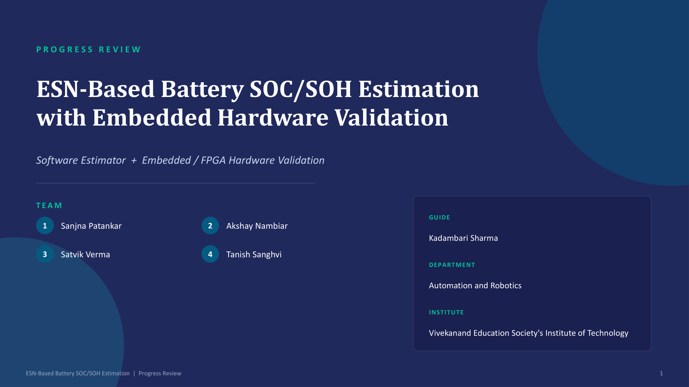
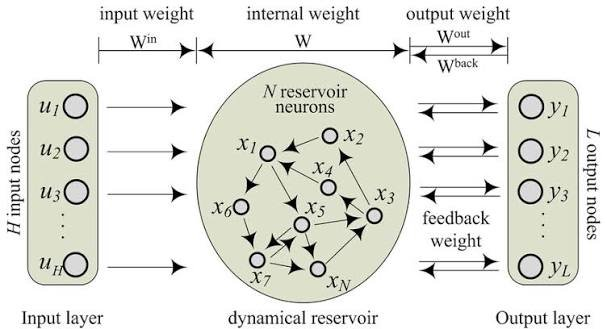

# Review 1 Milestone: Baseline Engineering & Initial Verification

[← Back to Main Repository](../../README.md) · [Documentation Hub](../README.md) · [Progress Report](Review_1_Progress.md) · [Slide Deck (PDF)](Review_1_PPT.pdf) · [Next: Review 2 →](../Review_2/README.md)

---

## 📌 Milestone Overview

* **Milestone Stage:** Review 1 (Phase 1 Baseline Defense)
* **Date:** September 2026
* **Academic Year:** 2026–2027
* **Institute:** Vivekanand Education Society's Institute of Technology (VESIT), Chembur, Mumbai (University of Mumbai)
* **Department:** Department of Automation and Robotics / Instrumentation
* **Project Mentor:** Dr. Kadambari Sharma
* **Project Guide / Coordinator:** Mr. Gopalkrishnan Narayan
* **Team Members:** Sanjna Patankar, Akshay Nambiar, Satvik Verma, Tanish Sanghvi

---

## 📸 Review 1 Defense Presentation Screenshot

  

---

## 🗣️ Evaluator & Mentor Comments (Review 1)

> **Official Evaluator & Mentor Guidance:**  
> *"Add ESN Core Architecture Diagram and Customise PPT"*  
>  
> **Key Observations by the Committee:**  
> 1. **Need for Dedicated ESN Architecture Visualization:** The initial proposal and presentation relied on standard generic neural network illustrations. The evaluation committee instructed the team to formulate and present a formal **ESN Core Architecture Diagram** clearly delineating the input scaling projection ($W_{\text{in}}$), the sparse recurrent dynamical reservoir ($W_{\text{res}}$), and the trained linear readout layer ($W_{\text{out}}$).  
> 2. **Presentation Customization & Flow:** The preliminary slide deck used standard generic templates. Evaluators instructed the team to **customise the PPT** with department-specific identity, high-contrast engineering waveforms, explicit mathematical equations, and a well-defined phased roadmap.

---

## 🛠️ Technical Changes Implemented in Response (Review 1)

1. **Integrated the Formal ESN Core Architecture Diagram:**  
   Engineered and integrated [`images/esn_architecture.png`](../../images/esn_architecture.png), explicitly displaying the 3-input feature mapping ($V, I, T$), the 100-neuron recurrent sparse reservoir matrix ($\rho = 0.95$, $85\%$ sparsity), and the single-shot Ridge regression readout layer ($W_{\text{out}}$):
   

     
   

2. **Complete PPT Customization:**  
   Redesigned the entire slide deck into a modern 16:9 widescreen format ([`docs/Review_1/Review_1_PPT.pdf`](Review_1_PPT.pdf)) with dedicated sections for problem formulation, 2-RC electro-thermal physics, and embedded silicon roadmap.
3. **Fixed-Point Datapath & CSR Optimization:**  
   Formulated the 16-bit Q6.10 fixed-point arithmetic datapath, synthesized a 33-point linear interpolated $\tanh$ lookup table, and developed the initial C99 Compressed Sparse Row (CSR) matrix multiplication structure demonstrating a **6.7× execution speedup**.
4. **Baseline Multi-Observer Suite:**  
   Implemented Coulomb Counting and Extended Kalman Filter (EKF) as standard benchmarks alongside the ESN model.

---

## 🔄 Evolution Path: From Review 1 to Review 2 & Final Capstone

The engineering milestones validated in Review 1 served as the baseline foundation for the subsequent phases:
* **Advance to Review 2 (November 2026):** Transitioned from static ESN inference to online Recursive Least Squares (RLS) adaptation, expanded the simulator to 10 drive cycles with NASA PCoE aging data, and verified 200/200 bit-exact FPGA RTL parity on Artix-7.
* **Current Synced Release (`v2.4.0` — State A):** Production core, `esn_ip_platform` v1.2, camera-ready [`Research_Paper.pdf`](../Publications/Research_Paper.pdf), and **119 passing tests** verified (`21.60s`).
* **Final Capstone Goal (`v2.4.1` — State B):** Complete turnkey capstone upon dropping in only the **3 remaining** academic deliverables ([`docs/Poster/Project_Poster.pdf`](../Poster/Project_Poster.pdf), [`docs/Publications/Review_Paper.pdf`](../Publications/Review_Paper.pdf), [`docs/Thesis/Final_Thesis.pdf`](../Thesis/Final_Thesis.pdf)).

---

## 📂 Key Milestone Documents
* 📄 **Progress Report:** [`Review_1_Progress.md`](Review_1_Progress.md)
* 📊 **Presentation Slides:** [`Review_1_PPT.pdf`](Review_1_PPT.pdf)
* 🖼️ **Defense Slide Screenshot:** [`Review_1_Presentation_Title.png`](Review_1_Presentation_Title.png)

---

[← Return to Proposal](../Resources/PROJECT_PROPOSAL.md) · [Proceed to Review 2 Milestone →](../Review_2/README.md)

