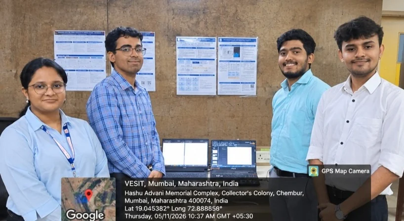
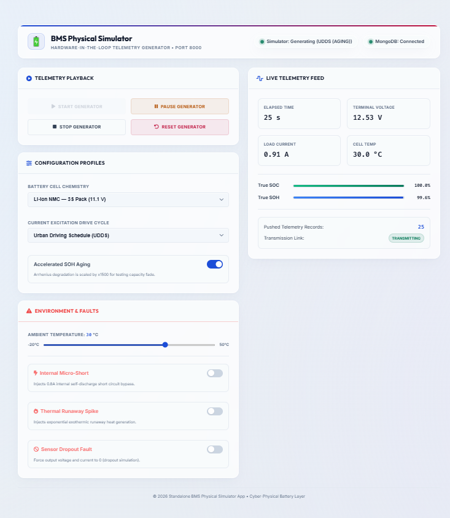

# Review 2 Milestone: Maturity, Parity & Institutional Defense

[← Back to Main Repository](../../README.md) · [Documentation Hub](../README.md) · [Review 1](../Review_1/README.md) · [Progress Report](Review_2_Progress.md) · [Slide Deck (PDF)](Review_2_PPT.pdf) · [FPGA Outcomes (PDF)](Outcomes/FPGA-Based-Echo-State-Network-for-Battery-SOC-SOH-Estimation-Outcomes.pdf) · [Next: Capstone Thesis →](../Thesis/README.md)

---

## 📌 Milestone Overview

* **Milestone Stage:** Review 2 (Phase 2 Comprehensive Defense)
* **Defense Dates:** November 5 & November 6, 2026
* **Academic Year:** 2026–2027
* **Institute:** Vivekanand Education Society's Institute of Technology (VESIT), Chembur, Mumbai (University of Mumbai)
* **Department:** Department of Automation and Robotics / Instrumentation
* **Project Mentor:** Dr. Kadambari Sharma
* **Project Guide / Coordinator:** Mr. Gopalkrishnan Narayan
* **Team Members:** Sanjna Patankar, Akshay Nambiar, Satvik Verma, Tanish Sanghvi
* **Milestone Release:** [GitHub Release v2.3.0](https://github.com/tanish-jain-225/Battery_State_Estimator_BE_Project_2026_2027/releases/tag/v2.3.0)

---

## 📸 Review 2 Project Defense & Institutional Evaluation (Geotagged Group Photo)

  

> **Official Institutional Defense Verification (VESIT Chembur, 05/11/2026 & 06/11/2026):**  
> Defense session conducted before Project Mentor **Dr. Kadambari Sharma** and Project Guide / Coordinator **Mr. Gopalkrishnan Narayan** at the Department of Automation & Robotics / Instrumentation. The presentation demonstrated the live cyber-physical 2-RC battery simulator, online RLS ESN adaptation, embedded C99 firmware execution, and 200/200 bit-exact FPGA parity verification on the Xilinx Artix-7 platform.

---

## 🗣️ Evaluator & Mentor Comments (Review 2)

> **Official Evaluator & Mentor Guidance:**  
> *"Change Flow of team's presentation to make things easy to understand and Add more Dataset Points to make simulator as close as real battery."*  
>  
> **Key Observations by the Committee:**  
> 1. **Presentation Narrative Flow:** The technical content was extensive and dense. Evaluators advised restructuring the presentation flow into an intuitive narrative arc that systematically guides the committee from electrochemical challenges to machine learning solutions and silicon realization.  
> 2. **Simulator Realism & Dataset Breadth:** The initial simulator operated on a single standardized drive cycle (UDDS). Evaluators instructed the team to **add more dataset points, realistic drive cycles, and real cell degradation profiles** so the simulator closely reflects real automotive battery behavior under harsh Indian conditions.

---

## 🛠️ Technical Changes Implemented in Response (Review 2)

1. **Re-engineered Presentation Flow into a 5-Act Narrative:**  
   Restructured the presentation deck ([`Review_2_PPT.pdf`](Review_2_PPT.pdf)) into an intuitive 5-Act storyline (*Act I: The Dilemma ──► Act II: Digital Twin ──► Act III: Neuromorphic Reservoir ──► Act IV: Dual-Silicon Realization ──► Act V: Capstone Culmination*), making technical concepts intuitive for academic examiners and industry juries.
2. **Massive Dataset Expansion & 10 Dynamic Drive Cycles:**  
   Expanded the physics engine from a single UDDS cycle to **10 dynamic drive cycles** (UDDS, US06, HWFET, WLTP, NEDC, EV Aggressive, Solar Microgrid, etc.) with high-density 1-second telemetry sampling.
   

     
   

3. **NASA Ames PCoE 32-Cycle Aging Integration:**  
   Integrated the **NASA Ames Prognostics Center of Excellence (PCoE) 32-cycle battery aging datasets** into the simulator calibration pipeline to model real capacity fade and impedance growth.
4. **Multi-Chemistry Physics with Arrhenius Thermal Solver:**  
   Implemented 5 real-world battery chemistries (**LFP, NMC, LCO, NCA, Lead-Acid**) with dynamic temperature tracking and active fault injection (`fault_thermal`, `fault_short`, `fault_dropout`).
5. **Online Recursive Least Squares (RLS) Adaptation:**  
   Formulated and verified an online RLS adaptive readout with Variable Forgetting Factor (VFF) that tracks internal resistance growth ($R_0$) and capacity degradation without offline retraining, maintaining **$< 1.0\%$ SOC error**.
6. **200/200 Bit-Exact FPGA Parity on Xilinx Artix-7:**  
   Verified the 100-neuron Verilog RTL datapath on Xilinx Artix-7 with bit-exact parity against the Python golden model. Packaged the core as an **IEEE 1685 IP-XACT AXI4 IP Block** (`component.xml`) with a 3.7 MB bitstream (`esn_platform_top.bit`).
7. **Automated Test Suite Expansion:**  
   Expanded regression tests to 62 tests at Review 2 (and 119 tests today) with 100% pass rate.

---

## 🌟 Delivery Status & Final Capstone Roadmap (State A vs. State B)

> ### 📊 Ground Truth Delivery Status
> * **State A (Review 2 Complete / Current Working Codebase):** **`Production Core Verified`**  
>   *(All software microservices, 2-RC multi-chemistry physics, EKF/UKF/ESN/RLS estimators, C99 firmware, 100-neuron Artix-7 RTL, AXI4-Lite IP block with 3.7 MB bitstream, and 119 automated pytest tests are 100% complete and verified with zero defects. For comprehensive industrial landscape and research analysis, see [`docs/Resources/WEB_RESEARCH.md`](../Resources/WEB_RESEARCH.md)).*
> * **State B (Final Turnkey Capstone / After the 4 Deliverables):** **`Complete Turnkey Capstone`**  
>   *(Achieved upon compiling and dropping in the 4 designated academic publication and thesis deliverables into their respective folders).*
>
> ### 📌 What is Left to be Updated (The 4 Final Deliverables):
> 1. [`docs/Poster/Project_Poster.pdf`](../Poster/Project_Poster.pdf) — Print-ready A1 exhibition poster (companion: [`docs/Poster/README.md`](../Poster/README.md)).
> 2. [`docs/Publications/Review_Paper.pdf`](../Publications/Review_Paper.pdf) — Comprehensive 29-page review survey (companion: [`docs/Review_2/Outcomes/Neuromorphic-BMS-Review-Paper-Draft.pdf`](Outcomes/Neuromorphic-BMS-Review-Paper-Draft.pdf)).
> 3. [`docs/Publications/Research_Paper.pdf`](../Publications/Research_Paper.pdf) — Original IEEE experimental research paper on edge ESN + Artix-7 RTL (companion: [`reference/paper.md`](../../reference/paper.md)).
> 4. [`docs/Thesis/Final_Thesis.pdf`](../Thesis/Final_Thesis.pdf) — University of Mumbai / VESIT Bachelor of Engineering dissertation capstone thesis (companion: [`docs/Thesis/README.md`](../Thesis/README.md)).

---

## 📂 Key Milestone Documents
* 📄 **Progress Report:** [`Review_2_Progress.md`](Review_2_Progress.md)
* 📊 **Presentation Slides (16:9 Widescreen):** [`Review_2_PPT.pdf`](Review_2_PPT.pdf)
* 🖼️ **Geotagged Group Photo:** [`Review_2_Geotag_Group_Photo.png`](Review_2_Geotag_Group_Photo.png)
* 📑 **FPGA Outcomes Report (PDF):** [`Outcomes/FPGA-Based-Echo-State-Network-for-Battery-SOC-SOH-Estimation-Outcomes.pdf`](Outcomes/FPGA-Based-Echo-State-Network-for-Battery-SOC-SOH-Estimation-Outcomes.pdf)
* 📑 **Review Paper Draft (PDF):** [`Outcomes/Neuromorphic-BMS-Review-Paper-Draft.pdf`](Outcomes/Neuromorphic-BMS-Review-Paper-Draft.pdf)

---

[← Return to Review 1](../Review_1/README.md) · [Proceed to B.E. Final Thesis →](../Thesis/README.md)

