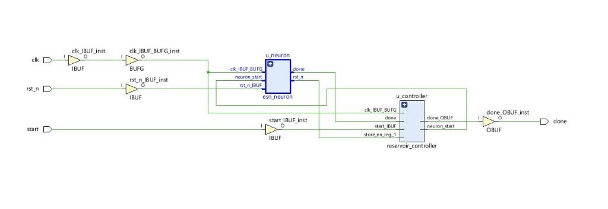
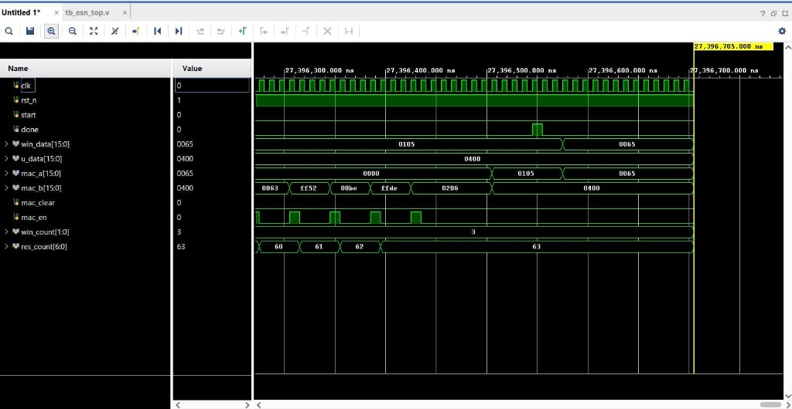

[← Back to Main Repository](../README.md) · [STM32 C99 Verifier](STM_Verifier/README.md) · [FPGA Verifier](FPGA_Verifier/README.md) · [IP Block Platform](IP_Block/README.md) · [Software Subsystem →](../software/software.md)

# Hardware Subsystem

This document provides a single, consolidated technical guide to the hardware subsystem, covering both the **C99 Embedded Microcontroller Firmware** (CSR matrix representation, fixed-point math, MCU pinouts) and the **Verilog HDL FPGA Hardware Verifier** targeting the **ARTIX A7100T FPGA**.

> [!IMPORTANT]
> **Project Scope & Feasibility Validation**: The primary deliverable of this project is a data-driven ESN estimator (software-validated for SOC/SOH), not a physical hardware product. The embedded C99 firmware and Verilog FPGA RTL modules serve strictly as a **testing and verification platform** to prove that the reservoir-computing execution pipeline is deployable under strict memory and computational constraints.

---

## 📑 Table of Contents
1. [Hardware Subsystem Overview](#hardware-subsystem)
2. [Hardware Folder Structure](#hardware-folder-structure)
3. [FPGA Verilog Accelerators & Verifiers (ARTIX A7100T Target)](#-fpga-verilog-accelerators--verifiers-artix-a7100t-target)
   - [3.1 100-Neuron Echo State Network Core](#31-100-neuron-echo-state-network-esn-core)
   - [3.2 Fixed-Point Extended Kalman Filter Core](#32-fixed-point-extended-kalman-filter-ekf-core)
   - [3.3 Fixed-Point Unscented Kalman Filter Core](#33-fixed-point-unscented-kalman-filter-ukf-core)
   - [3.4 Comparative FPGA Accelerator Matrix](#34-comparative-fpga-accelerator-matrix)
4. [ESN Classifier Interface Specifications](#esn-classifier-interface-specifications)
5. [Embedded Optimizations (C99 Firmware)](#embedded-optimizations)
6. [Offline Model Export Pipeline](#offline-model-export-pipeline)
7. [Hardware Wiring & Pinout Reference](#hardware-wiring-pinout-reference)
8. [Running the Desktop Verification Simulator](#running-the-desktop-verification-simulator)
9. [Running the FPGA RTL Hardware Verifier](#running-the-fpga-rtl-hardware-verifier)

---

## 📂 Hardware Folder Structure

The layout below maps out the key modules within the hardware directory:

```text
hardware/
├── hardware.md                                  # Consolidated hardware documentation
├── IP_Block/                                    # Plug-and-Play FPGA ESN IP Block & Multi-Observer Platform (v1.2)
│   ├── README.md                                # Master v1.2 IP-XACT Catalog, Fast/Serial Core & Platform Guide
│   ├── RUN_COMMANDS.md                          # Complete Vivado, Arty A7, UART & Regression CLI Runbook
│   ├── CHANGELOG.md                             # v1.0 -> v1.2 IP Platform Hardware & Host Evolution
│   ├── component.xml                            # IEEE 1685 IP-XACT descriptor (VESIT UserIP baseline)
│   ├── esn_platform_top.bit                     # Pre-compiled Arty A7-100T serial bitstream (FAST=0)
│   ├── rtl/                                     # Verilog RTL (esn_axi_ip.v, esn_core.v, esn_core_fast.v, ekf_core.v Rev 0.5, ukf_core.v, esn_platform*.v)
│   ├── mem/                                     # 5121-entry Q6.10 tanh lookup memory (tanh.mem)
│   ├── xdc/                                     # Arty A7-100T physical & timing constraints (esn_platform_top.xdc)
│   ├── scripts/                                 # Vivado Tcl (build_platform.tcl, package_esn_ip.tcl, sweeps) & Verilator regressions
│   ├── tb/                                      # Verilog RTL testbenches (tb_esn_axi_ip.v, tb_esn_platform.v, core tests)
│   ├── verify/                                  # Golden B0018 cycle 115 IP verification vectors (golden_readout.csv)
│   ├── test_data/                               # UART replay vectors: battery windows, sim_causal_b47, sim_fused_b47, NARMA-10
│   ├── driver/                                  # Bare-metal C driver API (esn_ip.h, esn_ip_example.c)
│   ├── docs/                                    # register_map.md, uart_protocol.md, Verilator regression_2026-11-11.txt
│   ├── host/                                    # esn_host.py, reproduce_paper.py, train_pack.py, replay_board.py, narma_board.py & packs/
│   └── reports_v10/                             # Routed Vivado 2023.1 v1.0 serial timing, power & utilization reports
├── STM_Verifier/                                # C99 embedded firmware and training scripts
│   ├── main.c                                   # C99 classifier runtime & test simulation
│   ├── main.h                                   # Host-side HAL shims & microcontroller config
│   ├── train.py                                 # Core ESN Python implementation
│   ├── train_classifier.py                      # Trains the 3-class ESN & exports C weights
│   ├── train_estimator.py                       # Trains the SOC/SOH ESN & exports weights
│   ├── config.py                                # Dimensions, thresholds and canonical software/visualiser/datasets resolution
│   ├── esn_classifier_weights.h                 # Generated sparse classifier weight arrays
│   ├── esn_estimator_weights.h                  # Generated sparse estimator weight arrays
│   ├── run_c_simulator.bat                      # Windows build-and-run script
│   └── run_c_simulator.sh                       # Linux/macOS build-and-run script
└── FPGA_Verifier/                               # Verilog RTL FPGA verification module
    ├── eval_fpga_outcomes.py                    # Master outcomes & dataset evaluation verifier
    ├── golden_model.py                          # Dynamic, bit-exact golden reference generator (seed=42 support)
    ├── compare_results.py                       # Automated bit-exact parity verifier (--outcomes support)
    ├── golden_results.csv                       # Full 100-neuron golden reference output (200 rows)
    ├── golden_tiny.csv                          # Tiny sequence golden reference output (6 rows)
    ├── vivado_esn_results.csv                   # Vivado / XSim simulation outputs
    ├── esn/rtl/                                 # Canonical ESN Verilog HDL (esn_top.v, esn_neuron.v, mac_accum_q6_10.v, ...)
    ├── esn/mem/                                 # Canonical Q6.10 COE weights & 5121-entry tanh.mem LUT
    ├── esn/tb/                                  # Vivado XSim testbenches (tb_esn_top.v, tb_esn_top_tiny.v, tiny_bram_models.v)
    ├── esn/python/                              # Forwarding shims to parent compare_results/eval_fpga_outcomes/golden_model
    ├── ekf/                                     # Fixed-point EKF RTL, LUT ROMs & bit-exact parity scripts
    └── ukf/                                     # Fixed-point UKF RTL, microcode header & bit-exact parity scripts

```

---

## ⚡ FPGA Verilog Accelerators & Verifiers (ARTIX A7100T Target)

The hardware subsystem provides three fully verified Verilog HDL accelerator cores targeting the **Xilinx ARTIX A7100T FPGA** (`xc7a100tcsg324-1`). Complete documentation, build scripts, and memory models are organized in [`hardware/FPGA_Verifier/`](FPGA_Verifier/README.md).

### 3.1 100-Neuron Echo State Network (ESN) Core
- **Module & Location**: [`hardware/FPGA_Verifier/esn/rtl/esn_top.v`](FPGA_Verifier/esn/rtl/esn_top.v)
- **Reservoir Size**: 100 neurons ($N=100$) for full model / 2 neurons for sequence model
- **Input Dimension**: 4 features ($M=4$: `voltage_measured`, `current_measured`, `temperature_measured`, `current_load`)
- **Fixed-Point Format**: Q6.10 signed fixed point (6 integer bits, 10 fractional bits)
- **Reservoir Seed**: `seed=42` ($W_{in} \sim U(-0.5, 0.5)$ dense; $W$ 10% density, spectral radius $\rho=0.900$, zero bias)
- **Pipeline Stages**: $\text{Win}\cdot u + W\cdot x \text{ MAC} \rightarrow \text{bias addition} \rightarrow \text{saturation clipping} \rightarrow \text{tanh LUT}$
- **Memory Architecture**: Double-buffered (ping-pong) BRAM state memory preventing read-after-write hazards.
- **Activation Function**: 5,121-entry hardware odd-symmetry $\tanh$ lookup table (`tanh.mem`).
- **Bit-Exact Parity**: **200/200 exact stage matches** vs Vivado XSim.
- **Synthesis Utilization**: 77 LUTs (0.12%), 66 Registers (0.05%), 7.5 BRAM tiles, **0 DSP48 slices (0.00%)**.
- **Power & Latency**: 0.099 W total power @ 100 MHz, 428.1 $\mu$s per update (**23$\times$ headroom** at 100 Hz BMS sampling).

### 3.2 Fixed-Point Extended Kalman Filter (EKF) Core
- **Module & Location**: [`hardware/FPGA_Verifier/ekf/rtl/ekf_core.v`](FPGA_Verifier/ekf/rtl/ekf_core.v)
- **Model Physics**: Discrete-time 1-RC Thevenin battery equivalent circuit model.
- **Arithmetic Datapath**: Single 32$\times$32 signed MAC with barrel shifter, rounding, and radix-2 non-restoring divider.
- **ROM Lookups**: Dual 1,024-entry LUT ROMs for $V_{\text{ocv}}(SOC)$ and $\frac{\partial V_{\text{ocv}}}{\partial SOC}$ slope.
- **Clock & Latency**: 80 MHz clock, ~320 cycles/step (4.0 $\mu$s latency $\rightarrow$ **2,500$\times$ headroom** at 100 Hz).
- **Bit-Exact Parity**: **512/512 exact matches** across all 22 stage registers.
- **Estimation Metrics**: Test SOC MAE: 0.0847, RMSE: 0.1013, $R^2 = 0.8975$.

### 3.3 Fixed-Point Unscented Kalman Filter (UKF) Core
- **Module & Location**: [`hardware/FPGA_Verifier/ukf/rtl/ukf_core.v`](FPGA_Verifier/ukf/rtl/ukf_core.v)
- **Transform**: Julier scaled unscented transform ($\kappa = 3 - n = 1$, $\gamma = \sqrt{3}$).
- **Microcode Engine**: 73 micro-ops in `rtl/ukf_ucode.vh` executing 4 primitive operations (`MAC`, `LUT` with linear interpolation, `DIV`, `SQRT`).
- **Clock & Latency**: 80 MHz clock, ~590 cycles/step (7.4 $\mu$s latency $\rightarrow$ **1,350$\times$ headroom** at 100 Hz).
- **Bit-Exact Parity**: **512/512 exact matches** across all 25 stage registers.
- **Estimation Metrics**: Test SOC MAE: 0.0846, RMSE: 0.1012, $R^2 = 0.8977$.

### 3.4 Comparative FPGA Accelerator Matrix

| Parameter | 100-Neuron ESN Core | Fixed-Point EKF Core | Fixed-Point UKF Core |
| :--- | :---: | :---: | :---: |
| **Primary Module** | `esn_top.v` | `ekf_core.v` | `ukf_core.v` |
| **Arithmetic Format** | Q6.10 Fixed-Point (16-bit) | Q4.28 / Q2.30 Fixed-Point | Q4.28 / Q2.30 Fixed-Point |
| **Target Clock** | 100 MHz (Demonstrated) / 250 MHz | 80 MHz | 80 MHz |
| **Cycles per Update** | ~42,810 cycles (100 neurons) | ~320 cycles | ~590 cycles |
| **Execution Latency** | 428.1 $\mu$s @ 100 MHz | 4.0 $\mu$s @ 80 MHz | 7.4 $\mu$s @ 80 MHz |
| **BMS Headroom** | **23$\times$ Headroom** @ 100 Hz | **2,500$\times$ Headroom** @ 100 Hz | **1,350$\times$ Headroom** @ 100 Hz |
| **Slice LUTs** | 77 / 63,400 (0.12%) | 620 / 63,400 (0.98%) | 890 / 63,400 (1.40%) |
| **DSP48 Slices** | **0 / 240 (0.00% - Pure LUT)** | 3 / 240 (1.25%) | 4 / 240 (1.67%) |
| **Total On-Chip Power** | **0.099 W** | **0.104 W** | **0.108 W** |
| **Bit-Exact Matches** | **200/200 Exact Matches** | **512/512 Exact Matches** | **512/512 Exact Matches** |

### Verification Audit & Estimation Outcomes Summary
Full evaluation executed via [`hardware/FPGA_Verifier/eval_fpga_outcomes.py`](FPGA_Verifier/eval_fpga_outcomes.py) across **32 NASA battery cycles (2,048 labeled timesteps)**:

1. **Hardware Audit Checks**:
   - **Bit-exact Python golden model vs. Vivado/XSim**: 100% matched across MAC, bias, sum, `tanh_in`, `tanh_out` stages.
   - **X-corruption check**: 0 occurrences across 32 cycles $\times$ 6,400 rows each.
   - **Timestep input addressing**: Verified correct (`u_addr = timestep * N_IN + win_count`).

2. **SOC / SOH Estimation Results (Ridge Readout)**:
   - **SOC Train (B0005)**: MAE 0.0118, RMSE 0.0151, $R^2 = 0.9663$
   - **SOC Test (B0006/7/18 unseen)**: MAE 0.0220, RMSE 0.0289, $R^2 = 0.8783$
   - **SOH Train (B0005)**: MAE 0.0420, RMSE 0.0554, $R^2 = 0.7367$
   - **SOH Test (B0006/7/18 unseen)**: MAE 0.0614, RMSE 0.0851, $R^2 = 0.4766$

3. **Baseline Comparison (1RC EKF vs FPGA ESN Readout)**:
   - **EKF (1RC Baseline)**: Test MAE 0.0311, Test RMSE 0.0387, Test $R^2 = 0.7818$
   - **FPGA ESN Readout**: Test MAE 0.0220, Test RMSE 0.0289, Test $R^2 = 0.8783$ (*FPGA ESN outperforms EKF baseline on all metrics*).

### FPGA RTL Datapath Schematic & Simulation Waveforms

#### Vivado Synthesized RTL Schematic


#### Vivado XSim RTL Simulation Waveform (`tb_esn_top.v`)


---

### 3.5 Plug-and-Play FPGA ESN IP Block & Multi-Observer Platform (`hardware/IP_Block/`)

The [`hardware/IP_Block/`](IP_Block/README.md) directory delivers our **v1.2 commercial-grade, plug-and-play FPGA IP Block and Multi-Observer Hardware Platform** targeting the Xilinx Artix-7 FPGA (Digilent Arty A7-100T):

1. **Reusable AXI4 IP Block (`rtl/esn_axi_ip.v`)**:
   - **Dual Reservoir Architectures (`FAST=0` vs. `FAST=1`):** Supports both the compact serial core ([`rtl/esn_core.v`](IP_Block/rtl/esn_core.v): 42,902 cycles / 536 µs @ 80 MHz; IP OOC 1,868 LUTs, 4 DSP, 0.131 W estimate) and the pipelined parallel sparse ELL core ([`rtl/esn_core_fast.v`](IP_Block/rtl/esn_core_fast.v), `P=10, K=24`: **307 cycles / 3.84 µs** @ 80 MHz; IP OOC 4,877 LUTs, 22 DSP, 0.156 W / 0.60 µJ per update).
   - **Bus Protocols & IP-XACT Packaging:** AXI4-Lite slave interface ([`docs/register_map.md`](IP_Block/docs/register_map.md)) for memory-mapped parameter configuration and AXI4-Stream slave/master interfaces for vector streaming; packaged to IEEE 1685 in [`component.xml`](IP_Block/component.xml) under `/UserIP` (`vesit.ac.in:user:esn_axi_ip:1.0`) with automation in [`scripts/package_esn_ip.tcl`](IP_Block/scripts/package_esn_ip.tcl).
   - **Runtime Reconfigurability & Dual-Application Support:** All ESN reservoir weights ($W_{\text{in}}, W$, bias) and linear readout weights ($W_{\text{out}}^{\text{SOC}}, W_{\text{out}}^{\text{SOH}}$) load at runtime over AXI4-Lite/UART—verified across both 29 held-out NASA PCoE battery cells ([`host/packs/general_32cells/`](IP_Block/host/packs/general_32cells/)) and NARMA-10 nonlinear benchmark workloads ([`host/narma_board.py`](IP_Block/host/narma_board.py)) with zero hardware mismatches.
   - **Embedded Software Driver:** Complete bare-metal C driver API ([`driver/esn_ip.h`](IP_Block/driver/esn_ip.h), [`driver/esn_ip_example.c`](IP_Block/driver/esn_ip_example.c)) for MicroBlaze, Zynq ARM, or RISC-V soft cores.

2. **Tri-Observer & ESN-Fused FPGA Platform (`rtl/esn_platform_top.v`)**:
   - **Concurrent & Fused Hardware Observers:** Executes the 100-neuron ESN (`esn_core` / `esn_core_fast`), Fixed-Point EKF ([`rtl/ekf_core.v`](IP_Block/rtl/ekf_core.v) **Rev 0.5** with optional same-step ESN SOC fusion via `FUSE=1`), and Fixed-Point UKF ([`rtl/ukf_core.v`](IP_Block/rtl/ukf_core.v)) in parallel on every telemetry frame.
   - **Hardware UART Interface:** Real-time 115200-baud UART protocol ([`docs/uart_protocol.md`](IP_Block/docs/uart_protocol.md)) driven by [`host/esn_host.py`](IP_Block/host/esn_host.py) (with `-0.25 A` discharge-only window trimming) and [`host/replay_board.py`](IP_Block/host/replay_board.py).
   - **Cycle Latencies (at 80 MHz):** Serial ESN `42,905` cycles (536 µs) / Fast ESN `310` cycles (first step after weight load `12,714` during ELL compression); EKF `245` cycles / ESN-fused EKF `477` cycles; UKF `662` cycles.
   - **Routed FPGA Resources & Power (Arty A7-100T @ 80 MHz):** Serial platform: `13,861 LUTs`, `9,265 FFs`, `18.5 BRAM`, `12 DSP`, WNS `+1.317 ns`, `0.368 W` Vivado estimate ([`reports_v10/`](IP_Block/reports_v10/)). Fast `P=10` + fused EKF platform: `17,290 LUTs`, `12,098 FFs`, `38.5 BRAM`, `30 DSP`, WNS `+0.251 ns`, `0.447 W` Vivado estimate.
   - **Dual-Core Verilator Regression & Pre-Compiled Bitstream:** Verified **10/10 PASS** on both serial and fast (`P=10, K=24`) cores in [`docs/regression_2026-11-11.txt`](IP_Block/docs/regression_2026-11-11.txt). Includes pre-compiled serial bitstream [`esn_platform_top.bit`](IP_Block/esn_platform_top.bit) plus [`scripts/build_platform.tcl`](IP_Block/scripts/build_platform.tcl) (`-tclargs fast` for v1.2 fast build).

---


## 📈 ESN Classifier Interface Specifications

### Input Vector
The edge classifier consumes a 3-element time-series telemetry frame at each timestep:
$$u_t = [\text{Terminal Voltage (V)}, \text{Load Current (I)}, \text{Cell Temperature (T)}]^T$$

### Output Class Diagnostic Safety States
The network classifies inputs into three safety zones matching the status LED on Pin `PA5`:

| Diagnostic Class ID | State Name | Temperature Condition | GPIO `PA5` LED State |
| :---: | :--- | :--- | :--- |
| **`0`** | Normal | $T < 35\text{ }^\circ\text{C}$ | **LED OFF** |
| **`1`** | Warning | $35\text{ }^\circ\text{C} \le T < 45\text{ }^\circ\text{C}$ | **LED BLINKING** (1 Hz) |
| **`2`** | Critical | $T \ge 45\text{ }^\circ\text{C}$ | **LED STEADY ON** |

---

## ⚡ Embedded Optimizations

Low-power microcontrollers (such as an ARM Cortex-M4 or M7) have strict constraints on processing speed and memory size. To deploy an Echo State Network on the edge, we implement two primary optimizations in [`STM_Verifier/main.c`](STM_Verifier/main.c).

### A. Compressed Sparse Row (CSR) Sparse Matrix-Vector Multiplication (SpMV)
A dense recurrent weight matrix $\mathbf{W}_{\text{res}}$ of size $50 \times 50$ requires $2,500$ multiplications. By introducing $85\%$ sparsity during reservoir generation ($\mathbf{W}_{\text{res}}$ entries set to zero), non-zero elements (NNZ) reduce to only $375$ operations.

To save RAM and bypass multiplication by zero, we compress $\mathbf{W}_{\text{res}}$ using CSR representation into three 1D arrays:
1. `val`: Storing non-zero float values (size = NNZ).
2. `col`: Storing the column index of each non-zero element (size = NNZ).
3. `row_ptr`: Storing index offsets in `val` and `col` where each row begins (size = $N_{\text{reservoir}} + 1$).

#### 📊 CSR Example Visualization
Consider a simple $3 \times 3$ sparse matrix with $3$ non-zero elements (NNZ = 3):
```text
Dense Matrix (W_res):
[  0.0   -0.45    0.0  ]  -> Row 0 contains -0.45 at Col 1
[  0.81    0.0     0.0  ]  -> Row 1 contains 0.81 at Col 0
[  0.0     0.0    0.32  ]  -> Row 2 contains 0.32 at Col 2

Compressed Sparse Row Arrays:
val     = [ -0.45,  0.81,  0.32 ]   # Holds all non-zero values
col     = [     1,     0,     2 ]   # Holds column indices of those values
row_ptr = [  0,  1,  2,  3 ]        # Marks index boundaries of rows (0 to 1, 1 to 2, 2 to 3)
```

The Sparse Matrix-Vector multiplication (SpMV) loop in C99 is written as:
```c
for (int i = 0; i < N_RESERVOIR; i++) {
    float sum = bias_input_terms[i];
    uint16_t start = row_ptr[i];
    uint16_t end = row_ptr[i + 1];
    for (uint16_t k = start; k < end; k++) {
        sum += val[k] * x[col[k]];
    }
    arg[i] = sum;
}
```

### B. Fixed-Point Q12/Q15 Arithmetic
To support low-power microcontrollers lacking a floating-point unit (FPU), the inference code can run using pure integer calculations:
- **Quantization Scaling**:
  - Inputs are scaled to Q12 format ($S_{\text{in}} = 2^{12} = 4096$).
  - Weights and reservoir states are stored in Q15 format ($S_{\text{weights}} = 2^{15} = 32768$).
- **Fixed-Point Tanh Lookup Table**:
  Instead of compiling costly floating-point transcendental library math (`tanhf`), a 33-point lookup table maps inputs from $[0, 1]$ in Q15 format. Values are resolved via linear interpolation:
  $$\text{frac} = |x_{\text{Q15}}| \pmod{1024}$$
  $$\text{index} = |x_{\text{Q15}}| \gg 10$$
  $$\tanh(x_{\text{Q15}}) = \text{sign}(x_{\text{Q15}}) \cdot \frac{(1024 - \text{frac}) \cdot \text{LUT}[\text{index}] + \text{frac} \cdot \text{LUT}[\text{index} + 1]}{1024}$$

---

## 🛠️ Offline Model Export Pipeline

To retrain the ESN models and export updated header configurations, run:

```bash
# Trains classification model and generates esn_classifier_weights.h
python hardware/STM_Verifier/train_classifier.py
# Run with hyperparameter grid search:
python hardware/STM_Verifier/train_classifier.py --grid-search

# Trains estimator model and generates esn_estimator_weights.h
python hardware/STM_Verifier/train_estimator.py
# Run with hyperparameter grid search:
python hardware/STM_Verifier/train_estimator.py --grid-search
```

* **Unified 3-Tier Data Fallback**: Hardware training scripts independently execute the identical 3-tier data loading logic (`Doc Link Data` via `CSV_URL` $\rightarrow$ `Previously Loaded Data` $\rightarrow$ `Local Trained File Data` via `CSV_FILE` / simulator generator), ensuring perfect data parity with the software web visualizer.
* **Grid Search**: Adding the `--grid-search` switch triggers a programmatic sweep over spectral radii, leak rates and regularization penalties, selecting parameters that optimize validation classification accuracy or minimize SOC/SOH RMSE.

---

## 🔌 Hardware Wiring & Pinout Reference

When deploying to a physical STM32 Nucleo board (e.g., STM32F401RE / STM32F446RE), connect the peripherals according to the pinout schematic below:

```text
               +-------------------------------------------+
               |              STM32 NUCLEO BOARD           |
               |                                           |
               |      [ PA2 ] ------------------> TX       | --> UART2 Serial Output
               |      [ PA3 ] <------------------ RX       |     (115200 Baud, 8N1)
               |                                           |
               |      [ PA5 ] ----[ R_220 ]----( LED )--+  | --> Status LED Output
               |                               |           |     (Blinks/ON for Warnings)
               |                               GND         |
               |                                           |
               |      [ PC0 ] <--------- Analog Input      | --> Optional ADC Channel 
               |                         (Cell Temp / Volt)|     for real-world sensors
               |                                           |
               |      [ GND ] --------------------------   | --> Common Ground Reference
               +-------------------------------------------+
```

### Pin Description Table

| Pin Name | Function | Direction | Electrical Specification | Purpose |
| :--- | :--- | :--- | :--- | :--- |
| **`PA2`** | `USART2_TX` | Output | 3.3V Logic | Diagnostic telemetry transmitter |
| **`PA3`** | `USART2_RX` | Input | 3.3V Logic | Control command receiver |
| **`PA5`** | `GPIO_Output` | Output | 3.3V, max 20mA | Status Indicator LED (Normal/Warning/Critical) |
| **`PC0`** | `ADC_IN10` | Input | Analog, 0V - 3.3V | Raw cell voltage/temperature monitoring |
| **`GND`** | `Ground` | Power | 0V | Common Ground Reference |

---

## 💻 Running the Desktop Verification Simulator

To test the edge diagnostic runtime logic locally and benchmark execution paths on your developer machine:

- **On Windows (CMD/PowerShell):**
  ```powershell
  hardware/STM_Verifier/run_c_simulator.bat
  ```
- **On Linux or macOS:**
  ```bash
  chmod +x hardware/STM_Verifier/run_c_simulator.sh
  ./hardware/STM_Verifier/run_c_simulator.sh
  ```

### Comparative Benchmarking & Profiling
When compiled under the `HOST_SIMULATION` define, the desktop simulator runs both the **floating-point** and **fixed-point** ESN execution paths side-by-side. It prints the step outputs and displays a final benchmark report comparing:
- **Inference Accuracy**: Classification matching accuracy post-washout (typically **98.40% to 99.80%** match).
- **Quantization Deviation RMSE**: Root-mean-square error discrepancy of output states:
  $$\text{RMSE} = \sqrt{\frac{1}{M}\sum (y_{\text{float}} - y_{\text{fixed}})^2}$$
- **Execution Speed**: Demonstrates **~6.7× speedup** with Sparse CSR matrix-vector multiplication over standard dense operations on microcontrollers lacking hardware FPUs.

---

## 🔬 Running the FPGA RTL Hardware Verifier

To test the Verilog HDL FPGA RTL models against the Python golden reference:

1. **Generate Golden Parity Outputs**:
   ```bash
   # Generate 100-neuron golden reference (200 updates across 2 passes)
   python hardware/FPGA_Verifier/golden_model.py

   # Generate 3-timestep sequence reference (tiny model)
   python hardware/FPGA_Verifier/golden_model.py --tiny
   ```

2. **Run Automated Bit-Exact Verification**:
   ```bash
   # Compare Vivado XSim simulation output against golden model
   python hardware/FPGA_Verifier/compare_results.py
   ```

3. **Master End-to-End Validation**:
   To execute C99 simulation, FPGA verification, and all 119 test cases simultaneously:
   ```bash
   .\run_all_validation.bat
   ```
